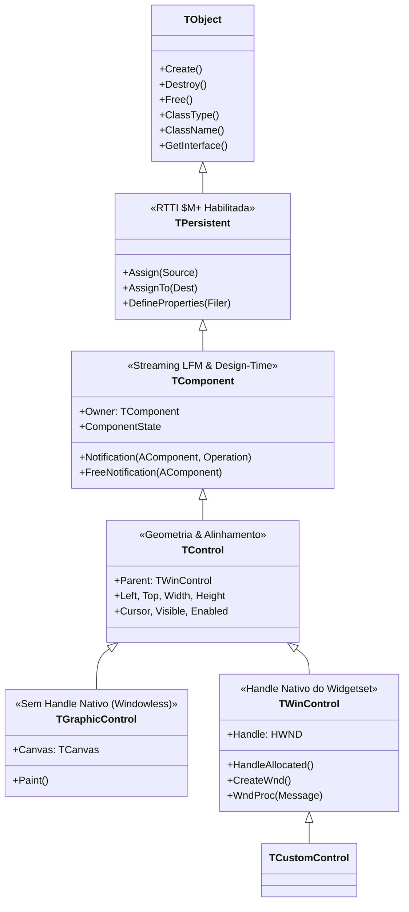

# MÓDULO 01: Arquitetura Orientada a Componentes e Hierarquia de Classes

No paradigma do Object Pascal moderno com **Free Pascal (FPC 3.2+)** e **Lazarus IDE (3.x+)**, o desenvolvimento baseado em componentes (*Component-Based Software Engineering - CBSE*) não é apenas uma convenção estética ou uma facilidade de arrastar e soltar (RAD). É uma arquitetura rigorosa de engenharia de software fundamentada em metaprogramação, introspecção em tempo de execução (RTTI), gerenciamento determinístico de memória e abstração de subsistemas operacionais através da **LCL (Lazarus Component Library)**.

Neste primeiro módulo, desvendaremos a anatomia estrutural das classes fundamentais que dão vida a qualquer componente no ecossistema Lazarus, explorando a genealogia das classes base, a física interna das instâncias de objetos na memória do FPC, o funcionamento da Virtual Method Table (VMT) e o papel crítico da seção `published`.

---

## 1. A Genealogia das Classes Base

Toda a arquitetura da RTL (Run-Time Library) do Free Pascal e da LCL é organizada em uma hierarquia estrita de herança de raiz única, originada em `TObject`. Compreender o ponto exato da árvore genealógica onde seu novo componente deve residir é a decisão arquitetural mais importante do projeto.



### 1.1 `TObject`: O Átomo do Free Pascal
`TObject` é o ancestral universal de todas as classes no Object Pascal. No Free Pascal, instâncias de classes derivadas de `TObject` são sempre alocadas no **Heap** e manipuladas como ponteiros implícitos.

Internamente, cada instância no Heap possui um cabeçalho que aponta diretamente para a **VMT (Virtual Method Table)** da sua classe. A VMT armazena ponteiros para os métodos virtuais, dinâmicos e metadados de RTTI gerados pelo compilador.

Principais responsabilidades de `TObject`:
- **Alocação e Desalocação:** Métodos de classe `InitInstance` e `CleanupInstance`, além do par clássico `Create` e `Destroy`. O método `Free` verifica com segurança se `Self <> nil` antes de chamar o destrutor virtual `Destroy`.
- **Introspecção Primitiva:** Métodos como `ClassType`, `ClassName`, `ClassParent`, `InheritsFrom` e `InstanceSize`.
- **Consulta a Interfaces:** Método `GetInterface` para suporte ao subsistema `IInterface` (COM/CORBA).

### 1.2 `TPersistent`: A Porta de Entrada da Metaprogramação e RTTI
Enquanto `TObject` não compila informações de tipo em tempo de execução por padrão, a classe `TPersistent` é compilada com a diretiva `{$M+}` (ou `{$TYPEINFO ON}`). 

A presença de `{$M+}` instrui o Free Pascal a emitir blocos binários de RTTI na seção de dados do executável para todos os membros declarados na visibilidade `published`.

Além da RTTI, `TPersistent` introduz o protocolo canônico de cópia profunda de dados:
- `procedure Assign(Source: TPersistent); virtual;`
- `procedure AssignTo(Dest: TPersistent); virtual;`

Se você está criando um objeto que precisa ser persistido em arquivo ou que será uma subpropriedade no Object Inspector (por exemplo, configurações de fontes, paletas de cores ou regras de validação), mas **não** precisa ser colocado diretamente na paleta de componentes do Lazarus, a sua classe base deve ser `TPersistent`.

### 1.3 `TComponent`: A Unidade Fundamental do RAD
`TComponent` herda de `TPersistent` e é a primeira classe que pode ser registrada na Tool Palette do Lazarus, arrastada para o Form Designer e salva em um arquivo de formulário `.lfm`.

`TComponent` introduz quatro pilares revolucionários:
1. **Ownership e Gerenciamento Determinístico de Ciclo de Vida:** O parâmetro `AOwner` no construtor `constructor Create(AOwner: TComponent); override;`. O Owner assume a responsabilidade formal de liberar o componente da memória quando ele for destruído.
2. **Streaming LFM (Lazarus Form Format):** Subsistema que lê e escreve propriedades via `TFiler`, `TReader` e `TWriter`.
3. **Mecanismo de Notificação Segura:** O método `Notification(AComponent: TComponent; Operation: TOperation)` e o método `FreeNotification(AComponent: TComponent)`, vitais para evitar ponteiros soltos (*dangling pointers*).
4. **Inspeção de Estados em Design-Time e Run-Time:** A propriedade de conjunto `ComponentState` contendo flags como `csDesigning`, `csLoading`, `csDestroying` e `csReadingState`.

### 1.4 `TControl`: A Abstração de Posição, Dimensão e Relação com o Usuário
`TControl` herda de `TComponent` e introduz conceitos espaciais no formulário:
- Coordenadas e Geometria: `Left`, `Top`, `Width`, `Height`, `BoundsRect`.
- Relação Visual de Paternidade: A propriedade `Parent: TWinControl`.
- Hierarquia de Layout: Ancoragem (`Anchors`), alinhamento automático (`Align`), margens (`BorderSpacing`) e visibilidade (`Visible`, `Enabled`).

> **ATENÇÃO ARQUITETURAL: OWNER vs. PARENT**
> - **Owner (Proprietário):** É um `TComponent`. Gerencia o **tempo de vida da memória**. Quando o Owner morre, todos os componentes que ele possui são destruídos.
> - **Parent (Pai Visual):** É um `TWinControl`. Gerencia o **espaço visual na tela**. Determina onde o controle é desenhado e de onde ele herda as coordenadas relativas.

### 1.5 O Grande Dilema: `TGraphicControl` vs. `TWinControl`

Ao projetar um controle visual na LCL, você deve obrigatoriamente optar entre duas ramificações diametralmente opostas:

| Característica | `TGraphicControl` (Controle Leve) | `TWinControl` (Controle Janelado) |
| :--- | :--- | :--- |
| **Handle do Sistema Operacional (HWND/Widget)** | **Nenhum**. É puramente virtual (*Windowless*). | **Sim**. Possui um handle alocado via Widgetset nativo. |
| **Consumo de Recursos do SO** | Quase zero. Extremamente leve em memória. | Médio a Alto. Consome recursos da GDI/X11/Wayland/Qt. |
| **Renderização** | É desenhado pelo `Parent` através do evento/método virtual `Paint(Canvas)`. | Desenha em seu próprio contexto de dispositivo (`PaintWindow` / Mensagens nativas). |
| **Foco e Teclado (`TabStop`, `OnKeyDown`)** | **Não suporta**. Não pode receber foco do cursor. | **Total suporte**. Recebe foco, eventos de teclado e tabulação. |
| **Hospedar Filhos (`Parent`)** | **Não pode** atuar como pai de outros controles. | **Pode** hospedar controles filhos (`csAcceptsControls`). |
| **Exemplos Canônicos** | `TLabel`, `TSpeedButton`, `TImage`, `TPaintBox`, Gauges. | `TEdit`, `TButton`, `TPanel`, `TListBox`, `TForm`. |

---

## 2. A Seção `published` e a Anatomia da RTTI

No Free Pascal, o modificador de acesso `published` possui visibilidade equivalente ao `public`, porém com uma diferença capital: **gera dados de RTTI compilados para a classe**.

O Object Inspector do Lazarus é totalmente cego para membros declarados em `public` ou `protected`. Para que uma propriedade apareça no Object Inspector, ela deve:
1. Pertencer a uma classe que herde de `TPersistent` ou superior.
2. Estar declarada dentro do bloco `published`.
3. Possuir um tipo suportado pelo subsistema RTTI do FPC (inteiros, floats, enums, sets, strings, classes derivadas de `TPersistent`, métodos de evento ou tipos registrados).

### Diagrama da Estrutura de Memória da RTTI no Free Pascal:

```
+-------------------------------------------------------------+
|                      INSTÂNCIA NO HEAP                      |
|  [ VMT Pointer ] -> Aponta para a Virtual Method Table      |
|  [ FField1     ] -> 4/8 bytes                               |
|  [ FField2     ] -> 4/8 bytes                               |
+-------------------------------------------------------------+
        |
        v
+-------------------------------------------------------------+
|               VIRTUAL METHOD TABLE (VMT) EM .RODATA         |
|  - vmtTypeInfo  -> Ponteiro para TTypeInfo                  |
|  - vmtParent    -> Ponteiro para a VMT da classe pai        |
|  - vmtClassName -> Nome canônico da classe                  |
|  - Métodos Virtuais: Create, Destroy, Paint, WndProc...    |
+-------------------------------------------------------------+
        |
        v
+-------------------------------------------------------------+
|                      ESTRUTURA TTypeInfo                    |
|  - Kind: TTypeKind (tkClass)                                |
|  - Name: 'TLazTypeInfoInspector'                            |
|  - TypeData: PTypeData                                      |
|       * ClassType: TClass                                   |
|       * ParentInfo: PPTypeInfo                              |
|       * PropCount: Quantidade de propriedades published     |
|       * PropList: Array contendo metadados de cada prop:    |
|           [Nome, PropType, GetProc, SetProc, StoredProc]    |
+-------------------------------------------------------------+
```

---

## 3. Implementação Prática: O Componente `TLazTypeInfoInspector`

Para consolidar os conceitos teóricos de genealogia e RTTI, construímos um componente real de inspeção profunda: o `TLazTypeInfoInspector`.

Este componente é capaz de:
- Conectar-se a qualquer componente ou formulário em tempo de design ou execução.
- Percorrer a árvore genealógica de herança até `TObject` usando introspecção de ponteiros VMT.
- Extrair todas as propriedades `published`, seus tipos nativos, e ponteiros de leitura (`GetProc`) e escrita (`SetProc`).
- Emitir relatórios formatados em Markdown limpo para documentação automática de componentes.

### 3.1 Código Pascal Completo e Compilável

O código-fonte integral da unidade `LazTypeInfoInspector.pas` está apresentado abaixo:

```pascal
{==============================================================================
  Livro: Engenharia e Arquitetura Avançada de Componentes para Lazarus IDE & LCL
  Módulo 01: Arquitetura Orientada a Componentes e Hierarquia de Classes
  Componente: TLazTypeInfoInspector
  Autor: Engenharia de Software Especializada & Arquitetura RAD
  Ambiente: Free Pascal 3.2.2+ / Lazarus 3.x+
  Descrição: Componente não-visual que inspeciona dinamicamente a árvore
             genealógica de classes e metadados RTTI (propriedades publicadas,
             métodos e tipos) de qualquer objeto ou componente LCL.
==============================================================================}
unit LazTypeInfoInspector;

{$mode objfpc}{$H+}
{$TYPEINFO ON} // Habilita geração explícita de RTTI para a unit

interface

uses
  Classes,
  SysUtils,
  TypInfo;

type
  { Enum para especificar o nível de profundidade da inspeção genealógica }
  TLazInspectionDepth = (
    idImmediateClass,   // Apenas a classe imediata do componente
    idFullHierarchy,    // Até a raiz TObject
    idComponentAncestry // Até a classe TComponent
  );

  { Tipo de registro estruturado para metadados de uma propriedade RTTI }
  TLazPropertyMetadata = record
    PropName: string;
    TypeName: string;
    PropTypeKind: TTypeKind;
    HasGetter: Boolean;
    HasSetter: Boolean;
    IsStored: Boolean;
  end;

  { Array dinâmico de metadados de propriedades }
  TLazPropertyMetadataArray = array of TLazPropertyMetadata;

  { Evento disparado quando um novo nível genealógico é identificado }
  TOnClassDiscovered = procedure(Sender: TObject; const AClassName: string;
    AClassRef: TClass; ADepthLevel: Integer) of object;

  { Evento disparado para cada propriedade RTTI encontrada }
  TOnPropertyDiscovered = procedure(Sender: TObject;
    const AMetadata: TLazPropertyMetadata) of object;

  {============================================================================
    Classe: TLazTypeInfoInspector
    Herda diretamente de TComponent para ter ciclo de vida gerenciado,
    suporte a Owner, visibilidade na Tool Palette e no Object Inspector.
  ============================================================================}
  TLazTypeInfoInspector = class(TComponent)
  private
    FTargetComponent: TComponent;
    FInspectionDepth: TLazInspectionDepth;
    FIncludeInheritedProps: Boolean;
    FOnClassDiscovered: TOnClassDiscovered;
    FOnPropertyDiscovered: TOnPropertyDiscovered;

    procedure SetTargetComponent(const AValue: TComponent);
    function TypeKindToString(AKind: TTypeKind): string;
  protected
    procedure Notification(AComponent: TComponent; Operation: TOperation); override;
  public
    constructor Create(AOwner: TComponent); override;
    destructor Destroy; override;

    { Métodos públicos de execução da inspeção }
    function GetAncestryReport(AInstance: TObject = nil): TStrings;
    function GetPublishedProperties(AInstance: TObject = nil): TLazPropertyMetadataArray;
    function GenerateMarkdownSummary(AInstance: TObject = nil): string;
  published
    { Propriedade publicada para selecionar o componente alvo no Object Inspector }
    property TargetComponent: TComponent read FTargetComponent write SetTargetComponent;
    property InspectionDepth: TLazInspectionDepth read FInspectionDepth write FInspectionDepth default idFullHierarchy;
    property IncludeInheritedProps: Boolean read FIncludeInheritedProps write FIncludeInheritedProps default True;

    { Eventos publicados para integração com a UI da aplicação }
    property OnClassDiscovered: TOnClassDiscovered read FOnClassDiscovered write FOnClassDiscovered;
    property OnPropertyDiscovered: TOnPropertyDiscovered read FOnPropertyDiscovered write FOnPropertyDiscovered;
  end;

{ Procedimento oficial de registro na IDE Lazarus }
procedure Register;

implementation

procedure Register;
begin
  RegisterComponents('Engenharia Lazarus', [TLazTypeInfoInspector]);
end;

{ TLazTypeInfoInspector }

constructor TLazTypeInfoInspector.Create(AOwner: TComponent);
begin
  inherited Create(AOwner);
  FTargetComponent := nil;
  FInspectionDepth := idFullHierarchy;
  FIncludeInheritedProps := True;
end;

destructor TLazTypeInfoInspector.Destroy;
begin
  FTargetComponent := nil;
  inherited Destroy;
end;

procedure TLazTypeInfoInspector.SetTargetComponent(const AValue: TComponent);
begin
  if FTargetComponent <> AValue then
  begin
    if Assigned(FTargetComponent) then
      FTargetComponent.RemoveFreeNotification(Self);

    FTargetComponent := AValue;

    if Assigned(FTargetComponent) then
      FTargetComponent.FreeNotification(Self);
  end;
end;

procedure TLazTypeInfoInspector.Notification(AComponent: TComponent; Operation: TOperation);
begin
  inherited Notification(AComponent, Operation);
  { Limpeza segura de referência em tempo de design e execução }
  if (Operation = opRemove) and (AComponent = FTargetComponent) then
    FTargetComponent := nil;
end;

function TLazTypeInfoInspector.TypeKindToString(AKind: TTypeKind): string;
begin
  case AKind of
    tkUnknown:      Result := 'Unknown';
    tkInteger:      Result := 'Integer';
    tkChar:         Result := 'Char';
    tkEnumeration:  Result := 'Enumeration';
    tkFloat:        Result := 'Float';
    tkSet:          Result := 'Set';
    tkMethod:       Result := 'Method/Event';
    tkSString:      Result := 'ShortString';
    tkLString:      Result := 'LongString/AnsiString';
    tkAString:      Result := 'AnsiString';
    tkWString:      Result := 'WideString';
    tkVariant:      Result := 'Variant';
    tkArray:        Result := 'Array';
    tkRecord:       Result := 'Record';
    tkInterface:    Result := 'Interface';
    tkClass:        Result := 'Class';
    tkObject:       Result := 'Object';
    tkWChar:        Result := 'WideChar';
    tkBool:         Result := 'Boolean';
    tkInt64:        Result := 'Int64';
    tkQWord:        Result := 'QWord';
    tkDynArray:     Result := 'DynamicArray';
    tkUString:      Result := 'UnicodeString';
    tkUChar:        Result := 'UnicodeChar';
    tkHelper:       Result := 'Helper';
    tkFile:         Result := 'File';
    tkClassRef:     Result := 'ClassReference';
    tkPointer:      Result := 'Pointer';
  else
    Result := 'CustomType';
  end;
end;

function TLazTypeInfoInspector.GetAncestryReport(AInstance: TObject): TStrings;
var
  CurrentObject: TObject;
  CurrentClass: TClass;
  Depth: Integer;
  ShouldContinue: Boolean;
begin
  Result := TStringList.Create;
  try
    CurrentObject := AInstance;
    if not Assigned(CurrentObject) then
      CurrentObject := FTargetComponent;

    if not Assigned(CurrentObject) then
    begin
      Result.Add('Nenhum objeto alvo especificado para inspeção.');
      Exit;
    end;

    CurrentClass := CurrentObject.ClassType;
    Depth := 0;

    while Assigned(CurrentClass) do
    begin
      Result.Add(Format('[Nível %d] %s (Instância base: %p)',
        [Depth, CurrentClass.ClassName, Pointer(CurrentClass)]));

      if Assigned(FOnClassDiscovered) then
        FOnClassDiscovered(Self, CurrentClass.ClassName, CurrentClass, Depth);

      Inc(Depth);

      ShouldContinue := True;
      case FInspectionDepth of
        idImmediateClass:
          ShouldContinue := False;
        idComponentAncestry:
          if CurrentClass = TComponent then
            ShouldContinue := False;
        idFullHierarchy:
          if CurrentClass = TObject then
            ShouldContinue := False;
      end;

      if not ShouldContinue then
        Break;

      CurrentClass := CurrentClass.ClassParent;
    end;
  except
    on E: Exception do
    begin
      Result.Add('Erro ao inspecionar genealogia: ' + E.Message);
    end;
  end;
end;

function TLazTypeInfoInspector.GetPublishedProperties(AInstance: TObject): TLazPropertyMetadataArray;
var
  CurrentObject: TObject;
  PropList: PPropList;
  PropCount: Integer;
  I: Integer;
  TypeDataPtr: PTypeData;
  PropInfoPtr: PPropInfo;
begin
  SetLength(Result, 0);

  CurrentObject := AInstance;
  if not Assigned(CurrentObject) then
    CurrentObject := FTargetComponent;

  if not Assigned(CurrentObject) then
    Exit;

  PropCount := GetTypeData(CurrentObject.ClassInfo)^.PropCount;
  if PropCount <= 0 then
    Exit;

  GetMem(PropList, PropCount * SizeOf(PPropInfo));
  try
    PropCount := GetPropList(CurrentObject.ClassInfo, tkAny, PropList);
    SetLength(Result, PropCount);

    for I := 0 to PropCount - 1 do
    begin
      PropInfoPtr := PropList^[I];
      TypeDataPtr := GetTypeData(PropInfoPtr^.PropType);

      Result[I].PropName := PropInfoPtr^.Name;
      Result[I].PropTypeKind := PropInfoPtr^.PropType^.Kind;
      Result[I].TypeName := PropInfoPtr^.PropType^.Name;
      Result[I].HasGetter := Assigned(PropInfoPtr^.GetProc);
      Result[I].HasSetter := Assigned(PropInfoPtr^.SetProc);
      Result[I].IsStored := (PropInfoPtr^.StoredProc <> nil);

      if Assigned(FOnPropertyDiscovered) then
        FOnPropertyDiscovered(Self, Result[I]);
    end;
  finally
    FreeMem(PropList);
  end;
end;

function TLazTypeInfoInspector.GenerateMarkdownSummary(AInstance: TObject): string;
var
  AncestryList: TStrings;
  Props: TLazPropertyMetadataArray;
  SB: TStringBuilder;
  I: Integer;
  CurrentObject: TObject;
begin
  CurrentObject := AInstance;
  if not Assigned(CurrentObject) then
    CurrentObject := FTargetComponent;

  if not Assigned(CurrentObject) then
    Exit('**Erro**: Nenhum componente ou objeto alvo atribuído.');

  SB := TStringBuilder.Create;
  AncestryList := nil;
  try
    SB.AppendLine(Format('### Relatório RTTI: %s (Classe: `%s`)',
      [CurrentObject.ToString, CurrentObject.ClassName]));
    SB.AppendLine('');
    SB.AppendLine('#### 1. Árvore Genealógica de Herança:');
    SB.AppendLine('```text');

    AncestryList := GetAncestryReport(CurrentObject);
    for I := 0 to AncestryList.Count - 1 do
      SB.AppendLine(AncestryList[I]);

    SB.AppendLine('```');
    SB.AppendLine('');
    SB.AppendLine('#### 2. Tabela de Propriedades Published:');
    SB.AppendLine('');
    SB.AppendLine('| Propriedade | Tipo Pascal | Categoria RTTI | Leitura (Get) | Escrita (Set) | Persistível |');
    SB.AppendLine('| :--- | :--- | :--- | :---: | :---: | :---: |');

    Props := GetPublishedProperties(CurrentObject);
    for I := Low(Props) to High(Props) do
    begin
      SB.AppendLine(Format('| `%s` | `%s` | %s | %s | %s | %s |', [
        Props[I].PropName,
        Props[I].TypeName,
        TypeKindToString(Props[I].PropTypeKind),
        BoolToStr(Props[I].HasGetter, 'Sim', 'Não'),
        BoolToStr(Props[I].HasSetter, 'Sim', 'Não'),
        BoolToStr(Props[I].IsStored, 'Sim', 'Não')
      ]));
    end;

    Result := SB.ToString;
  finally
    AncestryList.Free;
    SB.Free;
  end;
end;

end.
```

---

## 4. Análise Linha a Linha dos Pontos Críticos de Engenharia

### 4.1 O Tratamento do Ciclo de Vida Fraco em `SetTargetComponent`
Observe o método de escrita de `TargetComponent`:

```pascal
procedure TLazTypeInfoInspector.SetTargetComponent(const AValue: TComponent);
begin
  if FTargetComponent <> AValue then
  begin
    if Assigned(FTargetComponent) then
      FTargetComponent.RemoveFreeNotification(Self);

    FTargetComponent := AValue;

    if Assigned(FTargetComponent) then
      FTargetComponent.FreeNotification(Self);
  end;
end;
```
Quando o usuário seleciona um componente no Object Inspector, criamos uma referência cruzada. Se o usuário deletar o componente alvo no formulário do designer, o que acontece? Se não registrarmos `FreeNotification`, a variável `FTargetComponent` continuará apontando para o endereço de memória que acabou de ser desalocado. Ao tentar inspecionar o componente, o Lazarus sofrerá uma violação de acesso fatal (`SIGSEGV`).

Ao chamar `FTargetComponent.FreeNotification(Self)`, instruímos o componente alvo a avisar o nosso `TLazTypeInfoInspector` antes de morrer. Quando a morte iminente acontece, a LCL dispara automaticamente o método `Notification`:

```pascal
procedure TLazTypeInfoInspector.Notification(AComponent: TComponent; Operation: TOperation);
begin
  inherited Notification(AComponent, Operation);
  if (Operation = opRemove) and (AComponent = FTargetComponent) then
    FTargetComponent := nil;
end;
```
Esse é o padrão de ouro que separa programadores amadores de verdadeiros arquitetos RAD.

### 4.2 A Descoberta da Árvore Genealógica por Introspecção de Classes
No método `GetAncestryReport`, utilizamos as chamadas primitivas `ClassType` e `ClassParent`:

```pascal
CurrentClass := CurrentObject.ClassType;
while Assigned(CurrentClass) do
begin
  // Processa CurrentClass.ClassName
  CurrentClass := CurrentClass.ClassParent;
end;
```
No Free Pascal, `ClassParent` lê o deslocamento `vmtParent` da VMT, subindo a cadeia de herança em tempo constante $O(1)$ por nível, até que a raiz `TObject` seja atingida (cujo `ClassParent` retorna `nil`).

### 4.3 Alocação e Desalocação da Tabela RTTI com `TypInfo`
No método `GetPublishedProperties`:

```pascal
PropCount := GetTypeData(CurrentObject.ClassInfo)^.PropCount;
GetMem(PropList, PropCount * SizeOf(PPropInfo));
try
  PropCount := GetPropList(CurrentObject.ClassInfo, tkAny, PropList);
  // Iteração segura
finally
  FreeMem(PropList);
end;
```
O ponteiro `CurrentObject.ClassInfo` aponta diretamente para o descritor `PTypeInfo` da classe. A função `GetPropList` preenche o buffer alocado `PropList` com os ponteiros de cada propriedade published. Usamos rigorosamente o bloco `try..finally` para garantir liberação estrita do buffer de memória alocado por `GetMem`, mantendo o código imune a vazamentos no `Heaptrc`.

---

## 5. Exemplo de Saída Gerada pelo Componente

Quando o `TLazTypeInfoInspector` inspeciona uma instância de `TButton` do Lazarus, o método `GenerateMarkdownSummary` produz a seguinte estrutura analítica:

```text
[Nível 0] TButton (Instância base: 00007FF682B14120)
[Nível 1] TCustomButton (Instância base: 00007FF682B13F00)
[Nível 2] TButtonControl (Instância base: 00007FF682B13CE0)
[Nível 3] TWinControl (Instância base: 00007FF682B13780)
[Nível 4] TControl (Instância base: 00007FF682B131A0)
[Nível 5] TComponent (Instância base: 00007FF682B12C20)
[Nível 6] TPersistent (Instância base: 00007FF682B12800)
[Nível 7] TObject (Instância base: 00007FF682B12040)
```

E a tabela RTTI detalha cada propriedade herdada ou introduzida:

| Propriedade | Tipo Pascal | Categoria RTTI | Leitura (Get) | Escrita (Set) | Persistível |
| :--- | :--- | :--- | :---: | :---: | :---: |
| `Caption` | `TCaption` | LongString/AnsiString | Sim | Sim | Sim |
| `Default` | `Boolean` | Boolean | Sim | Sim | Sim |
| `Enabled` | `Boolean` | Boolean | Sim | Sim | Sim |
| `ModalResult` | `TModalResult` | Integer | Sim | Sim | Sim |
| `OnClick` | `TNotifyEvent` | Method/Event | Sim | Sim | Sim |
| `Visible` | `Boolean` | Boolean | Sim | Sim | Sim |

---

## 6. Checklist de Engenharia do Módulo 01

Antes de prosseguir para o Módulo 02, certifique-se de assimilar os seguintes preceitos:
- [x] Toda classe visual precisa de um `Parent` (`TWinControl`) para ser renderizada na tela.
- [x] O `Owner` (`TComponent`) é o único encarregado da desalocação determinística no encerramento do formulário ou aplicação.
- [x] Use `TGraphicControl` para controles puramente cosméticos e de alta densidade sem foco de teclado.
- [x] Use `TWinControl` quando seu componente necessitar de um identificador de janela nativo do SO (`Handle`), receber foco, manipular mensagens nativas de mouse/teclado ou hospedar outros controles filhos.
- [x] Sempre emparelhe campos que apontam para outros componentes com `FreeNotification` e limpe-os em `Notification(opRemove)`.
- [x] Para expor dados no Object Inspector, declare sempre propriedades sob a diretiva `published`.
