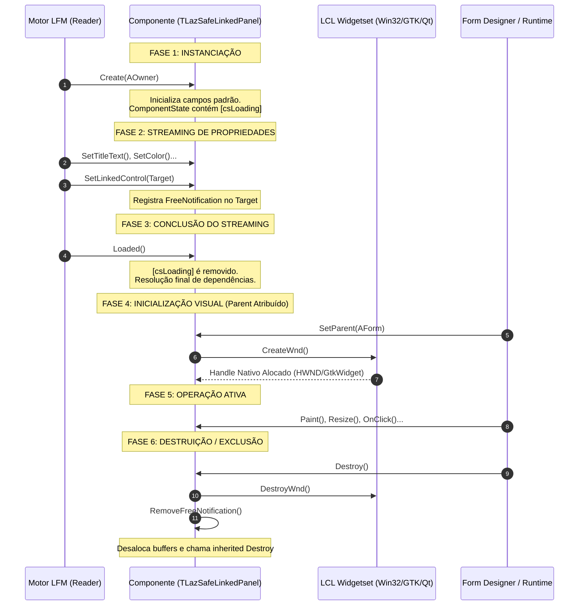

# MÓDULO 02: O Ciclo de Vida Completo do Componente

A estabilidade de uma biblioteca de componentes em **Free Pascal (FPC 3.2+)** e **Lazarus IDE (3.x+)** depende quase que exclusivamente do domínio absoluto sobre o ciclo de vida dos seus objetos. Erros sutis no gerenciamento de estados, instanciação fora de ordem ou falha no rastreamento de referências cruzadas resultam nas falhas mais temidas no desenvolvimento RAD: congelamento da IDE, corrupção silenciosa de dados no streaming LFM e violações de acesso catastróficas (`SIGSEGV` / Access Violation) ao deletar controles no Form Designer.

Neste módulo, realizaremos uma autópsia completa do ciclo de vida determinístico de um componente na **LCL (Lazarus Component Library)**, analisando a fronteira crítica entre a RTL e o Widgetset nativo, as nuances de cada flag de `ComponentState` e as técnicas consagradas para construir referências cruzadas blindadas contra falhas.

---

## 1. O Pipeline Determinístico de Vida da LCL

O ciclo de vida de um componente não é um fluxo linear simples. Ele varia substancialmente dependendo de como o componente é criado:
1. **Via Código (Runtime Dinâmico):** `MyControl := TLazSafeLinkedPanel.Create(Self); MyControl.Parent := Self;`
2. **Via Streaming (Design-Time / Form Loading):** A IDE ou o motor da LCL lê o arquivo `.lfm`, instancia a classe sem parâmetros de propriedades, atribui valores publicados sequentially e, ao final, ancora os controles e inicializa o subsistema visual.



---

## 2. As Fases Fundamentais de Instanciação e Execução

### 2.1 Fase 1: `constructor Create(AOwner: TComponent)`
O construtor é o ponto de entrada da vida da instância no Heap. Neste momento:
- A memória dos campos privados foi zerada pelo compilador (`InitInstance`).
- O parâmetro `AOwner` pode ser uma instância de `TForm`, um `TDataModule` ou até `nil` (caso o chamador decida controlar o tempo de vida manualmente).
- **Regra de Ouro:** Nunca acerte propriedades dependentes de `Parent` ou de `Handle` no construtor! Nesta fase, o componente **não possui janela nativa** e `Parent` é estritamente `nil`. Tentar acessar o `Canvas` ou propriedades gráficas que consultam o sistema operacional disparará a alocação precoce do Handle, quebrando o streaming LFM.

### 2.2 Fase 2: O Streaming LFM e o Método `Loaded`
Quando um formulário é aberto no Lazarus ou carregado em tempo de execução, o leitor de formulário (`TReader`) cria o componente e injeta suas propriedades publicadas uma a uma.

Durante esse processo, componentes interligados podem ainda não existir na memória! Imagine que o `ComponenteA` possui uma propriedade `LinkedControl` apontando para o `ComponenteB`, mas o `ComponenteB` está declarado 50 linhas abaixo no arquivo `.lfm`. O `TReader` registra uma referência pendente (*Fixup*).

Quando todo o arquivo `.lfm` foi completamente lido e todas as referências foram conectadas, a LCL dispara em cascata o método virtual:

```pascal
procedure Loaded; override;
```
- **Propósito:** É o momento canônico para realizar cálculos de inicialização que dependem de múltiplas propriedades ou de outros componentes.
- A flag `csLoading` é removida de `ComponentState` imediatamente antes da chamada de `Loaded`.

### 2.3 Fase 3: A Alocação do Handle e o Par `CreateWnd` / `DestroyWnd`
Em controles janelados derivados de `TWinControl` (como `TCustomControl` e `TPanel`), o controle existe logicamente na RTL antes de existir visualmente no sistema operacional.

A criação do recurso nativo (o `HWND` no Windows, o `GtkWidget` no GTK ou o `QWidget` no Qt) só ocorre quando o controle recebe um `Parent` e fica visível, ou quando o método `Handle` é consultado explicitamente pela primeira vez.

- `procedure CreateWnd; override;`: Chamado imediatamente após a interface do Widgetset alocar com sucesso o identificador nativo de janela. É o local seguro para chamadas de API nativa (ex: `SetWindowLongPtr`, registrar drag-and-drop no SO, associar listeners de eventos do servidor de display).
- `procedure DestroyWnd; override;`: Chamado quando o handle do sistema operacional está prestes a ser destruído (por exemplo, quando o controle muda de `Parent` ou é fechado).

> **PERIGO ARQUITETURAL: RE-CRIAÇÃO DE JANELA (RECREATEWND)**
> Na LCL e na VCL, certas alterações estruturais (como mudar bordas nativas ou estilos de janela em runtime) forçam a LCL a destruir o handle existente e recriá-lo (`RecreateWnd`). Qualquer estado mantido exclusivamente no handle nativo do SO será perdido se não for devidamente sincronizado nas propriedades do componente Pascal!

---

## 3. O Conjunto `ComponentState` e Suas Flags Críticas

A propriedade `ComponentState: TComponentState` de `TComponent` é um `set of TComponentStyle`. Ela informa exatamente a conjuntura operacional em que o código está executando.

| Flag de Estado | Significado Técnico | Ação Obrigatória no Componente |
| :--- | :--- | :--- |
| `csDesigning` | O componente está executando dentro do Form Designer do Lazarus IDE. | Renderizar indicadores visuais (bordas tracejadas, marcas d'água) e **não** disparar processos de negócio reais (como conectar sockets, executar queries SQL ou abrir portas seriais). |
| `csLoading` | O componente está sendo desserializado a partir do fluxo LFM. | Suprimir cálculos intermediários e notificações de repintura durante atribuição de propriedades nos métodos assessores (`Set...`). |
| `csDestroying` | O componente (ou seu formulário Owner) está em processo irreversível de destruição. | Não disparar eventos do usuário (`OnClick`, `OnExit`), não repintar o canvas e abortar qualquer thread de fundo imediatamente. |
| `csReadingState` | O subsistema `TReader` está ativamente injetando dados na classe. | Bloquear sincronizações de propriedades derivadas. |
| `csFreeNotification` | O componente possui dependentes aguardando aviso de destruição na lista interna. | Gerenciado automaticamente pela RTL via `FreeNotification`. |
| `csInline` | O componente faz parte de um frame incorporado ou herança visual profunda. | Tratar resolução relativa de controles embutidos. |

---

## 4. O Problema das Referências Cruzadas e Dangling Pointers

Considere o seguinte cenário clássico de falha:
1. O desenvolvedor adiciona ao formulário o `Painel1` e o `Botao1`.
2. No Object Inspector, seleciona a propriedade `Painel1.LinkedControl := Botao1`. O campo privado `FLinkedControl` passa a armazenar o ponteiro de memória de `Botao1`.
3. Posteriormente, o desenvolvedor clica sobre o `Botao1` no Form Designer e pressiona a tecla `Delete`.
4. O Lazarus deleta o `Botao1` do formulário e libera sua memória no Heap.
5. O `Painel1` **não sabe** que o `Botao1` foi destruído! O campo `FLinkedControl` continua apontando para a área de memória liberada (um *Dangling Pointer* ou ponteiro fantasma).
6. Na próxima vez que o `Painel1` tentar desenhar o nome de `FLinkedControl.Name` ou acessar suas coordenadas, o Lazarus congelará com:
   `Access violation at address 000000000045A12B in module 'lazarus.exe'. Read of address FFFFFFFFFFFFFFFF.`

### A Solução Canônica: `FreeNotification` e `Notification`

O subsistema `TComponent` possui um canal bilateral elegante de notificação.

Quando seu componente armazena o ponteiro de outro componente:
```pascal
procedure TLazSafeLinkedPanel.SetLinkedControl(const AValue: TControl);
begin
  if FLinkedControl <> AValue then
  begin
    // 1. Desinscreve o componente anterior
    if Assigned(FLinkedControl) then
      FLinkedControl.RemoveFreeNotification(Self);

    FLinkedControl := AValue;

    // 2. Inscreve o novo componente para nos avisar antes de morrer
    if Assigned(FLinkedControl) then
      FLinkedControl.FreeNotification(Self);
  end;
end;
```

E na sobrescrita do método protegido `Notification`:
```pascal
procedure TLazSafeLinkedPanel.Notification(AComponent: TComponent; Operation: TOperation);
begin
  inherited Notification(AComponent, Operation);

  if (Operation = opRemove) and (AComponent = FLinkedControl) then
  begin
    // 3. O componente associado está sendo destruído! Anulamos o ponteiro imediatamente.
    FLinkedControl := nil;
    Invalidate;
  end;
end;
```

---

## 5. Implementação Prática: O Componente `TLazSafeLinkedPanel`

Para ilustrar e comprovar em código de produção cada um dos conceitos descritos, construímos o componente `TLazSafeLinkedPanel`.

Ele é um controle contêiner completo (`TCustomControl`) equipado com:
- Monitoramento de cada marco de vida (`Create`, `CreateWnd`, `Loaded`, `Notification`, `Destroy`).
- Proteção bilateral contra referências cruzadas pendentes (`LinkedControl` e `CompanionComponent`).
- Renderização visual moderna com tema escuro, cabeçalho de título estilizado e detecção de `csDesigning` para desenho de indicadores de layout.
- Métodos de diagnóstico para inspeção de flags em tempo de execução.

### 5.1 Código Pascal Completo e Compilável

O código-fonte integral da unidade `LazSafeLinkedPanel.pas` é apresentado a seguir:

```pascal
{==============================================================================
  Livro: Engenharia e Arquitetura Avançada de Componentes para Lazarus IDE & LCL
  Módulo 02: O Ciclo de Vida Completo do Componente
  Componente: TLazSafeLinkedPanel
  Autor: Engenharia de Software Especializada & Arquitetura RAD
  Ambiente: Free Pascal 3.2.2+ / Lazarus 3.x+
  Descrição: Painel contêiner visual avançado que demonstra o ciclo de vida
             completo de um componente (Create -> CreateWnd -> Loaded ->
             Notification -> Destroy), com gerenciamento seguro de referências
             cruzadas fracas e renderização diferenciada para csDesigning.
==============================================================================}
unit LazSafeLinkedPanel;

{$mode objfpc}{$H+}

interface

uses
  Classes,
  SysUtils,
  Controls,
  Graphics,
  Forms,
  LCLType,
  LCLIntf;

type
  { Enum para estilo de destaque visual no Form Designer }
  TLazDesignIndicator = (diDottedBorder, diWatermarkText, diNone);

  { Evento para notificar alterações de ciclo de vida à aplicação }
  TOnLifecycleStage = procedure(Sender: TObject; const AStageName: string;
    const ADetails: string) of object;

  {============================================================================
    Classe: TLazSafeLinkedPanel
    Herda de TCustomControl para ter Handle próprio (TWinControl) e método
    Paint virtual configurável, além de gerenciar referências cruzadas fracas.
  ============================================================================}
  TLazSafeLinkedPanel = class(TCustomControl)
  private
    FLinkedControl: TControl;
    FCompanionComponent: TComponent;
    FDesignIndicator: TLazDesignIndicator;
    FHeaderColor: TColor;
    FHeaderHeight: Integer;
    FBorderColor: TColor;
    FTitleText: string;
    FOnLifecycleStage: TOnLifecycleStage;

    procedure SetLinkedControl(const AValue: TControl);
    procedure SetCompanionComponent(const AValue: TComponent);
    procedure SetDesignIndicator(const AValue: TLazDesignIndicator);
    procedure SetHeaderColor(const AValue: TColor);
    procedure SetHeaderHeight(const AValue: Integer);
    procedure SetBorderColor(const AValue: TColor);
    procedure SetTitleText(const AValue: string);

    procedure NotifyStage(const AStageName, ADetails: string);
    procedure DrawDesignWatermark(ACanvas: TCanvas);
  protected
    { 1. Fase de alocação de handle no Widgetset nativo }
    procedure CreateWnd; override;
    procedure DestroyWnd; override;

    { 2. Fase de pós-carregamento do streaming LFM }
    procedure Loaded; override;

    { 3. Mecanismo de notificação de ciclo de vida entre componentes }
    procedure Notification(AComponent: TComponent; Operation: TOperation); override;

    { 4. Ciclo de renderização visual }
    procedure Paint; override;
    procedure Resize; override;
  public
    { Construtor e Destrutor gerenciadores de memória }
    constructor Create(AOwner: TComponent); override;
    destructor Destroy; override;

    { Métodos públicos utilitários }
    function IsLinkedControlActive: Boolean;
    function GetLifecycleDiagnosticInfo: string;
  published
    { Propriedades de vinculação fraca com ciclo de vida seguro }
    property LinkedControl: TControl read FLinkedControl write SetLinkedControl;
    property CompanionComponent: TComponent read FCompanionComponent write SetCompanionComponent;

    { Propriedades visuais publicadas no Object Inspector }
    property DesignIndicator: TLazDesignIndicator read FDesignIndicator write SetDesignIndicator default diDottedBorder;
    property HeaderColor: TColor read FHeaderColor write SetHeaderColor default $002B2B2B;
    property HeaderHeight: Integer read FHeaderHeight write SetHeaderHeight default 28;
    property BorderColor: TColor read FBorderColor write SetBorderColor default $00555555;
    property TitleText: string read FTitleText write SetTitleText;

    { Propriedades padrão herdadas da LCL }
    property Align;
    property Anchors;
    property AutoSize;
    property BorderSpacing;
    property Caption;
    property Color default $001E1E1E;
    property Enabled;
    property Font;
    property ParentColor default False;
    property ParentFont;
    property PopupMenu;
    property TabOrder;
    property TabStop default True;
    property Visible;

    { Eventos padrão }
    property OnClick;
    property OnDblClick;
    property OnEnter;
    property OnExit;
    property OnKeyDown;
    property OnKeyPress;
    property OnKeyUp;
    property OnMouseDown;
    property OnMouseEnter;
    property OnMouseLeave;
    property OnMouseMove;
    property OnMouseUp;
    property OnResize;

    { Evento customizado de monitoramento de ciclo de vida }
    property OnLifecycleStage: TOnLifecycleStage read FOnLifecycleStage write FOnLifecycleStage;
  end;

procedure Register;

implementation

procedure Register;
begin
  RegisterComponents('Engenharia Lazarus', [TLazSafeLinkedPanel]);
end;

{ TLazSafeLinkedPanel }

constructor TLazSafeLinkedPanel.Create(AOwner: TComponent);
begin
  inherited Create(AOwner);

  { Inicializa estilos de controle de contêiner }
  ControlStyle := ControlStyle + [csAcceptsControls, csCaptureMouse, csClickEvents, csDoubleClicks];

  { Define dimensões padrão e cores iniciais (Dark Theme Moderno) }
  Width := 280;
  Height := 180;
  Color := $001E1E1E;
  FHeaderColor := $002B2B2B;
  FHeaderHeight := 28;
  FBorderColor := $00555555;
  FTitleText := 'Safe Linked Panel';
  FDesignIndicator := diDottedBorder;
  FLinkedControl := nil;
  FCompanionComponent := nil;

  { Configura fonte padrão para alta nitidez }
  Font.Name := 'Segoe UI';
  Font.Size := 9;
  Font.Color := $00E0E0E0;

  NotifyStage('Create', Format('Owner: %s | csDesigning: %s',
    [BoolToStr(Assigned(AOwner), 'Presente', 'nil'),
     BoolToStr(csDesigning in ComponentState, 'Sim', 'Não')]));
end;

destructor TLazSafeLinkedPanel.Destroy;
begin
  NotifyStage('Destroy', 'Liberando recursos e desvinculando ponteiros...');

  { Remove notificações bilaterais pendentes para evitar chamadas tardias }
  if Assigned(FLinkedControl) then
  begin
    FLinkedControl.RemoveFreeNotification(Self);
    FLinkedControl := nil;
  end;

  if Assigned(FCompanionComponent) then
  begin
    FCompanionComponent.RemoveFreeNotification(Self);
    FCompanionComponent := nil;
  end;

  inherited Destroy;
end;

procedure TLazSafeLinkedPanel.CreateWnd;
begin
  inherited CreateWnd;

  { O Handle nativo foi criado no Widgetset neste exato momento }
  NotifyStage('CreateWnd', Format('Handle nativo alocado: 0x%x', [Handle]));
end;

procedure TLazSafeLinkedPanel.DestroyWnd;
begin
  NotifyStage('DestroyWnd', Format('Handle prestes a ser desalocado: 0x%x', [Handle]));
  inherited DestroyWnd;
end;

procedure TLazSafeLinkedPanel.Loaded;
begin
  inherited Loaded;

  { Todos os componentes do LFM foram instanciados e suas propriedades carregadas }
  NotifyStage('Loaded', Format('LFM concluído. LinkedControl: %s | Companion: %s',
    [BoolToStr(Assigned(FLinkedControl), 'Atribuído', 'Vazio'),
     BoolToStr(Assigned(FCompanionComponent), 'Atribuído', 'Vazio')]));

  Invalidate;
end;

procedure TLazSafeLinkedPanel.SetLinkedControl(const AValue: TControl);
begin
  if FLinkedControl <> AValue then
  begin
    { Evita auto-referência circular }
    if AValue = Self then
      raise Exception.Create('Um componente não pode vincular-se a si mesmo como LinkedControl.');

    { Remove notificação do componente antigo }
    if Assigned(FLinkedControl) then
      FLinkedControl.RemoveFreeNotification(Self);

    FLinkedControl := AValue;

    { Solicita notificação formal de destruição do novo controle }
    if Assigned(FLinkedControl) then
      FLinkedControl.FreeNotification(Self);

    NotifyStage('SetLinkedControl', Format('Novo controle: %s',
      [BoolToStr(Assigned(FLinkedControl), FLinkedControl.Name, 'nil')]));

    Invalidate;
  end;
end;

procedure TLazSafeLinkedPanel.SetCompanionComponent(const AValue: TComponent);
begin
  if FCompanionComponent <> AValue then
  begin
    if AValue = Self then
      raise Exception.Create('Um componente não pode vincular-se a si mesmo como CompanionComponent.');

    if Assigned(FCompanionComponent) then
      FCompanionComponent.RemoveFreeNotification(Self);

    FCompanionComponent := AValue;

    if Assigned(FCompanionComponent) then
      FCompanionComponent.FreeNotification(Self);

    NotifyStage('SetCompanionComponent', Format('Novo companion: %s',
      [BoolToStr(Assigned(FCompanionComponent), FCompanionComponent.Name, 'nil')]));

    Invalidate;
  end;
end;

procedure TLazSafeLinkedPanel.Notification(AComponent: TComponent; Operation: TOperation);
begin
  inherited Notification(AComponent, Operation);

  { Tratamento cirúrgico de remoção em Design-Time e Run-Time }
  if Operation = opRemove then
  begin
    if AComponent = FLinkedControl then
    begin
      NotifyStage('Notification(opRemove)', Format('LinkedControl [%s] está sendo destruído. Anulando ponteiro.', [AComponent.Name]));
      FLinkedControl := nil;
      Invalidate;
    end
    else if AComponent = FCompanionComponent then
    begin
      NotifyStage('Notification(opRemove)', Format('CompanionComponent [%s] está sendo destruído. Anulando ponteiro.', [AComponent.Name]));
      FCompanionComponent := nil;
      Invalidate;
    end;
  end;
end;

procedure TLazSafeLinkedPanel.SetDesignIndicator(const AValue: TLazDesignIndicator);
begin
  if FDesignIndicator <> AValue then
  begin
    FDesignIndicator := AValue;
    Invalidate;
  end;
end;

procedure TLazSafeLinkedPanel.SetHeaderColor(const AValue: TColor);
begin
  if FHeaderColor <> AValue then
  begin
    FHeaderColor := AValue;
    Invalidate;
  end;
end;

procedure TLazSafeLinkedPanel.SetHeaderHeight(const AValue: Integer);
begin
  if (FHeaderHeight <> AValue) and (AValue >= 0) then
  begin
    FHeaderHeight := AValue;
    Invalidate;
  end;
end;

procedure TLazSafeLinkedPanel.SetBorderColor(const AValue: TColor);
begin
  if FBorderColor <> AValue then
  begin
    FBorderColor := AValue;
    Invalidate;
  end;
end;

procedure TLazSafeLinkedPanel.SetTitleText(const AValue: string);
begin
  if FTitleText <> AValue then
  begin
    FTitleText := AValue;
    Invalidate;
  end;
end;

procedure TLazSafeLinkedPanel.Resize;
begin
  inherited Resize;
  Invalidate;
end;

procedure TLazSafeLinkedPanel.DrawDesignWatermark(ACanvas: TCanvas);
var
  OldPenStyle: TPenStyle;
  InfoStr: string;
  TextSz: TSize;
  Tx, Ty: Integer;
begin
  { Se não estiver em design-time, ignora indicadores }
  if not (csDesigning in ComponentState) then
    Exit;

  case FDesignIndicator of
    diDottedBorder:
      begin
        OldPenStyle := ACanvas.Pen.Style;
        try
          ACanvas.Pen.Style := psDot;
          ACanvas.Pen.Color := clHighlight;
          ACanvas.Pen.Width := 1;
          ACanvas.Brush.Style := bsClear;
          ACanvas.Rectangle(1, 1, Width - 1, Height - 1);
        finally
          ACanvas.Pen.Style := OldPenStyle;
        end;
      end;

    diWatermarkText:
      begin
        InfoStr := '[DESIGN MODE] ' + Name;
        ACanvas.Font.Size := 8;
        ACanvas.Font.Color := clGray;
        ACanvas.Brush.Style := bsClear;
        TextSz := ACanvas.TextExtent(InfoStr);
        Tx := (Width - TextSz.cx) div 2;
        Ty := Height - TextSz.cy - 6;
        if Ty > FHeaderHeight then
          ACanvas.TextOut(Tx, Ty, InfoStr);
      end;

    diNone: ;
  end;
end;

procedure TLazSafeLinkedPanel.Paint;
var
  R: TRect;
  TitleR: TRect;
  OldBrushColor: TColor;
begin
  { Supressão de pintura se o componente estiver sendo destruído ou durante leitura inicial }
  if (csDestroying in ComponentState) or (csReadingState in ComponentState) then
    Exit;

  { 1. Fundo do Contêiner }
  Canvas.Brush.Color := Color;
  Canvas.Brush.Style := bsSolid;
  Canvas.Pen.Color := FBorderColor;
  Canvas.Pen.Width := 1;
  Canvas.Rectangle(0, 0, Width, Height);

  { 2. Cabeçalho Superior }
  if FHeaderHeight > 0 then
  begin
    R := Rect(0, 0, Width, FHeaderHeight);
    Canvas.Brush.Color := FHeaderColor;
    Canvas.FillRect(R);

    { Linha divisória inferior do cabeçalho }
    Canvas.Pen.Color := FBorderColor;
    Canvas.MoveTo(0, FHeaderHeight);
    Canvas.LineTo(Width, FHeaderHeight);

    { Texto do Título }
    TitleR := Rect(10, 0, Width - 10, FHeaderHeight);
    Canvas.Font.Assign(Self.Font);
    Canvas.Font.Style := [fsBold];
    Canvas.Brush.Style := bsClear;
    LCLIntf.DrawText(Canvas.Handle, PChar(FTitleText), Length(FTitleText),
      TitleR, DT_LEFT or DT_VCENTER or DT_SINGLELINE);
  end;

  { 3. Destaque de Vínculo com LinkedControl }
  if Assigned(FLinkedControl) then
  begin
    Canvas.Font.Size := 8;
    Canvas.Font.Style := [fsItalic];
    Canvas.Font.Color := $0070C070; // Verde suave
    Canvas.TextOut(10, FHeaderHeight + 6, Format('Link: %s (%s)',
      [FLinkedControl.Name, FLinkedControl.ClassName]));
  end;

  { 4. Marca d'água e auxiliares do Form Designer }
  DrawDesignWatermark(Canvas);
end;

procedure TLazSafeLinkedPanel.NotifyStage(const AStageName, ADetails: string);
begin
  if Assigned(FOnLifecycleStage) then
  begin
    try
      FOnLifecycleStage(Self, AStageName, ADetails);
    except
      { Proteção contra exceções em handlers de eventos durante ciclo de vida }
    end;
  end;
end;

function TLazSafeLinkedPanel.IsLinkedControlActive: Boolean;
begin
  Result := Assigned(FLinkedControl) and
            not (csDestroying in FLinkedControl.ComponentState);
end;

function TLazSafeLinkedPanel.GetLifecycleDiagnosticInfo: string;
var
  SB: TStringBuilder;
begin
  SB := TStringBuilder.Create;
  try
    SB.AppendLine(Format('Componente: %s (%s)', [Name, ClassName]));
    SB.AppendLine(Format('- Handle Alocado: %s', [BoolToStr(HandleAllocated, 'Sim', 'Não')]));
    SB.AppendLine(Format('- csDesigning: %s', [BoolToStr(csDesigning in ComponentState, 'Sim', 'Não')]));
    SB.AppendLine(Format('- csLoading: %s', [BoolToStr(csLoading in ComponentState, 'Sim', 'Não')]));
    SB.AppendLine(Format('- csDestroying: %s', [BoolToStr(csDestroying in ComponentState, 'Sim', 'Não')]));
    SB.AppendLine(Format('- csReadingState: %s', [BoolToStr(csReadingState in ComponentState, 'Sim', 'Não')]));
    SB.AppendLine(Format('- LinkedControl: %s',
      [BoolToStr(Assigned(FLinkedControl), FLinkedControl.Name, 'nil')]));
    SB.AppendLine(Format('- CompanionComponent: %s',
      [BoolToStr(Assigned(FCompanionComponent), FCompanionComponent.Name, 'nil')]));
    Result := SB.ToString;
  finally
    SB.Free;
  end;
end;

end.
```

---

## 6. Análise de Casos Extremos de Produção

### 6.1 Proteção contra Auto-Vínculo Circular
O que acontece se um desenvolvedor desatento selecionar no Object Inspector o próprio componente como seu `LinkedControl`?
```pascal
if AValue = Self then
  raise Exception.Create('Um componente não pode vincular-se a si mesmo como LinkedControl.');
```
Sem essa verificação expressa, rotinas recursivas de desenho ou delegação de foco entrariam em loop infinito, resultando em estouro de pilha (*Stack Overflow*).

### 6.2 O Guardião `csDestroying in ComponentState`
No método `Paint`:
```pascal
if (csDestroying in ComponentState) or (csReadingState in ComponentState) then
  Exit;
```
Durante o processo de fechamento de um formulário complexo, os componentes filhos são destruídos em ordem não garantida. Se um componente tentar repintar seu canvas enquanto seu `Parent` ou o contexto de dispositivo do SO já estiver sendo liberado, uma exceção em cascata será disparada. A verificação antecipada de `csDestroying` atua como um escudo protetor intransponível.

---

## 7. Checklist de Engenharia do Módulo 02

- [x] O construtor `Create` deve inicializar valores padrões e estilos (`ControlStyle`), mantendo-se estritamente isolado de `Parent` ou `Handle`.
- [x] Utilize `Loaded` para inicializar regras de negócio ou sincronizações visuais que dependem de múltiplas propriedades serializadas no `.lfm`.
- [x] O par `CreateWnd` e `DestroyWnd` demarca a alocação física do recurso nativo do SO (`Handle`).
- [x] Todo componente que faz referência a outra instância de `TComponent` deve registrar `FreeNotification` e limpar o ponteiro em `Notification(opRemove)`.
- [x] Verifique sempre `csDesigning` para habilitar ou desabilitar comportamentos específicos de design-time.
- [x] Verifique sempre `csDestroying` antes de disparar eventos ou realizar pinturas visuais.
