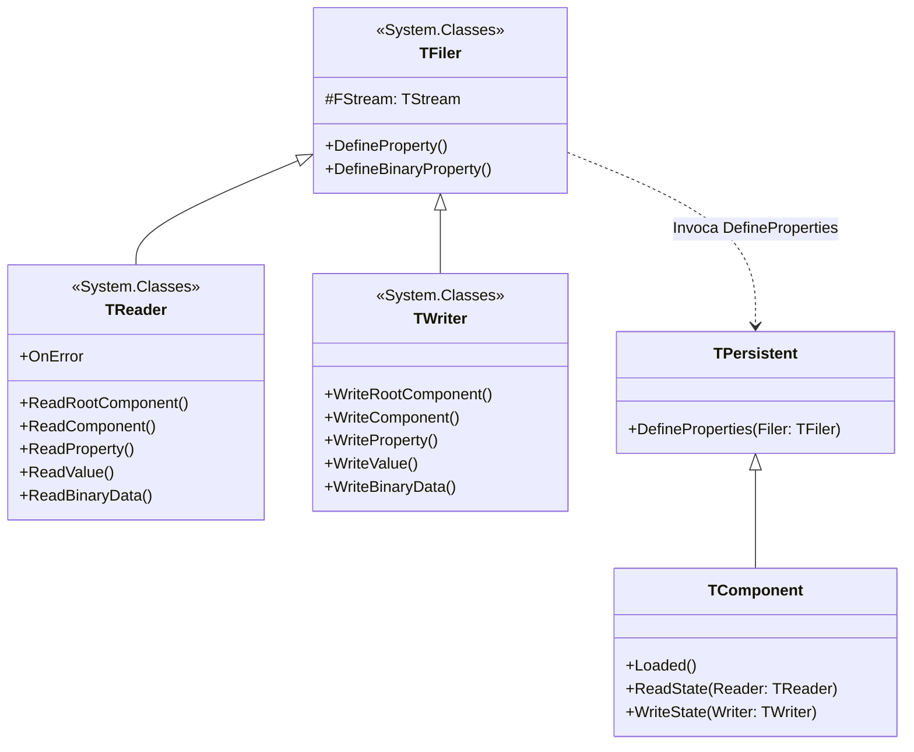

# MÓDULO 03: Mecanismo de Streaming e Persistência (LFM)

A magia do desenvolvimento RAD reside na capacidade de desenhar visualmente telas complexas, configurar dezenas de propriedades no Object Inspector e ter todo esse estado reconstituído de forma transparente e instantânea na inicialização da aplicação. No ecossistema **Free Pascal (FPC 3.2+)** e **Lazarus IDE (3.x+)**, o motor responsável por essa proeza é o subsistema de **Streaming da RTL**, centrado nos arquivos `.lfm` (Lazarus Form Format).

No entanto, limitar-se à persistência automática padrão é insuficiente para componentes de alta complexidade. Como persistir estruturas dinâmicas, matrizes esparsas, buffers binários de imagem ou configurações em JSON/XML sem poluir a interface pública do componente com dezenas de campos artificiais?

Neste módulo, desvendaremos as entranhas dos subsistemas `TFiler`, `TReader` e `TWriter`, o formato textual e binário do `.lfm`, o funcionamento dos especificadores `stored`, e dominaremos a implementação de propriedades virtuais customizadas através do método canônico `DefineProperties`.

---

## 1. A Arquitetura do Subsistema de Streaming

O streaming de objetos no Free Pascal é um pipeline de serialização reflexiva bidirecional fundamentado na RTTI gerada pelo compilador.



### 1.1 Formato Textual `.lfm` vs. Formato Binário Compilado

No Lazarus, o arquivo de formulário é salvo no disco em formato texto legível por humanos (`.lfm`), com sintaxe declarativa limpa:

```text
object MainForm: TMainForm
  Left = 350
  Top = 220
  Width = 640
  Height = 480
  Caption = 'Aplicação Corporativa'
  Color = clBlack
  Font.Color = clWhite
  Font.Name = 'Segoe UI'
  object SafePanel: TLazSafeLinkedPanel
    Left = 24
    Top = 16
    Width = 320
    Height = 200
    TitleText = 'Monitor de Conexões'
  end
end
```

Quando você compila seu projeto no Lazarus, a diretiva `{$R *.lfm}` instrui o compilador a converter essa estrutura textual para o formato binário otimizado da RTL e anexá-la como um recurso compilado dentro do executável final. 

Na inicialização da aplicação, a função global `InitComponent` localiza esse recurso binário e o alimenta diretamente em uma instância de `TReader`. O `TReader` cria as instâncias de classe via reflexão (`FindClass`), lê os pares de propriedade/valor e invoca os métodos assessores `Set...`.

---

## 2. Persistência Automática: O Que o RTTI Consegue Serializar?

Nem toda propriedade declarada em um componente é persistida no `.lfm`. Para que a persistência automática ocorra, a propriedade deve:
1. Residir na seção `published` da classe.
2. Possuir um método assessor de leitura (`read`) e um de escrita (`write`). Propriedades somente-leitura (`read-only`) **nunca** são persistidas pelo `TWriter`.

### Tabela de Mapeamento de Tipos no Streaming da RTL:

| Categoria de Tipo | Exemplo Pascal | Mecanismo de Gravação no LFM |
| :--- | :--- | :--- |
| **Inteiros / Cardinais** | `Integer`, `Byte`, `Int64` | `TWriter.WriteInteger` / Codificação em bytes variáveis. |
| **Ponto Flutuante** | `Single`, `Double`, `Currency` | `TWriter.WriteFloat` (formato IEEE 754). |
| **Booleanos** | `Boolean` | `TWriter.WriteBoolean` (`True` ou `False`). |
| **Strings** | `string`, `AnsiString`, `UTF8String` | `TWriter.WriteString` / Cadeia de caracteres com prefixo de tamanho. |
| **Enumerações** | `TAlign`, `TBorderStyle` | Gravado como o identificador textual exato do enum (ex: `alClient`, `bsSingle`). |
| **Conjuntos (Sets)** | `TAnchors`, `TBorderSpacing` | Gravado entre colchetes como lista de identificadores (ex: `[akLeft, akTop, akRight]`). |
| **Sub-Objetos `TPersistent`** | `Font: TFont` | O `TWriter` abre um bloco aninhado recursivo e grava as propriedades publicadas do sub-objeto. |
| **Coleções `TCollection`** | `Items: TCollection` | Gravado como uma lista estruturada de itens aninhados (`<item> ... </item>`). |
| **Componentes (`TComponent`)** | `LinkedControl: TControl` | Gravado como o nome identificador do componente (ex: `LinkedControl = Edit1`). |

---

## 3. Otimização de Arquivo com o Especificador `stored`

Por padrão, o `TWriter` grava no arquivo `.lfm` todas as propriedades publicadas cujo valor atual difere do valor padrão declarado (`default`).

Se você não declarar um valor `default`, a LCL será forçada a gravar a propriedade mesmo que ela contenha valores óbvios (como `0`, `False` ou strings vazias), gerando arquivos `.lfm` gigantescos e lentos para processar.

### 3.1 Declarando Valores `default`
```pascal
published
  property HeaderHeight: Integer read FHeaderHeight write SetHeaderHeight default 28;
  property ShowWatermark: Boolean read FShowWatermark write SetShowWatermark default True;
```
Quando o valor de `HeaderHeight` for `28`, o `TWriter` compara o valor em memória com o metadado `default 28` presente na RTTI e **omite** a propriedade do `.lfm`.

### 3.2 O Modificador `stored` Dinâmico
Para tipos complexos que não aceitam literais simples na cláusula `default` (como strings dinâmicas, coleções ou classes), você pode associar uma função booleana ao especificador `stored`:

```pascal
private
  function IsTitleTextStored: Boolean;
published
  property TitleText: string read FTitleText write SetTitleText stored IsTitleTextStored;

// Implementação:
function TMyComponent.IsTitleTextStored: Boolean;
begin
  // Só grava no .lfm se o título for diferente do padrão de fábrica
  Result := (FTitleText <> 'Título Padrão de Fábrica') and (FTitleText <> '');
end;
```

---

## 4. Propriedades Não-Nativas com `DefineProperties`

Existe uma barreira arquitetural na RTTI convencional: propriedades precisam mapear diretamente para um tipo fixo suportado pelo Object Inspector.

E se o seu componente precisar serializar:
- Um dump binário de um modelo de inteligência artificial ou de um certificado digital?
- Uma árvore de dados hierárquica compactada em tempo real com zlib?
- Um cache de consultas em memória?

A solução oficial da RTL do Free Pascal é sobrescrever o método protegido:

```pascal
procedure DefineProperties(Filer: TFiler); override;
```

O `TFiler` expõe dois métodos fundamentais para registro de propriedades virtuais:
1. `Filer.DefineProperty('NomeDaPropriedade', @ReadMethod, @WriteMethod, CondicaoBooleana);`: Para tipos literais e estruturados lidos via `TReader` / `TWriter`.
2. `Filer.DefineBinaryProperty('NomeDaPropriedade', @ReadStreamMethod, @WriteStreamMethod, CondicaoBooleana);`: Para fluxos contínuos de bytes puros ou compactados gravados diretamente no stream do LFM.

```
+---------------------------------------------------------------------------------+
|                       FLUXO DE GRAVAÇÃO DO .LFM (TWriter)                       |
|                                                                                 |
| 1. TWriter inspeciona propriedades published via RTTI.                          |
| 2. TWriter invoca Componente.DefineProperties(Self).                            |
| 3. Componente verifica 'HasDataToStore'. Se True:                               |
|       - TWriter escreve marcador de propriedade virtual no stream.             |
|       - TWriter invoca WriteBlobData(Stream).                                   |
|       - Componente comprime os dados com TCompressionStream (zlib).             |
|       - Bytes comprimidos são injetados diretamente na seção do componente.     |
+---------------------------------------------------------------------------------+
```

No arquivo `.lfm`, uma propriedade binária definida dessa forma aparece codificada em formato hexadecimal legível:

```text
object BlobContainer: TLazBinaryBlobContainer
  Description = 'Repositório de Dados Criptografados'
  CompressionMode = bcmZLibMax
  CustomBlobPayload = {
    78DA636080010B10800000021A00E5
  }
end
```

---

## 5. Implementação Prática: O Componente `TLazBinaryBlobContainer`

Para dominar na prática o subsistema `TFiler`, construímos o `TLazBinaryBlobContainer`.

Este componente é capaz de:
- Armazenar payloads binários arbitrários na memória (`TMemoryStream`).
- Aplicar compressão automática de alto desempenho utilizando a biblioteca nativa `zstream` do Free Pascal (zlib).
- Persistir o payload binário comprimido diretamente no arquivo `.lfm` através de `DefineProperties` e `DefineBinaryProperty`.
- Reconstituir e descompactar os dados de forma transparente quando o formulário for carregado pela LCL.

### 5.1 Código Pascal Completo e Compilável

Abaixo está o código integral da unidade `LazBinaryBlobContainer.pas`:

```pascal
{==============================================================================
  Livro: Engenharia e Arquitetura Avançada de Componentes para Lazarus IDE & LCL
  Módulo 03: Mecanismo de Streaming e Persistência (LFM)
  Componente: TLazBinaryBlobContainer
  Autor: Engenharia de Software Especializada & Arquitetura RAD
  Ambiente: Free Pascal 3.2.2+ / Lazarus 3.x+
  Descrição: Componente não-visual que demonstra a implementação profunda de
             streaming customizado no arquivo .lfm utilizando o subsistema
             TFiler, TReader, TWriter, DefineProperties e compressão zlib nativa.
==============================================================================}
unit LazBinaryBlobContainer;

{$mode objfpc}{$H+}

interface

uses
  Classes,
  SysUtils,
  zstream;

type
  { Modo de compressão para persistência do blob no LFM }
  TLazBlobCompressionMode = (
    bcmNone,        // Salva os bytes puros
    bcmZLibFast,    // Compressão rápida
    bcmZLibMax      // Compressão máxima
  );

  { Evento disparado quando o blob é atualizado ou desserializado do LFM }
  TOnBlobDataChanged = procedure(Sender: TObject; ADataSize: Int64;
    ACompressedSize: Int64) of object;

  {============================================================================
    Classe: TLazBinaryBlobContainer
    Componente não-visual que implementa DefineProperties para persistência
    customizada de payloads binários compactados no arquivo de formulário .lfm.
  ============================================================================}
  TLazBinaryBlobContainer = class(TComponent)
  private
    FRawDataStream: TMemoryStream;
    FDescription: string;
    FCompressionMode: TLazBlobCompressionMode;
    FLastDecompressedSize: Int64;
    FLastPersistedSize: Int64;
    FOnBlobDataChanged: TOnBlobDataChanged;

    procedure SetDescription(const AValue: string);
    procedure SetCompressionMode(const AValue: TLazBlobCompressionMode);
    function HasDataToStore: Boolean;

    { Métodos assessores de streaming para o TFiler }
    procedure ReadBlobData(AStream: TStream);
    procedure WriteBlobData(AStream: TStream);
  protected
    { Ponto de entrada canônico da RTL para persistência customizada }
    procedure DefineProperties(Filer: TFiler); override;
    procedure DoBlobDataChanged; virtual;
  public
    constructor Create(AOwner: TComponent); override;
    destructor Destroy; override;

    { Manipulação do payload binário em tempo de execução }
    procedure Clear;
    procedure LoadFromStream(AStream: TStream);
    procedure SaveToStream(AStream: TStream);
    procedure LoadFromFile(const AFileName: string);
    procedure SaveToFile(const AFileName: string);
    procedure SetDataAsString(const AContent: string);
    function GetDataAsString: string;

    { Métricas do payload }
    property RawDataSize: Int64 read FLastDecompressedSize;
    property PersistedSize: Int64 read FLastPersistedSize;
  published
    property Description: string read FDescription write SetDescription;
    property CompressionMode: TLazBlobCompressionMode read FCompressionMode write SetCompressionMode default bcmZLibMax;
    property OnBlobDataChanged: TOnBlobDataChanged read FOnBlobDataChanged write FOnBlobDataChanged;
  end;

procedure Register;

implementation

procedure Register;
begin
  RegisterComponents('Engenharia Lazarus', [TLazBinaryBlobContainer]);
end;

{ TLazBinaryBlobContainer }

constructor TLazBinaryBlobContainer.Create(AOwner: TComponent);
begin
  inherited Create(AOwner);
  FRawDataStream := TMemoryStream.Create;
  FDescription := 'Binary Blob Container';
  FCompressionMode := bcmZLibMax;
  FLastDecompressedSize := 0;
  FLastPersistedSize := 0;
end;

destructor TLazBinaryBlobContainer.Destroy;
begin
  FreeAndNil(FRawDataStream);
  inherited Destroy;
end;

procedure TLazBinaryBlobContainer.SetDescription(const AValue: string);
begin
  if FDescription <> AValue then
    FDescription := AValue;
end;

procedure TLazBinaryBlobContainer.SetCompressionMode(const AValue: TLazBlobCompressionMode);
begin
  if FCompressionMode <> AValue then
    FCompressionMode := AValue;
end;

function TLazBinaryBlobContainer.HasDataToStore: Boolean;
begin
  Result := Assigned(FRawDataStream) and (FRawDataStream.Size > 0);
end;

procedure TLazBinaryBlobContainer.DefineProperties(Filer: TFiler);
begin
  inherited DefineProperties(Filer);

  { Define a propriedade virtual binária 'CustomBlobPayload' no arquivo .lfm }
  Filer.DefineBinaryProperty('CustomBlobPayload', @ReadBlobData, @WriteBlobData, HasDataToStore);
end;

procedure TLazBinaryBlobContainer.ReadBlobData(AStream: TStream);
var
  ModeByte: Byte;
  OrigSize: Int64;
  Decompressor: TDecompressionStream;
  Buffer: array[0..4095] of Byte;
  BytesRead: Integer;
begin
  FRawDataStream.Clear;

  if AStream.Size = 0 then
    Exit;

  { 1. Lê o byte de cabeçalho com o modo de compressão original }
  AStream.ReadBuffer(ModeByte, SizeOf(Byte));
  { 2. Lê o tamanho original descomprimido }
  AStream.ReadBuffer(OrigSize, SizeOf(Int64));

  FLastDecompressedSize := OrigSize;
  FLastPersistedSize := AStream.Size;

  case TLazBlobCompressionMode(ModeByte) of
    bcmNone:
      begin
        { Carrega os dados diretamente sem descompressão }
        FRawDataStream.CopyFrom(AStream, AStream.Size - AStream.Position);
      end;

    bcmZLibFast, bcmZLibMax:
      begin
        { Descomprime o payload utilizando zstream nativo do FPC }
        Decompressor := TDecompressionStream.Create(AStream);
        try
          repeat
            BytesRead := Decompressor.Read(Buffer, SizeOf(Buffer));
            if BytesRead > 0 then
              FRawDataStream.WriteBuffer(Buffer, BytesRead);
          until BytesRead = 0;
        finally
          Decompressor.Free;
        end;
      end;
  end;

  FRawDataStream.Position := 0;
  DoBlobDataChanged;
end;

procedure TLazBinaryBlobContainer.WriteBlobData(AStream: TStream);
var
  ModeByte: Byte;
  OrigSize: Int64;
  Compressor: TCompressionStream;
  ZLevel: Tcompressionlevel;
  StartPos: Int64;
begin
  if not HasDataToStore then
    Exit;

  StartPos := AStream.Position;

  { 1. Escreve cabeçalho: Modo de Compressão e Tamanho Original }
  ModeByte := Byte(FCompressionMode);
  AStream.WriteBuffer(ModeByte, SizeOf(Byte));

  OrigSize := FRawDataStream.Size;
  AStream.WriteBuffer(OrigSize, SizeOf(Int64));

  FRawDataStream.Position := 0;

  case FCompressionMode of
    bcmNone:
      begin
        AStream.CopyFrom(FRawDataStream, FRawDataStream.Size);
      end;

    bcmZLibFast, bcmZLibMax:
      begin
        if FCompressionMode = bcmZLibFast then
          ZLevel := clfastest
        else
          ZLevel := clmax;

        { Comprime o payload binário gravando diretamente no fluxo de saída do LFM }
        Compressor := TCompressionStream.Create(ZLevel, AStream);
        try
          Compressor.CopyFrom(FRawDataStream, FRawDataStream.Size);
        finally
          Compressor.Free;
        end;
      end;
  end;

  FLastDecompressedSize := OrigSize;
  FLastPersistedSize := AStream.Position - StartPos;
  FRawDataStream.Position := 0;
end;

procedure TLazBinaryBlobContainer.Clear;
begin
  FRawDataStream.Clear;
  FLastDecompressedSize := 0;
  FLastPersistedSize := 0;
  DoBlobDataChanged;
end;

procedure TLazBinaryBlobContainer.LoadFromStream(AStream: TStream);
begin
  FRawDataStream.Clear;
  if Assigned(AStream) and (AStream.Size > 0) then
  begin
    AStream.Position := 0;
    FRawDataStream.CopyFrom(AStream, AStream.Size);
    FRawDataStream.Position := 0;
    FLastDecompressedSize := FRawDataStream.Size;
    FLastPersistedSize := 0;
  end;
  DoBlobDataChanged;
end;

procedure TLazBinaryBlobContainer.SaveToStream(AStream: TStream);
begin
  if Assigned(AStream) and (FRawDataStream.Size > 0) then
  begin
    FRawDataStream.Position := 0;
    AStream.CopyFrom(FRawDataStream, FRawDataStream.Size);
    FRawDataStream.Position := 0;
  end;
end;

procedure TLazBinaryBlobContainer.LoadFromFile(const AFileName: string);
var
  FS: TFileStream;
begin
  if not FileExists(AFileName) then
    raise Exception.CreateFmt('Arquivo não encontrado para carga de blob: %s', [AFileName]);

  FS := TFileStream.Create(AFileName, fmOpenRead or fmShareDenyWrite);
  try
    LoadFromStream(FS);
  finally
    FS.Free;
  end;
end;

procedure TLazBinaryBlobContainer.SaveToFile(const AFileName: string);
var
  FS: TFileStream;
begin
  FS := TFileStream.Create(AFileName, fmCreate);
  try
    SaveToStream(FS);
  finally
    FS.Free;
  end;
end;

procedure TLazBinaryBlobContainer.SetDataAsString(const AContent: string);
var
  SS: TStringStream;
begin
  SS := TStringStream.Create(AContent);
  try
    LoadFromStream(SS);
  finally
    SS.Free;
  end;
end;

function TLazBinaryBlobContainer.GetDataAsString: string;
var
  SS: TStringStream;
begin
  if FRawDataStream.Size = 0 then
    Exit('');

  SS := TStringStream.Create('');
  try
    SaveToStream(SS);
    Result := SS.DataString;
  finally
    SS.Free;
  end;
end;

procedure TLazBinaryBlobContainer.DoBlobDataChanged;
begin
  if Assigned(FOnBlobDataChanged) then
    FOnBlobDataChanged(Self, FLastDecompressedSize, FLastPersistedSize);
end;

end.
```

---

## 6. Análise de Resiliência e Compatibilidade Futura

### 6.1 Versionamento de Streams em Produção
Observe como estruturamos a gravação em `WriteBlobData`:
```pascal
ModeByte := Byte(FCompressionMode);
AStream.WriteBuffer(ModeByte, SizeOf(Byte));
OrigSize := FRawDataStream.Size;
AStream.WriteBuffer(OrigSize, SizeOf(Int64));
```
Ao gravar um byte inicial com o modo de compressão e um inteiro de 64 bits com o tamanho original, o leitor `ReadBlobData` é capaz de identificar imediatamente como desempacotar o fluxo, mesmo que em versões futuras do componente você introduza novos algoritmos (como Zstandard, LZ4 ou criptografia AES).

### 6.2 O Parâmetro `HasData` no `DefineProperties`
O quarto parâmetro de `Filer.DefineBinaryProperty` é um booleano:
```pascal
Filer.DefineBinaryProperty('CustomBlobPayload', @ReadBlobData, @WriteBlobData, HasDataToStore);
```
Se `HasDataToStore` retornar `False` (o stream de memória estiver vazio), o `TWriter` nem sequer grava a chave `CustomBlobPayload` no arquivo `.lfm`. Isso mantém o arquivo de formulário 100% enxuto quando o componente não estiver armazenando nenhum dado.

---

## 7. Checklist de Engenharia do Módulo 03

- [x] O streaming é bidirecional: `TWriter` serializa a árvore em design-time ou compilação, e `TReader` a reconstitui em runtime.
- [x] Sempre forneça valores `default` para propriedades de tipos primitivos para evitar inchaço desnecessário do arquivo `.lfm`.
- [x] Use funções com o especificador `stored` para controlar condicionalmente a persistência de propriedades dinâmicas ou strings pesadas.
- [x] Utilize `DefineProperties` e `DefineBinaryProperty` para persistir dados complexos, streams comprimidos ou buffers binários sem criar propriedades artificiais no Object Inspector.
- [x] Sempre grave números mágicos ou bytes de cabeçalho no início de propriedades customizadas para viabilizar compatibilidade reversa entre versões da sua biblioteca.
