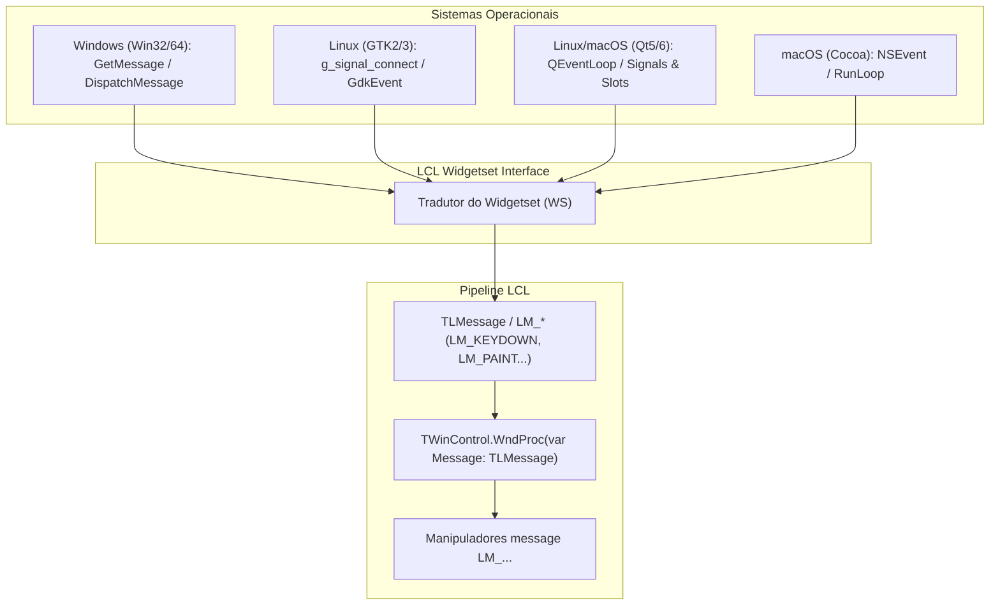

# MÓDULO 04: Tratamento de Mensagens do SO e Arquitetura de Eventos

A reatividade de uma aplicação gráfica repousa sobre o loop de mensagens (*Message Loop*). No **Free Pascal (FPC 3.2+)** e **Lazarus IDE (3.x+)**, a **LCL (Lazarus Component Library)** realiza uma proeza monumental de engenharia: ela unifica os pipelines de eventos heterogêneos de múltiplos sistemas operacionais (mensagens Win32/64 no Windows, sinais e callbacks do GTK2/GTK3 no Linux, slots do Qt5/Qt6 e eventos do Cocoa no macOS) sob uma interface consistente e determinística: a estrutura `TLMessage` e o protocolo de mensagens `LM_*`.

Neste módulo, aprenderemos como interceptar o fluxo nativo de mensagens através do encadeamento de `WindowProc` (subclassing), como projetar eventos modernos com delegates fortemente tipados e como despachar notificações assíncronas com segurança absoluta contra deadlocks através do mecanismo `Application.QueueAsyncCall`.

---

## 1. A Abstração de Mensagens da LCL

Diferente da VCL clássica, que espelha quase linearmente a API de mensagens do Windows (`WM_*`), a LCL precisa operar em plataformas que não possuem conceito nativo de mensagens Win32. 

Para resolver isso, a LCL introduziu a camada **LCLMessages** (`LMessages.pp`):



### 1.1 A Estrutura de Dados `TLMessage`
No Free Pascal, toda mensagem trafega na LCL empacotada na estrutura:

```pascal
type
  TLMessage = record
    Msg: Cardinal;
    case Integer of
      0: (
        WParam: PtrUInt;
        LParam: PtrInt;
        Result: PtrInt;
      );
  end;
```
- `Msg`: O identificador numérico da mensagem (constantes iniciadas por `LM_*`, como `LM_KEYDOWN`, `LM_LBUTTONDOWN`, `LM_USER`).
- `WParam` / `LParam`: Parâmetros de 32 ou 64 bits (dependendo da arquitetura da CPU) contendo ponteiros, identificadores de teclas ou coordenadas do cursor.
- `Result`: Valor de retorno processado pela janela ou repassado ao sistema operacional.

---

## 2. Técnicas de Interceptação: Subclassing via `WindowProc`

Quando desenvolvemos um componente que herda de `TWinControl`, podemos interceptar mensagens simplesmente sobrescrevendo o método virtual `WndProc`:

```pascal
procedure TMyControl.WndProc(var Message: TLMessage);
begin
  if Message.Msg = LM_KEYDOWN then
  begin
    // Trata a tecla internamente
  end;
  inherited WndProc(Message); // Encaminha para o processamento padrão
end;
```

Entretanto, imagine o seguinte desafio de engenharia: seu componente é **não-visual** (herda de `TComponent`), mas precisa monitorar e filtrar as teclas digitadas em um `TEdit` ou em um `TForm` existente no formulário. Como interceptar mensagens de um controle de terceiros sem herdar dele?

### A Resposta: Encadeamento de `WindowProc` (Subclassing Dinâmico)
Todo `TWinControl` possui a propriedade de método:
```pascal
property WindowProc: TWndMethod read FWindowProc write FWindowProc;
```
Onde `TWndMethod` é um ponteiro de método: `procedure(var Message: TLMessage) of object`.

O procedimento seguro para injetar um hook no controle é:
1. Salvar o ponteiro original de `TargetControl.WindowProc` em um campo privado (`FOriginalWndProc`).
2. Substituir `TargetControl.WindowProc` pelo método interceptador da nossa classe (`SubclassedWndProc`).
3. Ao finalizar, ou na destruição do nosso componente, restaurar imediatamente o ponteiro original.

```
[Fluxo de Mensagens do SO]
          |
          v
[TargetControl: TEdit]
          |
          v
[TLazAsyncEventHook.SubclassedWndProc]  <-- NOSSO HOOK INTERCEPTA AQUI
          |
          +---> Se Handled = True: Consome a mensagem (Message.Result := 0)
          |
          +---> Se Handled = False: Encaminha para FOriginalWndProc(Message)
                                              |
                                              v
                                   [Processamento Padrão da LCL]
```

---

## 3. Arquitetura de Eventos: De `TNotifyEvent` a Delegates com Múltiplos Parâmetros

No Object Pascal, um evento é uma propriedade do tipo *Method Pointer*. Na memória, um ponteiro de método ocupa exatamente **dois ponteiros nativos** (16 bytes em plataformas de 64 bits):
1. **Code Pointer:** O endereço da rotina de código executável.
2. **Data Pointer:** O ponteiro `Self` da instância de classe que tratará o evento.

### 3.1 Projetando Assinaturas de Eventos Ricas
Enquanto `TNotifyEvent = procedure(Sender: TObject) of object` transporta apenas a instância emissora, componentes avançados devem fornecer metadados detalhados:

```pascal
type
  TLazInterceptedMessage = record
    MsgCode: Cardinal;
    WParamVal: PtrUInt;
    LParamVal: PtrInt;
    Handled: Boolean;
    Timestamp: TDateTime;
  end;

  TOnInterceptMessageEvent = procedure(Sender: TObject;
    var AMessage: TLazInterceptedMessage) of object;
```

---

## 4. Comunicação Concorrente e Despacho com `Application.QueueAsyncCall`

Um dos maiores erros cometidos em sistemas multithread ou em interceptadores de eventos é disparar rotinas de interface ou manipulação de banco de dados diretamente de dentro do ciclo síncrono de mensagens. Isso gera:
- **UI Freezes:** A janela receptora congela enquanto a rotina do evento é processada.
- **Deadlocks e Reentrância:** Modificar o estado de um controle enquanto ele próprio está processando sua mensagem interna de repintura ou destruição.

A LCL resolve esse impasse com maestria através do método:
```pascal
Application.QueueAsyncCall(AMethod: TDataEvent; Data: PtrInt);
```

### Como Funciona o `QueueAsyncCall`?
1. O método empacota o ponteiro de dados (`Data`) e o ponteiro de método (`AMethod`) em um nó de fila thread-safe gerenciado pela `Application`.
2. O método de chamada retorna **instantaneamente**, liberando a thread atual ou a pilha de execução da mensagem.
3. No próximo ciclo de ociosidade (*idle loop*) da UI thread principal, a LCL desenfileira a chamada e executa o callback em contexto protegido e sincronizado.

---

## 5. Implementação Prática: O Componente `TLazAsyncEventHook`

Abaixo está o componente `TLazAsyncEventHook`. Ele encapsula:
- Subclassing seguro de qualquer `TWinControl` via `WindowProc`.
- Interceptação seletiva de mensagens de teclado e mouse com cancelamento (`Handled`).
- Despacho de notificações assíncronas através de tokens de sequência e transporte seguro de dados via `Application.QueueAsyncCall`.

### 5.1 Código Pascal Completo e Compilável

```pascal
{==============================================================================
  Livro: Engenharia e Arquitetura Avançada de Componentes para Lazarus IDE & LCL
  Módulo 04: Tratamento de Mensagens do SO e Arquitetura de Eventos
  Componente: TLazAsyncEventHook
  Autor: Engenharia de Software Especializada & Arquitetura RAD
  Ambiente: Free Pascal 3.2.2+ / Lazarus 3.x+
  Descrição: Componente que demonstra interceptação segura do ciclo de
             mensagens LCL (WndProc / TLMessage / LM_*), criação de delegates
             avançados com múltiplos parâmetros, despacho assíncrono seguro
             via Application.QueueAsyncCall e proteção contra deadlocks na UI.
==============================================================================}
unit LazAsyncEventHook;

{$mode objfpc}{$H+}

interface

uses
  Classes,
  SysUtils,
  Controls,
  Forms,
  LCLType,
  LCLMessages,
  LMessages;

const
  { Mensagem LCL customizada para despacho interno }
  LM_LAZ_ASYNC_DISPATCH = LM_USER + $0410;

type
  { Registro contendo dados detalhados da mensagem interceptada }
  TLazInterceptedMessage = record
    MsgCode: Cardinal;
    WParamVal: PtrUInt;
    LParamVal: PtrInt;
    Handled: Boolean;
    Timestamp: TDateTime;
  end;

  { Delegate tipado com múltiplos parâmetros para notificações ricas }
  TOnInterceptMessageEvent = procedure(Sender: TObject;
    var AMessage: TLazInterceptedMessage) of object;

  { Delegate assíncrono desacoplado da pilha de chamadas }
  TOnAsyncNotification = procedure(Sender: TObject; AToken: Int64;
    const APayload: string) of object;

  { Registro para transporte seguro no QueueAsyncCall }
  PAsyncPayloadRecord = ^TAsyncPayloadRecord;
  TAsyncPayloadRecord = record
    Token: Int64;
    Payload: string;
  end;

  {============================================================================
    Classe: TLazAsyncEventHook
    Componente não-visual que intercepta a fila de mensagens de um TWinControl
    e provê agendamento seguro de eventos assíncronos na fila da aplicação.
  ============================================================================}
  TLazAsyncEventHook = class(TComponent)
  private
    FTargetControl: TWinControl;
    FOriginalWndProc: TWndMethod;
    FEnabled: Boolean;
    FTokenSequence: Int64;
    FInterceptKeyMessages: Boolean;
    FInterceptMouseMessages: Boolean;
    FOnInterceptMessage: TOnInterceptMessageEvent;
    FOnAsyncNotification: TOnAsyncNotification;

    procedure SetTargetControl(const AValue: TWinControl);
    procedure SetEnabled(const AValue: Boolean);
    procedure HookControl;
    procedure UnhookControl;

    { Interceptador de mensagens do controle alvo }
    procedure SubclassedWndProc(var Message: TLMessage);

    { Callback executado pelo Application.QueueAsyncCall na UI thread }
    procedure ProcessAsyncCall(Data: PtrInt);
  protected
    procedure Notification(AComponent: TComponent; Operation: TOperation); override;
    procedure Loaded; override;
  public
    constructor Create(AOwner: TComponent); override;
    destructor Destroy; override;

    { Disparo de evento assíncrono na fila principal sem travar a thread }
    procedure PostAsyncEvent(const APayload: string);
  published
    property TargetControl: TWinControl read FTargetControl write SetTargetControl;
    property Enabled: Boolean read FEnabled write SetEnabled default True;
    property InterceptKeyMessages: Boolean read FInterceptKeyMessages write FInterceptKeyMessages default True;
    property InterceptMouseMessages: Boolean read FInterceptMouseMessages write FInterceptMouseMessages default False;

    property OnInterceptMessage: TOnInterceptMessageEvent read FOnInterceptMessage write FOnInterceptMessage;
    property OnAsyncNotification: TOnAsyncNotification read FOnAsyncNotification write FOnAsyncNotification;
  end;

procedure Register;

implementation

procedure Register;
begin
  RegisterComponents('Engenharia Lazarus', [TLazAsyncEventHook]);
end;

{ TLazAsyncEventHook }

constructor TLazAsyncEventHook.Create(AOwner: TComponent);
begin
  inherited Create(AOwner);
  FTargetControl := nil;
  FOriginalWndProc := nil;
  FEnabled := True;
  FTokenSequence := 0;
  FInterceptKeyMessages := True;
  FInterceptMouseMessages := False;
end;

destructor TLazAsyncEventHook.Destroy;
begin
  UnhookControl;
  inherited Destroy;
end;

procedure TLazAsyncEventHook.Loaded;
begin
  inherited Loaded;
  if FEnabled and Assigned(FTargetControl) then
    HookControl;
end;

procedure TLazAsyncEventHook.SetTargetControl(const AValue: TWinControl);
begin
  if FTargetControl <> AValue then
  begin
    UnhookControl;

    if Assigned(FTargetControl) then
      FTargetControl.RemoveFreeNotification(Self);

    FTargetControl := AValue;

    if Assigned(FTargetControl) then
    begin
      FTargetControl.FreeNotification(Self);
      if FEnabled and not (csLoading in ComponentState) then
        HookControl;
    end;
  end;
end;

procedure TLazAsyncEventHook.SetEnabled(const AValue: Boolean);
begin
  if FEnabled <> AValue then
  begin
    FEnabled := AValue;
    if not (csLoading in ComponentState) and not (csDesigning in ComponentState) then
    begin
      if FEnabled then
        HookControl
      else
        UnhookControl;
    end;
  end;
end;

procedure TLazAsyncEventHook.HookControl;
begin
  if csDesigning in ComponentState then
    Exit;

  if Assigned(FTargetControl) and (FOriginalWndProc = nil) then
  begin
    FOriginalWndProc := FTargetControl.WindowProc;
    FTargetControl.WindowProc := @SubclassedWndProc;
  end;
end;

procedure TLazAsyncEventHook.UnhookControl;
begin
  if Assigned(FTargetControl) and Assigned(FOriginalWndProc) then
  begin
    FTargetControl.WindowProc := FOriginalWndProc;
    FOriginalWndProc := nil;
  end;
end;

procedure TLazAsyncEventHook.Notification(AComponent: TComponent; Operation: TOperation);
begin
  inherited Notification(AComponent, Operation);
  if (Operation = opRemove) and (AComponent = FTargetControl) then
  begin
    FOriginalWndProc := nil;
    FTargetControl := nil;
  end;
end;

procedure TLazAsyncEventHook.SubclassedWndProc(var Message: TLMessage);
var
  Intercepted: TLazInterceptedMessage;
  IsTargetMsg: Boolean;
begin
  IsTargetMsg := False;

  if FInterceptKeyMessages and (Message.Msg in [LM_KEYDOWN, LM_KEYUP, LM_CHAR]) then
    IsTargetMsg := True;

  if FInterceptMouseMessages and (Message.Msg in [LM_LBUTTONDOWN, LM_RBUTTONDOWN, LM_MOUSEMOVE]) then
    IsTargetMsg := True;

  if IsTargetMsg and Assigned(FOnInterceptMessage) then
  begin
    Intercepted.MsgCode := Message.Msg;
    Intercepted.WParamVal := Message.WParam;
    Intercepted.LParamVal := Message.LParam;
    Intercepted.Handled := False;
    Intercepted.Timestamp := Now;

    try
      FOnInterceptMessage(Self, Intercepted);
    except
      { Impede que falhas no handler do usuário quebrem o pipeline da janela }
    end;

    if Intercepted.Handled then
    begin
      Message.Result := 0;
      Exit;
    end;
  end;

  { Encaminha para a WindowProc original do controle }
  if Assigned(FOriginalWndProc) then
    FOriginalWndProc(Message);
end;

procedure TLazAsyncEventHook.PostAsyncEvent(const APayload: string);
var
  DataPtr: PAsyncPayloadRecord;
begin
  if not Assigned(FOnAsyncNotification) then
    Exit;

  Inc(FTokenSequence);
  New(DataPtr);
  DataPtr^.Token := FTokenSequence;
  DataPtr^.Payload := APayload;

  { Enfileira de forma assíncrona e thread-safe na fila do Lazarus }
  Application.QueueAsyncCall(@ProcessAsyncCall, PtrInt(DataPtr));
end;

procedure TLazAsyncEventHook.ProcessAsyncCall(Data: PtrInt);
var
  DataPtr: PAsyncPayloadRecord;
begin
  DataPtr := PAsyncPayloadRecord(Data);
  if DataPtr = nil then
    Exit;

  try
    if Assigned(FOnAsyncNotification) and not (csDestroying in ComponentState) then
    begin
      FOnAsyncNotification(Self, DataPtr^.Token, DataPtr^.Payload);
    end;
  finally
    Dispose(DataPtr);
  end;
end;

end.
```

---

## 6. Checklist de Engenharia do Módulo 04

- [x] Mensagens na LCL são representadas por `TLMessage` e constantes `LM_*`, permitindo código portável entre Windows, Linux e macOS.
- [x] O encadeamento de `WindowProc` permite interceptar o comportamento de controles existentes sem necessidade de herança direta.
- [x] Sempre salve o ponteiro original de `WindowProc` e restaure-o na destruição ou desativação do hook.
- [x] Nunca ative hooks em tempo de design (`csDesigning in ComponentState`) para não travar a superfície do Form Designer.
- [x] Para notificações desacopladas ou integração thread-safe sem deadlocks na UI, utilize `Application.QueueAsyncCall`.
- [x] Sempre libere ponteiros alocados dinamicamente no callback assíncrono com blocos `try..finally`.
