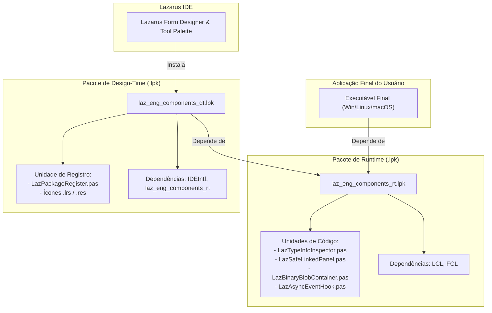

# MÓDULO 05: Empacotamento Profissional (Packages .lpk)

No ecossistema **Free Pascal (FPC 3.2+)** e **Lazarus IDE (3.x+)**, uma biblioteca de componentes só se torna um produto distribuível e de nível comercial quando estruturada sob a forma de **Pacotes Lazarus (`.lpk`)**.

Contudo, muitos desenvolvedores cometem o erro elementar de criar um único pacote híbrido que mistura código de lógica de negócios, controles de runtime e código exclusivo de design-time (editores da `IDEIntf`). O resultado? Aplicações finais que não compilam em servidores headless (Linux sem X11), binários inflados com código inútil da IDE e falhas de dependência em pipelines de integração contínua (CI/CD).

Neste módulo, aprenderemos a desenhar a arquitetura canônica desacoplada de pacotes, dominar as regras de separação entre **Run-Time Only** e **Design-Time Only**, integrar ícones de alta resolução na Tool Palette e automatizar compilações via linha de comando com a ferramenta `lazbuild`.

---

## 1. A Regra Mandatória: Separação Run-Time vs. Design-Time

A arquitetura profissional de pacotes no Lazarus exige a criação de **dois arquivos de pacote (`.lpk`) distintos**:



### 1.1 Por Que Essa Separação É Inegociável?
1. **Compilação de Servidores e Microserviços (Headless):** Se sua aplicação cliente for um serviço de terminal ou backend Linux que consome componentes não-visuais, ela precisa compilar sem nenhuma dependência gráfica da `IDEIntf` ou de pacotes da IDE.
2. **Ciclo de Recompilação do Lazarus:** O Lazarus IDE é compilado em si mesmo. Quando você instala um pacote de design-time, a IDE recompila seu próprio executável (`lazarus.exe`). Se o pacote contiver erros de código de negócio, você quebrará a própria IDE. Mantendo o pacote de design-time enxuto (contendo apenas o procedimento `Register`), o risco de instabilidade na IDE cai para zero.
3. **Distribuição Limpa:** Usuários de suas bibliotecas podem escolher compilar pacotes estáticos ou dinâmicos sem conflitos de símbolos duplicados.

---

## 2. Anatomia dos Arquivos `.lpk`

O arquivo de pacote do Lazarus é estruturado em formato XML puro. Vamos examinar os dois pacotes criados para nossa biblioteca:

### 2.1 Pacote de Runtime: `laz_eng_components_rt.lpk`
Observe a configuração `<Type Value="RunTimeOnly"/>`:

```xml
<?xml version="1.0" encoding="UTF-8"?>
<CONFIG>
  <Package Version="5">
    <Name Value="laz_eng_components_rt"/>
    <Type Value="RunTimeOnly"/>
    <Author Value="Engenharia de Software Especializada &amp; Arquitetura RAD"/>
    <CompilerOptions>
      <Version Value="11"/>
      <SearchPaths>
        <OtherUnitFiles Value="..\units"/>
        <UnitOutputDirectory Value="..\lib\$(TargetCPU)-$(TargetOS)"/>
      </SearchPaths>
      <Parsing>
        <SyntaxOptions>
          <SyntaxMode Value="ObjFPC"/>
        </SyntaxOptions>
      </Parsing>
      <CodeGeneration>
        <SmartLinkUnit Value="True"/>
        <Optimizations>
          <OptimizationLevel Value="3"/>
        </Optimizations>
      </CodeGeneration>
    </CompilerOptions>
    <Files Count="4">
      <Item1>
        <Filename Value="..\units\LazTypeInfoInspector.pas"/>
        <UnitName Value="LazTypeInfoInspector"/>
      </Item1>
      <Item2>
        <Filename Value="..\units\LazSafeLinkedPanel.pas"/>
        <UnitName Value="LazSafeLinkedPanel"/>
      </Item2>
      <Item3>
        <Filename Value="..\units\LazBinaryBlobContainer.pas"/>
        <UnitName Value="LazBinaryBlobContainer"/>
      </Item3>
      <Item4>
        <Filename Value="..\units\LazAsyncEventHook.pas"/>
        <UnitName Value="LazAsyncEventHook"/>
      </Item4>
    </Files>
    <RequiredPkgs Count="2">
      <Item1>
        <PackageName Value="LCL"/>
      </Item1>
      <Item2>
        <PackageName Value="FCL"/>
      </Item2>
    </RequiredPkgs>
  </Package>
</CONFIG>
```

> **NOTA DE ENGENHARIA: MACROS DE PLATAFORMA**
> Observe a linha `<UnitOutputDirectory Value="..\lib\$(TargetCPU)-$(TargetOS)"/>`. O uso das macros `$(TargetCPU)` (ex: `x86_64`, `aarch64`, `i386`) e `$(TargetOS)` (ex: `win64`, `linux`, `darwin`) garante que a compilação cruzada ou para múltiplas plataformas nunca sobrescreva arquivos compilados (`.ppu` e `.o`), permitindo desenvolvimento multiplataforma limpo.

---

### 2.2 Pacote de Design-Time: `laz_eng_components_dt.lpk`
Observe a configuração `<Type Value="DesignTime"/>` e a presença da flag `<HasRegisterProc Value="True"/>`:

```xml
<?xml version="1.0" encoding="UTF-8"?>
<CONFIG>
  <Package Version="5">
    <Name Value="laz_eng_components_dt"/>
    <Type Value="DesignTime"/>
    <CompilerOptions>
      <Version Value="11"/>
      <SearchPaths>
        <OtherUnitFiles Value="..\units"/>
        <UnitOutputDirectory Value="..\lib\$(TargetCPU)-$(TargetOS)"/>
      </SearchPaths>
      <Parsing>
        <SyntaxOptions>
          <SyntaxMode Value="ObjFPC"/>
        </SyntaxOptions>
      </Parsing>
    </CompilerOptions>
    <Files Count="1">
      <Item1>
        <Filename Value="..\units\LazPackageRegister.pas"/>
        <HasRegisterProc Value="True"/>
        <UnitName Value="LazPackageRegister"/>
      </Item1>
    </Files>
    <RequiredPkgs Count="2">
      <Item1>
        <PackageName Value="laz_eng_components_rt"/>
      </Item1>
      <Item2>
        <PackageName Value="IDEIntf"/>
      </Item2>
    </RequiredPkgs>
  </Package>
</CONFIG>
```

---

## 3. O Procedimento `Register` e a Injeção na Tool Palette

No Lazarus, a unidade de registro deve conter um procedimento público sem parâmetros chamado exatamente `Register`. É nele que agrupamos nossos componentes sob uma aba semântica na Tool Palette:

```pascal
unit LazPackageRegister;

{$mode objfpc}{$H+}

interface

uses
  Classes,
  SysUtils,
  LResources,
  LazTypeInfoInspector,
  LazSafeLinkedPanel,
  LazBinaryBlobContainer,
  LazAsyncEventHook;

procedure Register;

implementation

procedure Register;
begin
  RegisterComponents('Engenharia Lazarus', [
    TLazTypeInfoInspector,
    TLazSafeLinkedPanel,
    TLazBinaryBlobContainer,
    TLazAsyncEventHook
  ]);
end;

initialization
  {$I laz_components_icons.lrs}

end.
```

---

## 4. Ícones de Paleta: Criação e Compilação

Para que seus componentes exibam ícones nítidos e profissionais na Tool Palette do Lazarus:
1. Crie imagens em formato **PNG** na dimensão padrão de **24x24 pixels**.
2. O nome do arquivo deve ser rigorosamente o **nome da classe em maiúsculas**, por exemplo:
   - `TLAZTYPEINFOINSPECTOR.png`
   - `TLAZSAFELINKEDPANEL.png`
   - `TLAZBINARYBLOBCONTAINER.png`
   - `TLAZASYNCEVENTHOOK.png`
3. Converta as imagens PNG em um arquivo de recurso Lazarus (`.lrs`) utilizando o utilitário `lazres` incluído no Lazarus:
   ```bash
   lazres laz_components_icons.lrs TLAZTYPEINFOINSPECTOR.png TLAZSAFELINKEDPANEL.png TLAZBINARYBLOBCONTAINER.png TLAZASYNCEVENTHOOK.png
   ```
4. Inclua o arquivo resultante na seção `initialization` da unidade de registro através da diretiva `{$I laz_components_icons.lrs}`.

---

## 5. Compilação Automatizada via Linha de Comando com `lazbuild`

Em ambientes de produção profissional, nunca dependa exclusivamente de compilar pacotes clicando em botões da IDE. A compilação deve ser reproduzível através do **`lazbuild`**:

```bash
# 1. Compila o pacote de runtime (não instala na IDE)
lazbuild -B --pcp=~/.lazarus laz_eng_components_rt.lpk

# 2. Compila o pacote de design-time
lazbuild -B --pcp=~/.lazarus laz_eng_components_dt.lpk
```

Parâmetros-chave do `lazbuild`:
- `-B` / `--build-all`: Força a recompilação de todas as unidades, garantindo que arquivos `.ppu` obsoletos sejam eliminados.
- `--pcp`: Define o diretório de perfil de configuração do Lazarus, ideal para isolar pipelines de integração contínua (CI/CD) no GitHub Actions ou GitLab CI.

---

## 6. Checklist de Engenharia do Módulo 05

- [x] Nunca misture código de runtime com editores da `IDEIntf` no mesmo pacote.
- [x] O pacote de runtime deve ser estritamente configurado como `RunTimeOnly`.
- [x] O pacote de design-time deve conter `DesignTime`, depender do pacote de runtime e conter a unidade de registro marcada com `HasRegisterProc`.
- [x] Utilize variáveis de macro `$(TargetCPU)-$(TargetOS)` no diretório de saída para permitir compilações limpas para múltiplos alvos.
- [x] Padronize os ícones de paleta em PNG de 24x24 pixels nomeados com a classe em caixa alta e compilados com `lazres`.
- [x] Valide a integridade dos seus pacotes em scripts de automação através do comando `lazbuild`.
