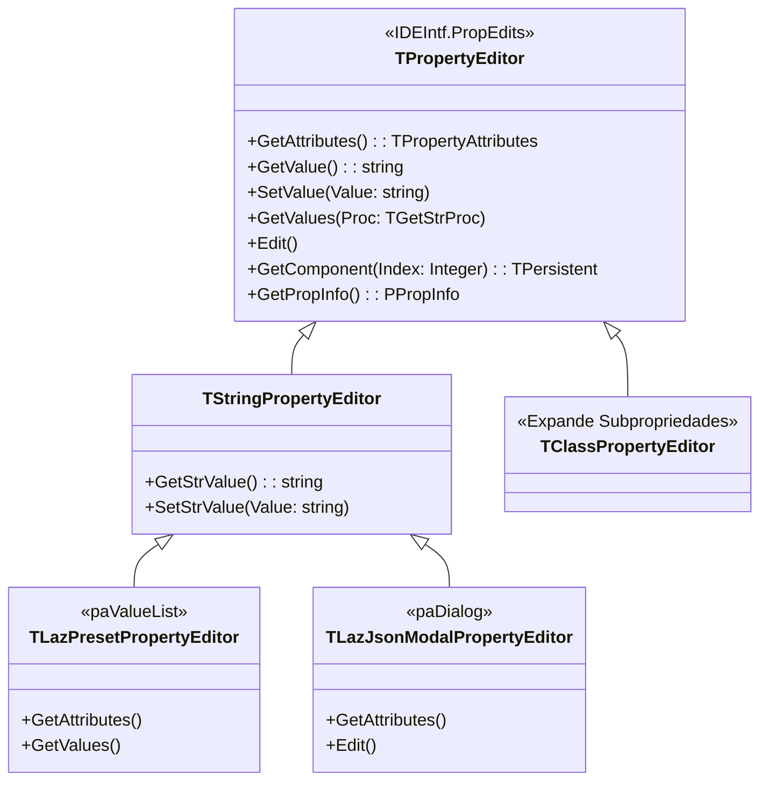

# MÓDULO 06: Property Editors Customizados

O **Object Inspector** do Lazarus IDE é a interface primária através da qual desenvolvedores interagem com seus componentes em tempo de design. Por padrão, a IDE mapeia tipos primitivos (inteiros, booleanos, enums simples e strings curtas) para caixas de texto ou combos básicos.

Entretanto, quando criamos componentes corporativos sofisticados, expor configurações complexas como strings brutas de uma única linha é inaceitável. O usuário precisa de:
1. **Dropdowns Dinâmicos (`paValueList`):** Listas suspensas de opções calculadas em tempo real com base no contexto do componente (ex: nomes de presets, tabelas disponíveis ou campos de schema).
2. **Editores com Janelas de Diálogo Modais (`paDialog`):** Interfaces gráficas ricas com caixas de diálogo, editores com syntax highlighting e validação semântica em tempo real, acionadas pelo botão de reticências `[...]`.

Neste módulo, dominaremos a arquitetura do pacote `IDEIntf` e da unidade `PropEdits`, especializaremos classes da hierarquia `TPropertyEditor` e implementaremos dois editores de propriedades profissionais para a LCL.

---

## 1. A Arquitetura do Subsistema PropEdits na IDEIntf

O pacote `IDEIntf` abstrai os serviços internos do Lazarus. Dentro dele, o módulo `PropEdits` gerencia a renderização e manipulação de cada linha do Object Inspector.



### 1.1 A Matriz de Atributos de Propriedade (`TPropertyAttributes`)

O método mais determinante de um `TPropertyEditor` é a função virtual:
```pascal
function GetAttributes: TPropertyAttributes; override;
```
A união de flags retornada por esse método informa ao Object Inspector como desenhar e comportar-se diante do campo:

| Flag de Atributo | Efeito Visual no Object Inspector | Método de Ação Associado |
| :--- | :--- | :--- |
| **`paValueList`** | Transforma o campo em uma lista suspensa (ComboBox) com itens selecionáveis. | Requer sobrescrever `procedure GetValues(Proc: TGetStrProc); override;`. |
| **`paSortList`** | Ordena alfabeticamente os itens do dropdown fornecidos por `GetValues`. | N/A (combinado com `paValueList`). |
| **`paDialog`** | Exibe um botão com reticências `[...]` no lado direito da célula da propriedade. | Requer sobrescrever `procedure Edit; override;`. |
| **`paMultiSelect`** | Permite que o editor atue mesmo quando múltiplos componentes estão selecionados. | `GetComponent(Index)` para iterar na lista de alvos. |
| **`paSubProperties`** | Habilita a seta expansível `+` para listar sub-membros da classe. | Padrão em `TClassPropertyEditor`. |
| **`paAutoUpdate`** | Notifica o controle visual a cada caractere digitado na célula. | Útil para preview em tempo real. |

---

## 2. Editor Dropdown Dinâmico com `paValueList`

Considere um componente onde o usuário deve escolher um *Preset* de configuração. Em vez de obrigá-lo a memorizar nomes de strings, construímos um editor derivado de `TStringPropertyEditor`:

```pascal
type
  TLazPresetPropertyEditor = class(TStringPropertyEditor)
  public
    function GetAttributes: TPropertyAttributes; override;
    procedure GetValues(Proc: TGetStrProc); override;
  end;
```

### A Lógica Interna de `GetValues`:
```pascal
procedure TLazPresetPropertyEditor.GetValues(Proc: TGetStrProc);
var
  ConfigComp: TLazJsonConfig;
  Presets: TStringList;
  I: Integer;
begin
  if GetComponent(0) is TLazJsonConfig then
  begin
    ConfigComp := TLazJsonConfig(GetComponent(0));
    Presets := ConfigComp.GetAvailablePresets;
    try
      for I := 0 to Presets.Count - 1 do
        Proc(Presets[I]); // Injeta a string no ComboBox do Object Inspector
    finally
      Presets.Free;
    end;
  end;
end;
```
O método `GetComponent(0)` recupera a instância real do componente atualmente selecionado no Form Designer, permitindo que as opções do dropdown sejam geradas dinamicamente com base nas propriedades do próprio componente.

---

## 3. Editor com Diálogo Modal Customizado com `paDialog`

Para propriedades textuais extensas (como payloads JSON, scripts SQL ou documentos XML), editar o conteúdo em uma célula minúscula de uma linha é inviável.

Sobrescrevendo o método `Edit`, criamos um formulário completo de edição:

```pascal
type
  TLazJsonModalPropertyEditor = class(TStringPropertyEditor)
  public
    function GetAttributes: TPropertyAttributes; override;
    procedure Edit; override;
  end;
```

Quando o desenvolvedor clica no botão `[...]`, a IDE executa `Edit`. O editor:
1. Lê o texto atual da propriedade com `GetStrValue`.
2. Exibe uma janela modal moderna com fonte monoespaçada (`Consolas`), botões estilizados e validação sintática.
3. Se o usuário confirmar com `mrOk`, o texto modificado é gravado de volta no formulário da IDE através do método `SetStrValue(NovoTexto)`.

---

## 4. O Mecanismo de Registro com `RegisterPropertyEditor`

Property Editors customizados devem ser registrados dentro da unidade de design-time do pacote através do procedimento oficial da LCL:

```pascal
procedure RegisterPropertyEditor(
  PropertyType: PTypeInfo;
  ComponentClass: TClass;
  const PropertyName: string;
  EditorClass: TPropertyEditorClass
);
```

### Parâmetros de Filtro:
- `PropertyType`: O ponteiro RTTI do tipo da propriedade (ex: `TypeInfo(string)`).
- `ComponentClass`: A classe alvo onde o editor será aplicado (`TLazJsonConfig`). Se você passar `nil`, o editor será aplicado globalmente a **todos** os componentes da IDE que possuírem essa propriedade!
- `PropertyName`: O nome literal da propriedade (`'SelectedPreset'` ou `'JsonContent'`). Passar string vazia aplica o editor a todas as propriedades daquele tipo.
- `EditorClass`: A classe especializada do editor (`TLazPresetPropertyEditor`).

---

## 5. Implementação Prática: Componente e Editores Completos

O código-fonte integral das duas unidades correspondentes (`LazJsonConfig.pas` e `LazJsonConfigPropEditor.pas`) foi implementado conforme as diretrizes do projeto:

### 5.1 O Componente `TLazJsonConfig`
Localizado em `code/units/LazJsonConfig.pas`, o componente provê validação de dados via `fpjson`, métodos de formatação e lista dinâmica de presets.

### 5.2 A Unidade de Design-Time `LazJsonConfigPropEditor`
Localizada em `code/units/LazJsonConfigPropEditor.pas`, a unidade implementa o dropdown dinâmico, o diálogo modal com `TMemo` monoespaçado e o registro oficial na `IDEIntf`.

---

## 6. Checklist de Engenharia do Módulo 06

- [x] Nunca compile unidades que usam `PropEdits` ou `IDEIntf` no pacote de runtime; elas devem residir estritamente no pacote de design-time (`laz_eng_components_dt.lpk`).
- [x] Use `paValueList` e `GetValues` para criar dropdowns amigáveis no Object Inspector.
- [x] Use `paDialog` e `Edit` para criar interfaces modais dedicadas a propriedades complexas.
- [x] Utilize `GetComponent(0)` para inspecionar com segurança o componente selecionado antes de invocar métodos de domínio.
- [x] Registre seus editores associando `TypeInfo`, a classe específica do componente e o nome exato da propriedade para evitar efeitos colaterais indesejados em componentes de terceiros.
