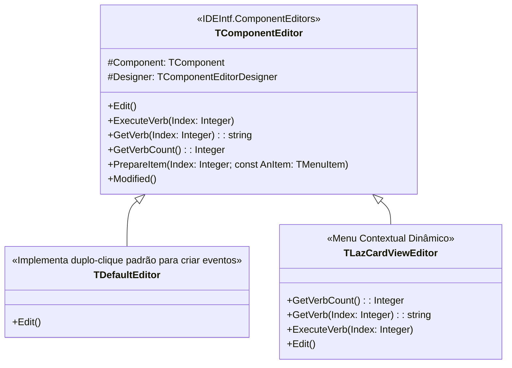

# MÓDULO 07: Component Editors e Ações de Design-Time (Verbos)

Enquanto os *Property Editors* (Módulo 06) refinam a edição de propriedades isoladas no Object Inspector, os **Component Editors** oferecem o mais alto nível de interatividade na superfície do Form Designer do **Lazarus IDE**.

Através de um Component Editor especializado, o desenvolvedor é capaz de:
1. **Injetar Verbos no Menu de Contexto:** Adicionar comandos personalizados no menu do botão direito sobre o componente no designer (ex: "Adicionar Novo Card", "Limpar Coleção", "Configurar Conexão").
2. **Definir Ações para o Duplo-Clique (`Edit`):** Controlar o que acontece quando o usuário clica duas vezes sobre o componente no formulário (geralmente abrindo um assistente visual ou inserindo um elemento padrão).
3. **Persistência Forçada (`Modified`):** Notificar o motor da IDE de que o estado do componente foi alterado programaticamente para garantir sua gravação no arquivo `.lfm`.

Neste módulo, dissecaremos a classe `TComponentEditor` do pacote `IDEIntf` e construiremos um editor de componentes moderno com menu contextual dinâmico para a LCL.

---

## 1. Arquitetura do Subsistema ComponentEditors

Na LCL, a unidade `ComponentEditors` define o ciclo de extensão de ações no Form Designer:



### 1.1 `TDefaultEditor` vs. `TComponentEditor`
- **`TDefaultEditor`:** É o editor herdado por padrão pela maioria dos componentes. Seu método `Edit` busca o primeiro evento da seção `published` (geralmente `OnClick` ou `OnChange`), gera o método no código-fonte do formulário e posiciona o cursor do editor de código dentro dele.
- **`TComponentEditor`:** Quando herdamos diretamente de `TComponentEditor`, assumimos controle integral. O duplo-clique não precisa mais criar eventos: ele pode abrir um assistente, alternar o estado do componente ou invocar o verbo principal de configuração.

---

## 2. A Mecânica de Verbos de Menu de Contexto

Um "verbo" (*Verb*) nada mais é do que uma entrada textual que a IDE insere no menu pop-up do Form Designer quando o usuário clica com o botão direito sobre o componente.

A implementação exige a trinca de métodos:

### 2.1 `GetVerbCount: Integer; override;`
Retorna a quantidade total de linhas de menu que serão injetadas:
```pascal
function TLazCardViewEditor.GetVerbCount: Integer;
begin
  Result := 5; // 4 ações + 1 separador
end;
```

### 2.2 `GetVerb(Index: Integer): string; override;`
Retorna o texto visível de cada entrada. Retornar um traço simples `'-'` cria automaticamente uma linha horizontal divisória:
```pascal
function TLazCardViewEditor.GetVerb(Index: Integer): string;
begin
  case Index of
    0: Result := 'Adicionar Novo Card...';
    1: Result := 'Limpar Todos os Cards';
    2: Result := 'Alternar Tema Claro / Escuro';
    3: Result := '-'; // Linha divisória separadora
    4: Result := 'Sobre o TLazCardView...';
  else
    Result := '';
  end;
end;
```

### 2.3 `ExecuteVerb(Index: Integer); override;`
Executa a lógica associada ao item clicado pelo usuário:
```pascal
procedure TLazCardViewEditor.ExecuteVerb(Index: Integer);
var
  CardView: TLazCardView;
begin
  CardView := TLazCardView(GetComponent);
  case Index of
    0:
      begin
        CardView.AddDefaultCard;
        Modified; // Notifica a IDE que o estado do componente mudou!
      end;
    // ...
  end;
end;
```

---

## 3. O Fluxo de Execução no Form Designer

```
[Desenvolvedor clica com Botão Direito no TLazCardView]
                        |
                        v
         [Lazarus Form Designer (IDEIntf)]
                        |
       +----------------+----------------+
       |                                 |
       v                                 v
[Verbos Padrão da IDE]        [TLazCardViewEditor]
- Cortar                      - GetVerbCount (5)
- Copiar                      - GetVerb(0..4)
- Deletar                                |
                                         v
                      [Injeta no topo do Menu Pop-up]
                      1. Adicionar Novo Card...
                      2. Limpar Todos os Cards
                      3. Alternar Tema Claro / Escuro
                      -------------------------------
                      4. Sobre o TLazCardView...
```

---

## 4. O Registro com `RegisterComponentEditor`

Para associar o editor à classe do componente:

```pascal
procedure Register;
begin
  RegisterComponentEditor(TLazCardView, TLazCardViewEditor);
end;
```

Essa linha deve residir exclusivamente no pacote de design-time (`laz_eng_components_dt.lpk`).

---

## 5. Implementação Prática: Componente e Editor Completos

O código integral das duas unidades está organizado em:
- **`code/units/LazCardView.pas`:** Componente visual de cartões em mosaico gerenciado via `TOwnedCollection` e itens `TCollectionItem`, com desenho vetorial de badges e controle de tema escuro/claro.
- **`code/units/LazCardViewEditor.pas`:** Editor de componente contendo os 5 verbos de menu de contexto, ação de duplo-clique e notificação `Modified`.

---

## 6. Checklist de Engenharia do Módulo 07

- [x] Utilize `TComponentEditor` para injetar ações de produtividade diretamente na superfície do designer.
- [x] Utilize `'-'` em `GetVerb` para agrupar comandos logicamente com separadores visuais.
- [x] Sobrescreva `Edit` para oferecer uma ação instantânea e intuitiva ao dar duplo-clique sobre o controle no designer.
- [x] Sempre invoque `Modified` após alterar qualquer propriedade ou coleção em `ExecuteVerb`.
- [x] Registre o editor através de `RegisterComponentEditor` estritamente no pacote de design-time.
