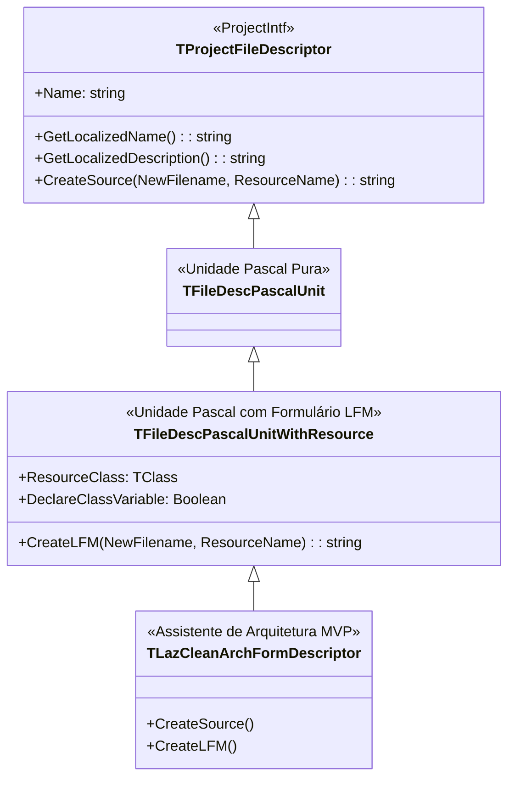

# MÓDULO 08: Assistentes de Projeto e Extensão da IDE (IDEIntf)

Nos módulos anteriores, exploramos como criar componentes, empacotá-los e customizar sua edição no Object Inspector e no Form Designer. Contudo, o ápice da engenharia RAD é a extensão da própria IDE através de **Wizards (Assistentes de Projeto e Formulário)**.

Em equipes corporativas e fábricas de software, garantir que dezenas de desenvolvedores sigam padrões arquiteturais estritos (como Clean Architecture, MVP ou DDD) é um desafio crítico. Em vez de depender de manuais ou templates manuais que se tornam obsoletos, o arquiteto de software constrói assistentes integrados à **`IDEIntf`** do **Lazarus IDE**.

Com um único clique no menu `File -> New...`, o assistente injeta esqueletos de código completos, contratos de interfaces e formulários pré-configurados.

Neste módulo, aprenderemos a arquitetura de descritores de projeto da `IDEIntf`, implementaremos o assistente `TLazCleanArchFormWizard` e dominaremos a geração algorítmica de arquivos `.pas` e `.lfm`.

---

## 1. A Arquitetura da IDEIntf para Assistentes

No Lazarus, a extensão de projetos e arquivos é gerenciada pela unidade `ProjectIntf`:



### 1.1 O Papel de `TFileDescPascalUnitWithResource`
Quando herdamos de `TFileDescPascalUnitWithResource`, a IDE do Lazarus reconhece automaticamente que:
1. O assistente criará um par indivisível de arquivos: o arquivo de código Pascal (`.pas`) e o arquivo de recursos do formulário (`.lfm`).
2. O assistente solicitará à IDE que aloque um nome de recurso único (ex: `Form1`, `Form2`) e o sincronize com a classe do formulário.
3. O item será exibido no diálogo oficial de novos itens acessível via menu `File -> New...`.

---

## 2. A Geração Algorítmica de Código Fonte

O método fundamental que o assistente precisa implementar é:

```pascal
function CreateSource(const NewFilename, ResourceName: string): string; override;
```

A IDE fornece dois parâmetros vitais:
- `NewFilename`: O caminho de arquivo planejado ou temporário fornecido pelo usuário.
- `ResourceName`: O nome da classe visual que deve coincidir com o formulário no LFM.

Através de um `TStringBuilder`, geramos uma estrutura completa de **Model-View-Presenter (MVP)**:
1. A interface de contrato `ICustomerView` (View desacoplada).
2. A classe de lógica de apresentação `TCustomerPresenter` (Presenter puro, sem dependências visuais).
3. O formulário `TForm` implementando o contrato `ICustomerView`.

---

## 3. A Geração do Fluxo LFM Correspondente

Para que o Form Designer do Lazarus abra a tela imediatamente após o clique, o método `CreateLFM` sintetiza o arquivo de formulário inicial:

```pascal
function TLazCleanArchFormDescriptor.CreateLFM(const NewFilename, ResourceName: string): string;
var
  SB: TStringBuilder;
begin
  SB := TStringBuilder.Create;
  try
    SB.AppendLine(Format('object %s: T%s', [ResourceName, ResourceName]));
    SB.AppendLine('  Left = 320');
    SB.AppendLine('  Top = 180');
    SB.AppendLine('  Width = 500');
    SB.AppendLine('  Height = 350');
    SB.AppendLine(Format('  Caption = ''Formulário MVP - %s''', [ResourceName]));
    SB.AppendLine('  Color = clBtnFace');
    SB.AppendLine('  Font.Name = ''Segoe UI''');
    SB.AppendLine('  Position = poScreenCenter');
    SB.AppendLine('end');
    Result := SB.ToString;
  finally
    SB.Free;
  end;
end;
```

---

## 4. O Registro no Subsistema da IDE

Na unidade de design-time, o descritor é registrado globalmente:

```pascal
procedure Register;
begin
  RegisterProjectFileDescriptor(TLazCleanArchFormDescriptor.Create, 'Engenharia Lazarus');
end;
```

Ao abrir o Lazarus e clicar em `File -> New...`, uma nova categoria chamada **"Engenharia Lazarus"** aparecerá na árvore, contendo o item **"Formulário MVP (Clean Architecture)"**.

---

## 5. Implementação Prática: O Assistente Completo

A unidade completa está localizada em:
- **`code/units/LazCleanArchFormWizard.pas`:** Contém o descritor completo, geração de código Pascal estruturado, geração de LFM inicial e procedimento de registro na `IDEIntf`.

---

## 6. Checklist de Engenharia do Módulo 08

- [x] Herde de `TFileDescPascalUnitWithResource` para assistentes que criam formulários e units vinculadas.
- [x] Use `TStringBuilder` para composição limpa de código-fonte dinâmico.
- [x] Certifique-se de que o nome da unit gerada em `CreateSource` coincida rigorosamente com o nome de arquivo sugerido pela IDE.
- [x] Sincronize as propriedades do `CreateLFM` com as diretivas de criação do construtor no código Pascal.
- [x] Registre o descritor através de `RegisterProjectFileDescriptor` exclusivamente dentro do pacote de design-time.
