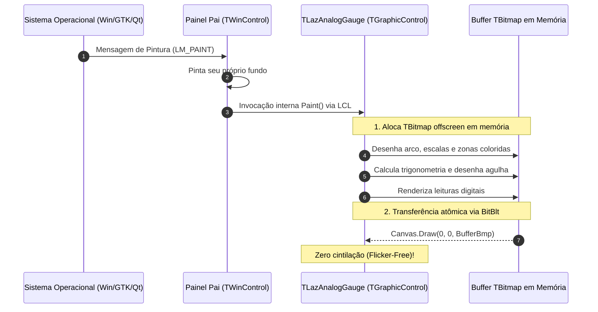

# MÓDULO 09: Controles Visuais Leves (TGraphicControl)

No desenvolvimento de interfaces de alto impacto visual e dashboards industriais no **Free Pascal (FPC 3.2+)** e **Lazarus IDE (3.x+)**, uma das decisões arquiteturais mais cruciais é escolher entre um controle janelado (`TWinControl`) e um controle leve windowless (**`TGraphicControl`**).

Quando uma tela precisa exibir dezenas de mostradores analógicos, VU meters de áudio, velocímetros ou indicadores de telemetria atualizados a 60 quadros por segundo, alocar um `HWND` nativo do sistema operacional para cada mostrador é um desperdício inaceitável de recursos da GPU e da CPU.

Neste módulo, aprenderemos a anatomia de renderização de controles leves, as técnicas matemáticas de trigonometria para instrumentos circulares, a erradicação absoluta de cintilação (**Double Buffering com `TBitmap`**) e a implementação completa do componente visual **`TLazAnalogGauge`**.

---

## 1. A Anatomia do `TGraphicControl`

Um controle derivado de `TGraphicControl` não possui janela própria no sistema operacional. Ele é um controle puramente lógico e visual gerenciado pelo seu `Parent` (`TWinControl`):



### 1.1 Vantagens de Desempenho
- **Consumo de Memória:** Zero handles do subsistema gráfico do SO consumidos.
- **Transparência e Clipping:** A LCL gerencia a sobreposição de outros controles com alta velocidade.
- **Densidade:** É possível posicionar centenas de instâncias em um único formulário sem degradar o loop de eventos.

---

## 2. A Física da Eliminação de Flickering (Double Buffering)

A cintilação gráfica (*flicker*) ocorre quando um controle desenha seu fundo e, frações de milissegundo depois, desenha os elementos sobrepostos diretamente na tela visível do monitor. O olho humano percebe o contraste entre o fundo intermediário e a imagem final.

Para anular o flicker em `TGraphicControl`, aplicamos o padrão **Double Buffering Manual**:

```pascal
procedure TLazAnalogGauge.Paint;
var
  BufferBmp: TBitmap;
begin
  BufferBmp := TBitmap.Create;
  try
    BufferBmp.SetSize(Width, Height);
    // Desenha tudo na memória sem tocar na tela do monitor
    RenderGaugeToCanvas(BufferBmp.Canvas, Rect(0, 0, Width, Height));
    // Transfere o quadro pronto em uma única operação atômica de BitBlt
    Canvas.Draw(0, 0, BufferBmp);
  finally
    BufferBmp.Free;
  end;
end;
```

---

## 3. Matemática do Mostrador Analógico

O mostrador circular cobre um arco de $270^\circ$, partindo de $225^\circ$ (canto inferior esquerdo) até $-45^\circ$ (canto inferior direito):

```
                     90° (Topo)
                        |
       135°             |             45°
           \            |            /
             \          |          /
               \        |        /
 180° (Esq) ----+-------(Cx,Cy)-------+---- 0° (Dir)
               /        |        \
             /          |          \
           /            |            \
       225°             |             -45° / 315°
    (Valor Mínimo)                 (Valor Máximo)
```

### 3.1 Conversão Linear de Valor para Ângulo:
$$\text{Fração} = \frac{\text{Valor} - \text{MinValue}}{\text{MaxValue} - \text{MinValue}}$$
$$\text{Ângulo (graus)} = 225.0 - (\text{Fração} \times 270.0)$$

### 3.2 Cálculo das Coordenadas Cartesianas da Agulha:
$$\theta = \text{DegToRad}(\text{Ângulo})$$
$$X_{\text{ponta}} = C_x + R \times \cos(\theta)$$
$$Y_{\text{ponta}} = C_y - R \times \sin(\theta)$$

Observe o sinal negativo no cálculo de $Y$: no sistema de coordenadas do `Canvas`, o eixo vertical cresce de cima para baixo.

---

## 4. Implementação Prática: O Componente `TLazAnalogGauge`

O componente completo está implementado em:
- **`code/units/LazAnalogGauge.pas`:** Contém o mostrador completo, zonas coloridas configuráveis (Normal, Atenção e Crítico), marcações principais e secundárias, agulha dinâmica, pivô metálico central, display digital e o evento `OnThresholdCrossed`.

---

## 5. Checklist de Engenharia do Módulo 09

- [x] Herde de `TGraphicControl` para mostradores e instrumentos visuais de alta densidade sem foco de teclado.
- [x] Aplique sempre Double Buffering manual com `TBitmap` em memória para garantir repintura suave a 60 FPS.
- [x] Utilize interpolação trigonométrica (`DegToRad`, `Cos`, `Sin`) com inversão no eixo Y para cálculo angular correto no Canvas.
- [x] Clamp valores de entrada (`EnsureRange`) para evitar que a agulha ultrapasse os limites visuais do mostrador.
- [x] Dispare eventos reativos (`OnThresholdCrossed`) quando grandezas físicas atingirem limites críticos de operação.
