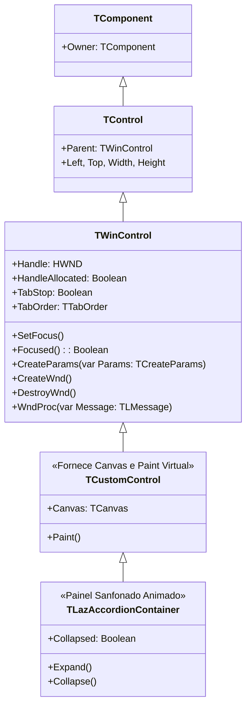

# MÓDULO 10: Controles Visuais Janelados (TWinControl)

Enquanto os controles leves (`TGraphicControl`) operam como elementos puramente desenhados, os controles derivados de **`TWinControl`** são os pilares arquiteturais de qualquer aplicação interativa no **Free Pascal (FPC 3.2+)** e **Lazarus IDE (3.x+)**.

Um `TWinControl` é uma entidade pesada que possui um identificador nativo de janela alocado no subsistema gráfico do sistema operacional (`HWND` no Windows, `GtkWidget` no Linux ou `NSView` no macOS). É essa conexão física com o SO que viabiliza:
1. **Foco e Teclado:** Capacidade de receber foco do usuário (`SetFocus`, `Focused`), participar da ordem de tabulação (`TabStop`, `TabOrder`) e interceptar teclas físicas (`OnKeyDown`, `OnKeyUp`).
2. **Hospedagem de Filhos:** Atuar como pai visual (`Parent`) de outros componentes e aceitar o arrasto de controles sobre sua superfície no Form Designer através da flag **`csAcceptsControls`**.
3. **Isolamento de Pintura:** Janelas nativas possuem seu próprio contexto de dispositivo (*Device Context*) e áreas de recorte (*Clipping*), garantindo que controles embutidos não vazem graficamente fora de suas bordas.

Neste módulo, aprenderemos a anatomia estrutural de `TWinControl`, as regras de foco e teclado, e construiremos um contêiner colapsável sanfonado moderno (**`TLazAccordionContainer`**) com animação fluida e suporte a filhos embutidos.

---

## 1. A Anatomia do `TWinControl` na LCL

A jornada de um `TWinControl` conecta diretamente a RTL do Pascal ao servidor de janelas nativo:



### 1.1 O Papel de `ControlStyle` e a Flag `csAcceptsControls`
Para que um controle janelado funcione como um contêiner hospedeiro (como o `TPanel` ou o nosso `TLazAccordionContainer`) permitindo que o usuário solte botões, edits e grids dentro dele no Form Designer, devemos configurar no construtor:

```pascal
ControlStyle := ControlStyle + [csAcceptsControls, csCaptureMouse, csClickEvents, csDoubleClicks];
```

Sem a flag `csAcceptsControls`, o Form Designer do Lazarus impedirá que outros componentes usem nossa instância como `Parent`, redirecionando o drop para o formulário raiz.

---

## 2. A Física do Painel Sanfonado (Accordion)

Um painel sanfonado é composto por duas regiões conceituais:
1. **O Cabeçalho Interativo:** Área fixa no topo com altura `HeaderHeight`, contendo o título, o indicador visual de expansão (*chevron* `►` ou `▼`) e o retângulo de foco de teclado.
2. **A Área Cliente de Conteúdo:** O espaço interno onde os controles filhos residem.

```
+-------------------------------------------------------------+
| [▼] CONFIGURAÇÕES AVANÇADAS                  (HeaderHeight) | <-- Clique aqui ou aperte Enter/Espaço
+-------------------------------------------------------------+
|                                                             |
|   [Edit1: Host do Banco]                                    |
|   [Edit2: Porta do Serviço]               (Área de Filhos   |
|   [Button1: Testar Conexão]                csAcceptsControls|
|                                            ExpandedHeight)  |
|                                                             |
+-------------------------------------------------------------+
```

### 2.1 Animação Suave com Interpolação por Timer
Ao alternar o estado `Collapsed`, em vez de truncar a altura abruptamente (o que gera um salto visual desagradável), acionamos um timer de alta frequência (`15 ms` $\approx$ 60 FPS) que interpola a altura corrente até `FTargetHeight`:

```pascal
procedure TLazAccordionContainer.OnTimerStep(Sender: TObject);
var
  Step: Integer;
begin
  Step := 16;
  if Height < FTargetHeight then
  begin
    if Height + Step >= FTargetHeight then
    begin
      Height := FTargetHeight;
      FAnimationTimer.Enabled := False;
    end
    else
      Height := Height + Step;
  end;
  // ...
  Invalidate;
end;
```

---

## 3. Acessibilidade de Teclado e Foco

Um componente janelado de produção deve ser acessível sem mouse:
- `TabStop := True;` permite que o controle seja alcançado pela tecla `Tab`.
- Ao receber foco (`DoEnter`), desenhamos uma moldura de foco pontilhada (`psDot`).
- No método `KeyDown`, capturamos `VK_SPACE` e `VK_RETURN` para abrir e fechar o sanfonado instantaneamente.

---

## 4. Implementação Prática: O Componente `TLazAccordionContainer`

O código-fonte integral está estruturado em:
- **`code/units/LazAccordionContainer.pas`:** Contêiner completo derivado de `TCustomControl`, suporte a `csAcceptsControls`, animação suave a 60 FPS, acessibilidade total via teclado e evento reativo `OnToggle`.

---

## 5. Checklist de Engenharia do Módulo 10

- [x] Herde de `TCustomControl` quando necessitar de um `TWinControl` com contexto gráfico `Canvas` e método `Paint` customizável.
- [x] Adicione `csAcceptsControls` ao `ControlStyle` no construtor para habilitar a hospedagem de componentes filhos no designer.
- [x] Habilite `TabStop := True` e processe `KeyDown` para garantir conformidade de acessibilidade para usuários que operam via teclado.
- [x] Ao implementar animações visuais com timer, desative o timer em tempo de design (`csDesigning in ComponentState`) para não sobrecarregar a IDE.
- [x] Utilize `LCLIntf.DrawText` para renderização tipográfica com alinhamento vertical e truncamento seguro de texto no cabeçalho.
