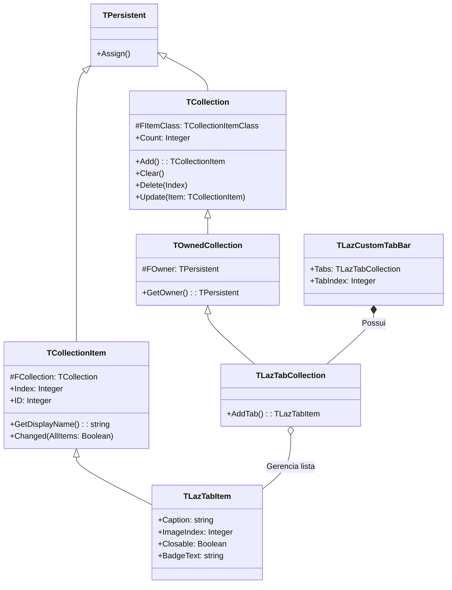

# MÓDULO 11: Coleções Tipadas e Sub-Propriedades Complexas

Componentes profissionais do mundo real frequentemente exigem gerenciar listas dinâmicas de sub-elementos estruturados: colunas de uma grid, itens de um menu, nós de uma árvore ou abas de um navegador.

Tentar modelar essas listas com arrays primitivos ou strings delimitadas é um erro fatal de arquitetura. O padrão de engenharia consagrado no Object Pascal para gerenciar sub-propriedades complexas é o subsistema de **Coleções Tipadas (`TCollection` e `TCollectionItem`)**, com ênfase na classe **`TOwnedCollection`**.

Neste módulo, aprenderemos a anatomia das coleções no **Free Pascal (FPC 3.2+)** e **Lazarus IDE (3.x+)**, sua integração nativa com o **Collection Editor do Object Inspector**, o mecanismo de notificação de repintura via `Update` e a implementação completa do componente **`TLazCustomTabBar`** (barra de abas moderna com ícones, badges e botões de fechamento individuais).

---

## 1. A Arquitetura `TCollection` e `TCollectionItem`

O framework de coleções da RTL estabelece uma relação mestre-detalhe estritamente tipada:



### 1.1 Por Que Usar `TOwnedCollection` em Vez de `TCollection`?
A classe base `TCollection` não armazena quem é o componente proprietário da coleção. 

Já `TOwnedCollection` recebe no construtor o componente pai (`AOwner: TPersistent`). Isso é crítico para dois fatores:
1. **Streaming LFM:** Permite que o leitor de formulário (`TReader`) saiba exatamente a qual componente a coleção pertence durante o carregamento de propriedades salvas no `.lfm`.
2. **Repintura Automática:** O método protegido `Update` pode consultar `GetOwner` e disparar imediatamente a repintura do controle gráfico na tela:
   ```pascal
   procedure TLazTabCollection.Update(Item: TCollectionItem);
   begin
     inherited Update(Item);
     if GetOwner is TControl then
       TControl(GetOwner).Invalidate;
   end;
   ```

---

## 2. Integração Nativa com o Collection Editor do Lazarus

Quando uma propriedade do tipo derivado de `TCollection` é declarada na seção `published` de um componente:
```pascal
published
  property Tabs: TLazTabCollection read FTabs write SetTabs;
```

O Object Inspector do Lazarus faz o trabalho pesado automaticamente! Ao clicar duas vezes ou no botão elíptico `[...]` da propriedade `Tabs`, a IDE abre a janela oficial do **Collection Editor**, permitindo adicionar, excluir e reordenar itens com os botões `Add`, `Delete`, `Up` e `Down`.

### O Papel Fundamental de `GetDisplayName`:
Por padrão, a lista da IDE exibe os itens com rótulos genéricos: `0 - TLazTabItem`, `1 - TLazTabItem`. Para que a experiência de design seja profissional, sobrescrevemos o método virtual:

```pascal
function TLazTabItem.GetDisplayName: string;
begin
  if FCaption <> '' then
    Result := FCaption
  else
    Result := inherited GetDisplayName;
end;
```
Com essa linha, o Collection Editor passa a listar o título real de cada aba (ex: `0 - Principal`, `1 - Relatórios`), permitindo identificação imediata.

---

## 3. Hit-Testing e Interatividade de Mouse

Diferente de controles com botões estáticos, a barra de abas possui geometria dinâmica calculada em tempo de execução:
- `GetTabRect(Index)`: Calcula as coordenadas retangulares da aba $i$ com base na largura acumulada do texto das abas anteriores.
- `GetCloseButtonRect(TabRect)`: Determina a área do botão de fechamento `[×]`.
- `TabIndexFromPoint(X, Y)`: Realiza o teste de colisão (*hit-testing*) para detectar se o clique ocorreu sobre o corpo da aba ou sobre o botão de fechamento.

---

## 4. Implementação Prática: O Componente `TLazCustomTabBar`

O código-fonte integral está estruturado em:
- **`code/units/LazCustomTabBar.pas`:** Barra de abas completa derivada de `TCustomControl`, suporte a `TOwnedCollection`, itens com suporte a ícones via `TCustomImageList`, badges de notificação coloridos, botões de fechamento individuais com efeito hover e evento com permissão de cancelamento `OnTabClose(var CanClose: Boolean)`.

---

## 5. Checklist de Engenharia do Módulo 11

- [x] Utilize sempre `TOwnedCollection` para associar coleções diretamente ao componente hospedeiro.
- [x] Sobrescreva `GetDisplayName` em cada classe derivada de `TCollectionItem` para exibir identificadores semânticos no Collection Editor da IDE.
- [x] Sobrescreva `Update` na coleção para invalidar e repintar o controle pai a cada adição, edição ou exclusão de item.
- [x] Ao referenciar listas de imagens (`TCustomImageList`), registre `FreeNotification` e trate `Notification(opRemove)` para evitar Access Violations.
- [x] Implemente hit-testing matemático para separar cliques no corpo da aba de cliques em botões de ação embutidos.
