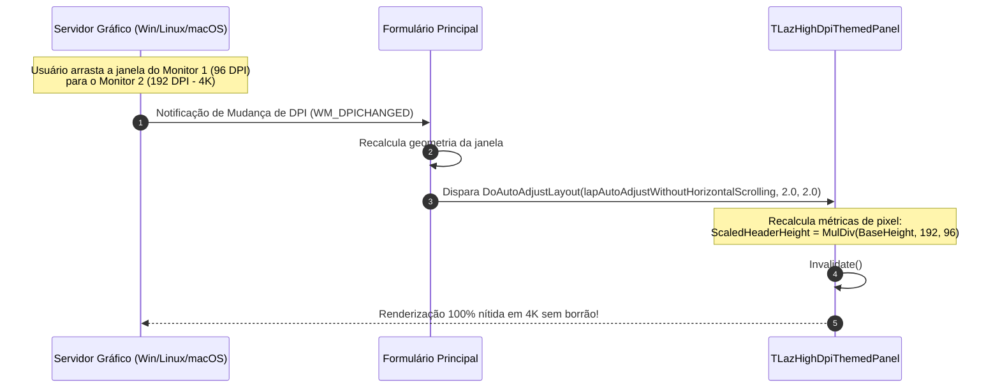

# MÓDULO 12: High-DPI, Escalonamento e Suporte a Temas Modernos

No cenário contemporâneo de monitores 4K, 8K e displays Retina de altíssima densidade de pixels, uma biblioteca de componentes que ignora o escalonamento dinâmico (**High-DPI**) ou que renderiza elementos com tamanhos fixos em pixels é considerada obsoleta e inutilizável.

Além disso, sistemas operacionais modernos (Windows 11, distribuições Linux com GNOME/KDE e macOS) operam hoje sob temas dinâmicos (**Dark Mode e Light Mode**), alternados automaticamente pelo usuário.

No **Free Pascal (FPC 3.2+)** e **Lazarus IDE (3.x+)**, a LCL fornece uma infraestrutura avançada de adaptação de layout através do método virtual `DoAutoAdjustLayout` e do serviço central `ThemeServices`.

Neste módulo, aprenderemos como construir componentes que se adaptam fluidamente entre diferentes monitores (arquitetura **Per-Monitor v2**), aplicar a matemática de escalonamento proporcional e renderizar componentes com fidelidade estética tanto em temas claros quanto escuros através do componente **`TLazHighDpiThemedPanel`**.

---

## 1. A Arquitetura High-DPI na LCL

Historicamente, o padrão da indústria estabelecia a densidade de **96 DPI (Dots Per Inch)** como escala base de 100%. Em monitores 4K modernos de 27 polegadas ou laptops compactos, a densidade padrão salta para 150% (144 DPI) ou 200% (192 DPI).

```
Densidade de Tela (PPI / DPI):
- 96 DPI   -> Escala 100% (1 pixel lógico = 1 pixel físico)
- 144 DPI  -> Escala 150% (1 pixel lógico = 1.5 pixels físicos)
- 192 DPI  -> Escala 200% (1 pixel lógico = 2 pixels físicos)
- 384 DPI  -> Escala 400% (1 pixel lógico = 4 pixels físicos)
```



---

## 2. A Matemática do Escalonamento: `MulDiv`

Nunca armazene valores de dimensão (alturas, larguras de borda, raios de canto) diretamente em variáveis que sofrem escalonamento acumulativo. Isso causa **erros de arredondamento cumulativos**, fazendo com que um botão cresça ou encolha indefinidamente após sucessivas trocas de monitor.

### O Padrão Canônico: Base Metrics vs. Scaled Metrics
Sempre preserve o valor original de design (`FBaseHeaderHeight := 36`) e calcule a métrica proporcional sob demanda:

```pascal
function TLazHighDpiThemedPanel.ScalePixels(AValue: Integer): Integer;
var
  PPI: Integer;
begin
  PPI := Font.PixelsPerInch;
  if PPI <= 0 then
    PPI := Screen.PixelsPerInch;
  if PPI <= 0 then
    PPI := 96;

  Result := MulDiv(AValue, PPI, 96);
end;
```
A função de baixo nível `MulDiv(A, B, C)` multiplica $A \times B$ em um registrador de precisão estendida (64 bits) e depois divide por $C$ com arredondamento correto, evitando estouro de inteiros.

---

## 3. O Método `DoAutoAdjustLayout`

Quando a janela é movida para um display com outro fator de escala, a LCL percorre a árvore de componentes e invoca:

```pascal
procedure TLazHighDpiThemedPanel.DoAutoAdjustLayout(
  const AMode: TLayoutAdjustmentPolicy; const AXProportion, AYProportion: Double);
begin
  inherited DoAutoAdjustLayout(AMode, AXProportion, AYProportion);
  RecalculateMetrics;
end;
```
Ao recalcular as métricas escalonadas (`FScaledHeaderHeight := ScalePixels(FBaseHeaderHeight)`), garantimos que todos os textos, margens e ícones se expandam ou contraiam na proporção geométrica exata do novo monitor.

---

## 4. Integração com Temas do SO via `ThemeServices`

Para respeitar as diretrizes de cores do sistema operacional:

```pascal
uses Themes;

if ThemeServices.ThemesEnabled then
begin
  // Obtém cores nativas do tema atual do Windows/Linux/macOS
  WindowColor := ThemeServices.GetSystemColor(clWindow);
  TextColor   := ThemeServices.GetSystemColor(clWindowText);
end;
```
Nosso componente implementa a enumeração `TLazThemeMode`:
- `tmAutoSystem`: Sincroniza dinamicamente com o tema do SO.
- `tmForcedDark`: Garante estética escura corporativa.
- `tmForcedLight`: Garante estética clara corporativa.

---

## 5. Implementação Prática: O Componente `TLazHighDpiThemedPanel`

O código-fonte integral está estruturado em:
- **`code/units/LazHighDpiThemedPanel.pas`:** Painel com suporte a Per-Monitor v2, escalonamento proporcional via `MulDiv`, consulta ativa ao `ThemeServices`, cantos arredondados escalonados e badge em tempo real indicando a resolução DPI ativa.

---

## 6. Checklist de Engenharia do Módulo 12

- [x] Nunca acumule operações de escalonamento sobre valores correntes; mantenha campos base de design (`Base...`) e derive campos escalonados (`Scaled...`).
- [x] Utilize `MulDiv(Valor, PixelsPerInch, 96)` para todos os cálculos dimensionais de desenho.
- [x] Sobrescreva `DoAutoAdjustLayout` para sincronizar métricas internas durante trocas de monitor.
- [x] Consulte `ThemeServices.ThemesEnabled` e `ThemeServices.GetSystemColor` para harmonizar a paleta visual com o tema ativo do sistema operacional.
- [x] Dê preferência a desenhos vetoriais matemáticos ou imagens em SVG para garantir nitidez cristalina em 100%, 150%, 200% e 400% de escala.
