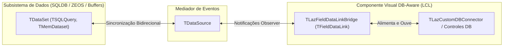
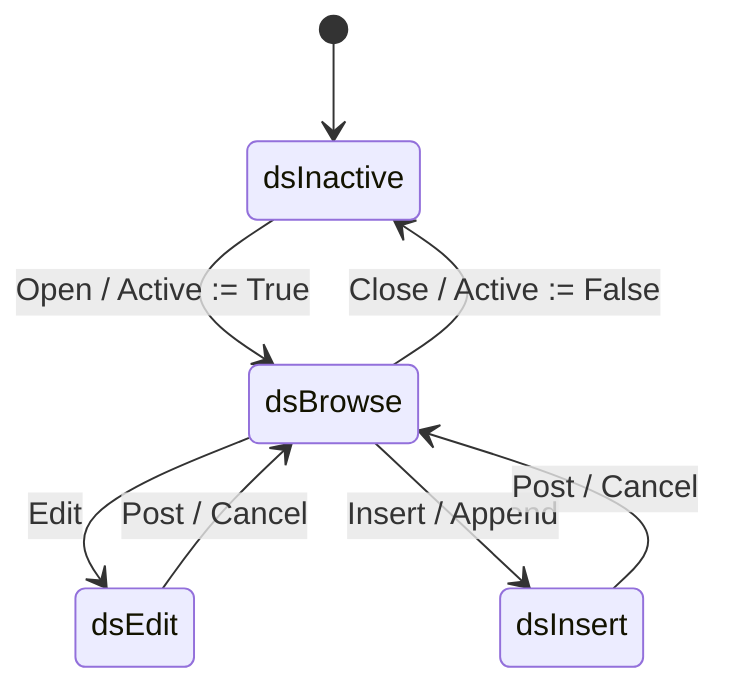

# MÓDULO 13: Arquitetura de Dados no Pascal e a Ponte TDataLink

No ecossistema **Free Pascal (FPC 3.2+)** e **Lazarus IDE (3.x+)**, o paradigma **DB-Aware (Consciência de Banco de Dados)** é historicamente um dos maiores diferenciais de produtividade do Object Pascal. Controles visuais conectam-se de forma reativa a cursores de banco de dados, refletindo alterações instantaneamente e gravando dados com validação semântica integrada.

Contudo, programadores amadores frequentemente tentam acoplar seus componentes diretamente a instâncias de `TDataSet` ou manipular campos através de loops síncronos invasivos.

O padrão de arquitetura correto e profissional da RTL repousa sobre uma tríade baseada nos padrões de projeto **Observer** e **Mediator**:
1. **`TDataSet`:** O provedor e manipulador de dados bruto.
2. **`TDataSource`:** O mediador de eventos central.
3. **`TDataLink` / `TFieldDataLink`:** O observador especializado que reside dentro do controle visual e traduz transições de estado de dados em repinturas e comandos de edição.

Neste módulo, dissecaremos o funcionamento interno do subsistema `DB`, a máquina de estados do `TDataSet` e construiremos o framework base **`TLazCustomDBConnector`**, alicerce sobre o qual todos os componentes conscientes de dados são edificados.

---

## 1. A Tríade Canônica: DataSet, DataSource e DataLink

O desacoplamento arquitetural entre a lógica de dados e a interface visual é absoluto:

### 1.1 Por Que o Controle Nunca se Conecta Diretamente ao `TDataSet`?
Se um controle se conectasse diretamente a um `TDataSet`:
1. Vários controles disputariam o mesmo estado de edição sem coordenação central.
2. Não haveria como redirecionar facilmente uma tela inteira de um dataset para outro apenas trocando a propriedade `TDataSource.DataSet`.
3. O `TDataLink` isola o componente: se o dataset estiver fechado (`dsInactive`), o `TDataLink` desabilita o controle visual automaticamente sem disparar exceções de ponteiro nulo.

---

## 2. A Máquina de Estados do `TDataSet`

O ciclo de vida dos dados transita entre estados bem definidos:

| Estado do DataSet | Descrição Operacional | Ação no Componente Visual |
| :--- | :--- | :--- |
| **`dsInactive`** | O dataset está fechado. Nenhum dado está disponível. | Desabilitar edição e limpar campos visuais. |
| **`dsBrowse`** | Modo de navegação e leitura. O cursor está posicionado em um registro. | Exibir os dados do registro atual. Impedir alteração no buffer até disparo de `Edit`. |
| **`dsEdit`** | O registro atual está aberto para modificação. | Habilitar digitação no controle. |
| **`dsInsert`** | Um novo registro em branco foi criado. | Limpar campos para preenchimento de novo cadastro. |

---

## 3. Os Cinco Métodos Sagrados de `TFieldDataLink`

Para criar um controle DB-Aware robusto, especializamos a classe `TFieldDataLink` e sobrescrevemos cinco métodos protegidos:

1. **`procedure ActiveChanged; override;`**
   - Disparado quando o `TDataSet` é aberto (`Open`) ou fechado (`Close`).
2. **`procedure DataSetChanged; override;`**
   - Disparado quando o ponteiro do registro se move (`Next`, `Prior`, `First`, `Last`) ou quando o dataset sofre um `Refresh`.
3. **`procedure EditingChanged; override;`**
   - Disparado quando o dataset entra ou sai do modo de edição (`dsEdit` / `dsInsert`).
4. **`procedure RecordChanged(Field: TField); override;`**
   - Disparado quando o valor do campo vinculado sofre alteração na memória.
5. **`procedure UpdateData; override;`**
   - Disparado imediatamente antes do `TDataSet.Post`. O controle deve ler o texto da interface gráfica e transferi-lo para `Field.AsString` ou `Field.AsVariant`.

---

## 4. Implementação Prática: O Framework `TLazCustomDBConnector`

A unidade completa está localizada em:
- **`code/units/LazCustomDBConnector.pas`:** Contém o observador `TLazFieldDataLinkBridge` e o componente base `TLazCustomDBConnector`, fornecendo os métodos `CanModify`, `Edit`, `Modified`, `Reset` e eventos fortemente tipados para os estados do dataset.

---

## 5. Checklist de Engenharia do Módulo 13

- [x] Nunca acople componentes visuais diretamente ao `TDataSet`; passe sempre pelo `TDataSource` e especialize `TFieldDataLink`.
- [x] Sobrescreva `ActiveChanged` para habilitar ou desabilitar o controle quando a tabela for aberta ou fechada.
- [x] Sobrescreva `DataSetChanged` e `RecordChanged` para manter a interface sincronizada com a linha ativa da tabela.
- [x] Sobrescreva `UpdateData` para aplicar alterações da UI de volta ao buffer de dados antes do `Post`.
- [x] Proteja o ponteiro `DataSource` contra exclusões usando `FreeNotification` e `Notification(opRemove)`.
