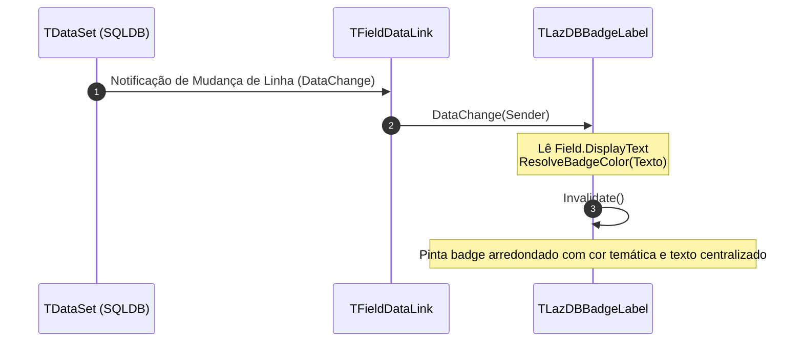

# MÓDULO 14: Controles DB-Aware Básicos de Exibição e Edição

Após compreendermos a espinha dorsal da ponte `TDataLink` (Módulo 13), é chegado o momento de construir controles conscientes de dados prontos para o ambiente de produção.

Aplicações comerciais de alta qualidade não se satisfazem com simples caixas de texto com bordas retangulares padrão. Elas exigem:
1. **Controles Visuais de Status com Formatação Condicional (`TLazDBBadgeLabel`):** Pílulas visuais (*badges*) com cores reativas que sinalizam o estado da entidade cadastral (Verde para "Ativo" ou "Pago", Âmbar para "Pendente", Cinza/Vermelho para "Bloqueado" ou "Inativo").
2. **Editores Numéricos e Monetários Especializados (`TLazDBNumberEdit`):** Caixas de texto alinhadas à direita com formatação de moeda dinâmica, filtragem rigorosa de caracteres no teclado e transição imperceptível e automática para o modo `dsEdit` do `TDataSet` ao teclar.

Neste módulo, implementaremos esses dois componentes indispensáveis no **Free Pascal (FPC 3.2+)** e **Lazarus IDE (3.x+)**.

---

## 1. O Controle `TLazDBBadgeLabel`: Visualização Condicional Reativa

O `TLazDBBadgeLabel` herda de `TGraphicControl`, consumindo zero recursos de janelas nativas:



### 1.1 O Algoritmo de Mapeamento de Cores
O método `ResolveBadgeColor` decodifica estados textuais, booleanos ou numéricos comuns:

```pascal
function TLazDBBadgeLabel.ResolveBadgeColor(const AText: string): TColor;
var
  UpperStr: string;
begin
  UpperStr := UpperCase(Trim(AText));
  if (UpperStr = 'ATIVO') or (UpperStr = 'PAGO') or (UpperStr = 'TRUE') or (UpperStr = '1') then
    Result := FActiveColor   // Verde vibrante
  else if (UpperStr = 'INATIVO') or (UpperStr = 'BLOQUEADO') or (UpperStr = 'FALSE') or (UpperStr = '0') then
    Result := FInactiveColor // Cinza neutro
  else if (UpperStr = 'PENDENTE') or (UpperStr = 'ALERTA') then
    Result := FWarningColor  // Laranja / Âmbar
  else
    Result := FDefaultColor;
end;
```

---

## 2. O Controle `TLazDBNumberEdit`: Edição Monetária com `DataLink.Edit`

Construir um editor numérico DB-Aware impõe três desafios fundamentais:
1. **Alinhamento:** Números e valores monetários devem ser alinhados à direita (`Alignment := taRightJustify`).
2. **Alternância Visual de Foco:** Quando o usuário clica para digitar, a máscara de moeda (ex: `R$ 1.500,00`) deve ceder lugar ao número decimal limpo (`1500.00`) para facilitar a edição. Ao sair do campo (`DoExit`), a formatação de moeda é restaurada.
3. **Disparo Automático de `Edit`:** O usuário não deve ser obrigado a clicar em um botão "Alterar" para digitar no campo. Ao pressionar o primeiro caractere válido no teclado, o controle deve disparar `DataLink.Edit`.

### 2.1 A Interceptação de Teclado no `KeyPress`:
```pascal
procedure TLazDBNumberEdit.KeyPress(var Key: Char);
begin
  if not (Key in ['0'..'9', ',', '.', #8, #13, #27]) then
  begin
    Key := #0; // Bloqueia caracteres não numéricos
    Exit;
  end;

  if (Key in ['0'..'9', ',', '.']) and not ReadOnly then
  begin
    // Força o DataSet para o modo dsEdit
    if not FDataLink.Editing then
      FDataLink.Edit;

    FDataLink.Modified;
  end;

  inherited KeyPress(Key);
end;
```

### 2.2 Gravação Segura no `DoExit`:
```pascal
procedure TLazDBNumberEdit.DoExit;
begin
  try
    if FDataLink.Editing then
      FDataLink.UpdateRecord; // Valida e aplica o registro no dataset
  except
    SetFocus; // Mantém o foco no campo caso haja falha de validação
    raise;
  end;
  FFocusedState := False;
  FormatDisplay;
  inherited DoExit;
end;
```

---

## 3. Implementação Prática: Componentes Completos

A unidade completa está localizada em:
- **`code/units/LazDBBasicControls.pas`:** Contém o `TLazDBBadgeLabel` e o `TLazDBNumberEdit`, ambos equipados com encapsulamento `TFieldDataLink`, proteção contra ponteiros pendentes de `TDataSource` com `FreeNotification` e registro oficial na Tool Palette.

---

## 4. Checklist de Engenharia do Módulo 14

- [x] Utilize `TGraphicControl` com `TFieldDataLink` para rótulos e badges somente-leitura de alta performance.
- [x] Em editores numéricos, configure `Alignment := taRightJustify` e filtre caracteres inválidos no `KeyPress`.
- [x] Chame `DataLink.Edit` e `DataLink.Modified` antes de aceitar a inserção de dígitos no buffer de texto.
- [x] Trate o par `DoEnter` e `DoExit` para alternar entre formato de edição amigável e formato de exibição monetário.
- [x] Proteja chamadas de `UpdateRecord` com bloco `try..except` para reter o foco no campo em caso de exceções de validação de dados.
