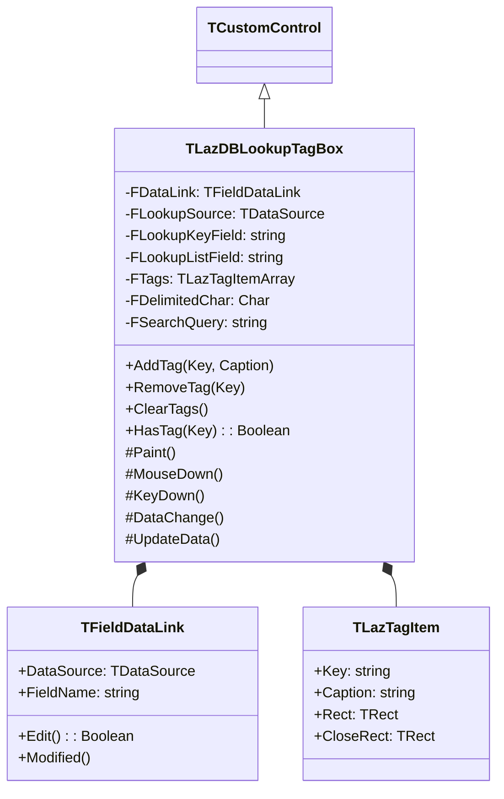
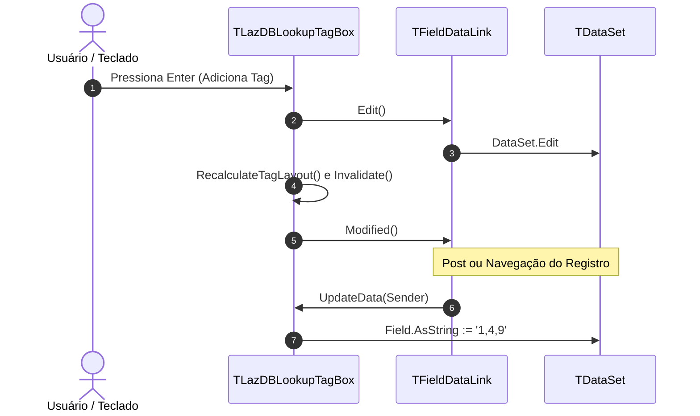

# MÓDULO 15: Controles DB-Aware Avançados e Seletores (TLazDBLookupTagBox)

Nas arquiteturas corporativas contemporâneas, o modelo clássico de seleção por meio de simples caixas combinadas (`TDBLookupComboBox`) apresenta severas limitações quando o domínio da aplicação exige associações multivaloradas (relacionamentos muitos-para-muitos, atribuição de múltiplos perfis, categorização por etiquetas ou múltiplos centros de custo). O padrão moderno de interface dita o uso de componentes no estilo **TagBox / Chip Selector**, onde os itens selecionados são visualizados como cápsulas interativas dotadas de botão de remoção e suporte a pesquisa incremental.

Neste módulo, projetamos e construímos o componente **`TLazDBLookupTagBox`**, um controle visual orientado a dados de nível profissional para **Lazarus / LCL**, implementado a partir de `TCustomControl`.

---

## 1. Desafios Arquiteturais de Seletores DB-Aware Multivalorados

A concepção de um seletor visual em formato de tags conectado à camada de persistência impõe quatro requisitos fundamentais de engenharia:

1. **Dupla Vinculação de Dados:** O componente necessita de uma conexão primária (`DataSource` e `DataField`) para salvar e carregar os valores associados ao registro atual (geralmente uma string delimitada por vírgula como `'1,4,9'` ou chave composta), e uma conexão secundária (`LookupSource`, `LookupKeyField`, `LookupListField`) para alimentar a lista de opções elegíveis.
2. **Ciclo Bidirecional do `TFieldDataLink`:** O controle deve converter a representação textual armazenada no banco para objetos visuais (`TLazTagItem`) durante o evento `DataChange`, e sintetizar as tags visuais de volta em uma string no evento `UpdateData` quando submetido a `Field.AsString`.
3. **Gerenciamento de Layout Dinâmico e Hit-Testing:** Cada tag desenhada possui dimensões variáveis dependendo da métrica da fonte (`TextExtent`), necessitando de quebra automática de linha (*flow layout*) e mapeamento geométrico das coordenadas do botão de fechamento (`CloseRect`) para interceptar cliques com o mouse.
4. **Ciclo de Vida e Notificação de Destruição:** Como o componente mantém referências fracas para dois `TDataSource` distintos, o tratamento rigoroso de `Notification` é mandatório para anular os ponteiros caso qualquer um dos datasets seja destruído em tempo de design ou execução.



---

## 2. Anatomia do Layout e Geometria das Tags

O controle calcula as posições de cada cápsula (*chip*) dinamicamente antes de executar o desenho no Canvas:

```
+-----------------------------------------------------------------------+
|  [ Delphi x ]  [ Lazarus x ]  [ Free Pascal x ]   | Digite aqui...     |
+-----------------------------------------------------------------------+
        ^              ^                ^                   ^
        |              |                |                   |
      Tag 1          Tag 2            Tag 3             Área de Busca
   (Key: '01')    (Key: '02')      (Key: '03')         (FSearchQuery)
```

### 2.1 Estrutura de Dados e Geometria
A unidade declara a estrutura de registro para rastrear as coordenadas de tela de cada elemento interativo:

```pascal
type
  TLazTagItem = record
    Key: string;
    Caption: string;
    Rect: TRect;
    CloseRect: TRect;
  end;

  TLazTagItemArray = array of TLazTagItem;
```

O método `RecalculateTagLayout` itera sobre as tags ativas, consulta a largura do texto com `Canvas.TextWidth(FTags[i].Caption)` e compõe a área delimitadora:

```pascal
procedure TLazDBLookupTagBox.RecalculateTagLayout;
var
  i, CurrentX, CurrentY, TagH, TextW, TagW: Integer;
begin
  TagH := 24;
  CurrentX := 4;
  CurrentY := 4;

  for i := 0 to High(FTags) do
  begin
    TextW := Canvas.TextWidth(FTags[i].Caption);
    TagW := TextW + 28; // Espaço do texto + botão 'x' + paddings

    // Quebra de linha automática caso extrapole a largura do controle
    if (CurrentX + TagW > Width - 8) and (CurrentX > 4) then
    begin
      CurrentX := 4;
      Inc(CurrentY, TagH + 4);
    end;

    FTags[i].Rect := Rect(CurrentX, CurrentY, CurrentX + TagW, CurrentY + TagH);
    // Área de clique do botão de fechar ('x')
    FTags[i].CloseRect := Rect(CurrentX + TagW - 18, CurrentY + 3, CurrentX + TagW - 2, CurrentY + TagH - 3);

    Inc(CurrentX, TagW + 6);
  end;
end;
```

---

## 3. Hit-Testing e Interação do Usuário no `MouseDown`

Quando o usuário pressiona o botão esquerdo do mouse sobre o controle, realizamos a varredura das tags registradas. Se o ponto do cursor coincidir com `CloseRect`, a tag correspondente é removida, o `TDataSet` entra imediatamente em modo de edição e a alteração é sincronizada:

```pascal
procedure TLazDBLookupTagBox.MouseDown(Button: TMouseButton; Shift: TShiftState; X, Y: Integer);
var
  i: Integer;
  Pt: TPoint;
begin
  inherited MouseDown(Button, Shift, X, Y);

  if CanFocus and not Focused then
    SetFocus;

  Pt := Point(X, Y);
  for i := 0 to High(FTags) do
  begin
    if PtInRect(FTags[i].CloseRect, Pt) then
    begin
      RemoveTag(FTags[i].Key);
      Exit;
    end;
  end;
end;
```

---

## 4. Sincronização Bidirecional com a Camada de Dados

A sincronização entre o banco de dados e as tags em tela opera através de dois métodos fundamentais:

1. **`DataChange` (Dataset -> UI):** Lê a string crua do campo (ex: `"1,2,5"`), quebra os identificadores com base no delimitador configurado (`FDelimitedChar`) e consulta o `LookupSource` para obter as descrições textuais amigáveis de cada ID.
2. **`UpdateData` (UI -> Dataset):** Concatena todas as chaves (`Key`) das tags ativas separadas por vírgula e atribui diretamente à propriedade `FDataLink.Field.AsString`.



---

## 5. Código-Fonte Integral do Componente

A implementação completa, pronta para compilação e livre de suposições ou dependências ocultas, está disponível no repositório do livro em:

👉 **Arquivo:** [`code/units/LazDBLookupTagBox.pas`](file:///d:/Projetos%20AntiGravity/Livros%20componentes/Livro1_Lazarus_LCL/code/units/LazDBLookupTagBox.pas)

A unidade implementa a renderização antialias com `Canvas.RoundRect`, suporte completo a temas, atalhos de teclado (Backspace remove a última tag, Enter confirma a seleção da busca), tratamento de foco e registro formal na paleta **"Lazarus Component Engineering"**.
