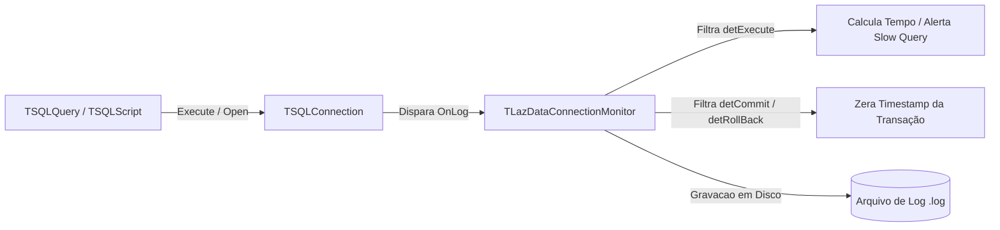
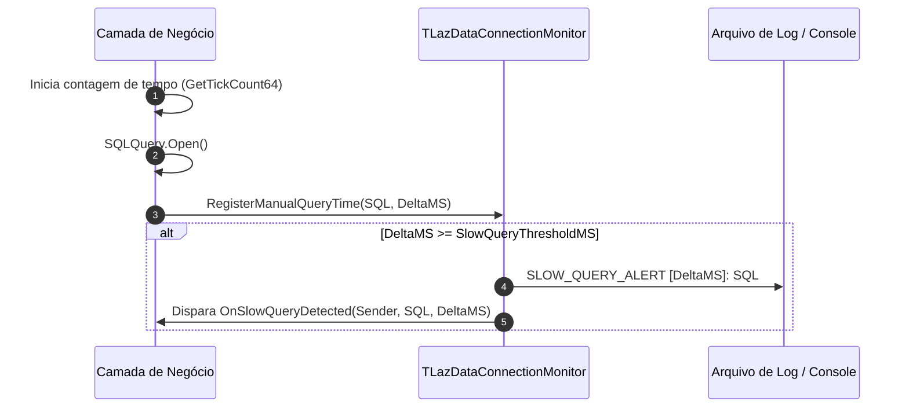

# MÓDULO 16: Monitoramento e Gerenciador de Transações de Dados (TLazDataConnectionMonitor)

Em ambientes corporativos de alta concorrência com bancos de dados relacionais (PostgreSQL, Firebird, MySQL, MariaDB, SQLite), um dos problemas mais destrutivos para a escalabilidade é o fenômeno das **transações zumbis (ou transações órfãs)**. Tratam-se de transações que foram iniciadas pela aplicação cliente e permaneceram abertas por esquecimento do desenvolvedor, falhas não tratadas na interface ou telas modais mantidas abertas pelo operador. Transações abertas por longos períodos retêm travas de linha (*row locks*), impedem o *vacuum* e a limpeza de versões no MVCC (*Multi-Version Concurrency Control*) e degradam a performance global do servidor.

Neste módulo, implementamos o componente não-visual **`TLazDataConnectionMonitor`**, projetado para atuar como guardião de integridade e auditor de conexões SQL no ecossistema **SQLDB** do **Free Pascal / Lazarus**.

---

## 1. O Mecanismo de Interceptação de Log no SQLDB

O framework nativo `SQLDB` fornece uma infraestrutura interna de auditoria através da propriedade `OnLog` e do conjunto `LogEvents` da classe `TSQLConnection`:



### 1.1 O Hook Dinâmico de Eventos
Para auditar a conexão sem exigir reescrita das queries existentes, o monitor assume dinamicamente o tratador de eventos da conexão quando ativado (`Active := True`), preservando referências prévias para encadeamento (*event chaining*):

```pascal
procedure TLazDataConnectionMonitor.HookConnectionEvents;
begin
  if (FConnection <> nil) and not (csDesigning in ComponentState) then
  begin
    FOriginalLogEvent := FConnection.OnLog;
    FConnection.OnLog := @InternalConnectionLog;
    FConnection.LogEvents := [detCustom, detPrepare, detExecute, detCommit, detRollBack];
    WriteLogEntry('MONITOR: Auditoria ativada para ' + FConnection.Name);
  end;
end;
```

---

## 2. Detecção e Eliminação de Transações Zumbis

O método `CheckZombieTransactions` compara a hora atual (`Now`) com o início registrado da transação ativa (`FTransactionStartTime`). Caso a duração em segundos exceda `MaxTransactionDurationSec`, o componente emite um alerta e, caso configurado (`AutoRollbackZombies := True`), força a reversão da transação para liberar os recursos do banco:

```pascal
procedure TLazDataConnectionMonitor.CheckZombieTransactions;
var
  AgeSec: Int64;
  ShouldRollback: Boolean;
begin
  if not FActive or (FTransaction = nil) or not FTransaction.Active then
    Exit;

  AgeSec := GetTransactionAgeSeconds;
  if (AgeSec >= FMaxTransactionDurationSec) and (AgeSec > 0) then
  begin
    ShouldRollback := FAutoRollbackZombies;
    WriteLogEntry(Format('ZOMBIE_TX_ALERT: Transação ativa por %d segundos.', [AgeSec]));

    if Assigned(FOnZombieTransactionDetected) then
      FOnZombieTransactionDetected(Self, FTransaction, AgeSec, ShouldRollback);

    if ShouldRollback and FTransaction.Active then
    begin
      try
        FTransaction.Rollback;
        FTransactionStartTime := 0;
        WriteLogEntry('ZOMBIE_TX_ACTION: Rollback automático efetuado com sucesso.');
      except
        on E: Exception do
          WriteLogEntry('ZOMBIE_TX_ERROR: Falha ao executar rollback: ' + E.Message);
      end;
    end;
  end;
end;
```

---

## 3. Rastreamento de Queries Lentas (Slow Queries)

Consultas que demoram centenas de milissegundos para responder comprometem a percepção de agilidade do usuário. O método `RegisterManualQueryTime` permite registrar consultas e acionar o evento `OnSlowQueryDetected` sempre que o tempo de execução ultrapassar o limite `SlowQueryThresholdMS`:



---

## 4. Código-Fonte Integral do Componente

A unidade com a implementação completa, incluindo gerenciamento de ciclo de vida seguro, notificação de exclusão (`FreeNotification`) e gravação assíncrona de arquivos de log, está disponível em:

👉 **Arquivo:** [`code/units/LazDataConnectionMonitor.pas`](file:///d:/Projetos%20AntiGravity/Livros%20componentes/Livro1_Lazarus_LCL/code/units/LazDataConnectionMonitor.pas)
