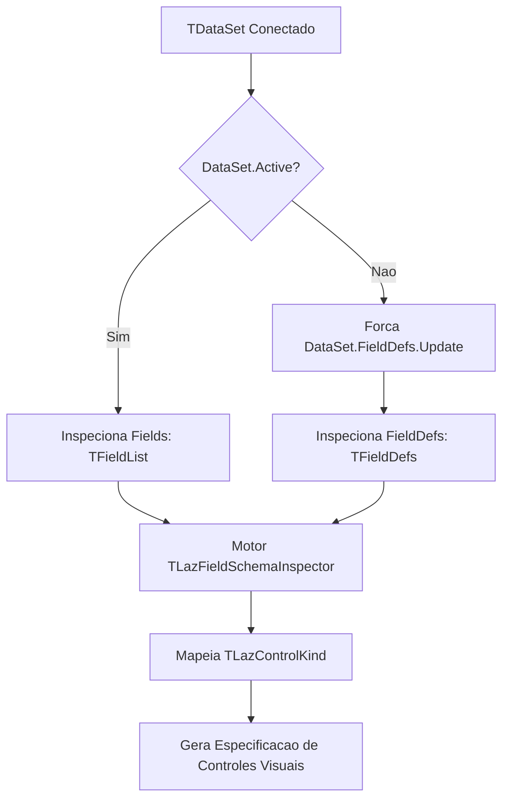
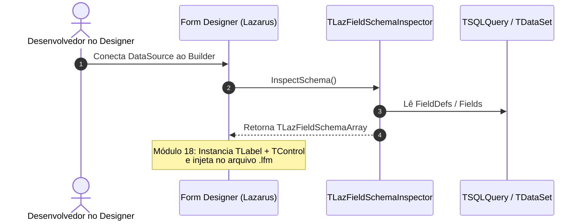

# MÓDULO 17: Engenharia de Arrastar e Soltar (Drag & Drop) no Designer

A experiência de desenvolvimento em ambientes RAD atinge seu ápice de produtividade através de operações de **Arrastar e Soltar (*Drag & Drop*)** diretamente sobre a superfície de desenho de formulários. Quando o arquiteto ou desenvolvedor arrasta uma tabela, consulta ou conjunto de campos a partir do inspetor de componentes ou de uma conexão ativa sobre um contêiner, a IDE não deve apenas posicionar um controle genérico: ela deve inspecionar os metadados do esquema relacional e instanciar os controles visuais ideais correspondentes a cada tipo de dado.

Neste módulo, desvendamos os mecanismos internos de captura em tempo de design da **Lazarus IDE (`FormEditingIntf`)** e implementamos o motor de introspecção de metadados **`TLazFieldSchemaInspector`**.

---

## 1. Introspecção em Tempo de Design e Extração de Esquemas

Quando um desenvolvedor associa um `TDataSet` a um contêiner inteligente, o primeiro desafio consiste em inspecionar com precisão a estrutura física e lógica da tabela, mesmo quando a conexão ainda não foi aberta em modo de execução (`Active = False`).

A LCL e a RTL do Free Pascal oferecem duas camadas de inspeção:



### 1.1 Metadados Essenciais de um Campo
Para que a geração de interface seja coerente, a extração deve capturar seis atributos fundamentais:

| Atributo | Propriedade no Pascal | Impacto na Geração da Interface |
|---|---|---|
| **Identificador Físico** | `FieldName` | Vinculação na propriedade `DataField` do controle. |
| **Rótulo Amigável** | `DisplayLabel` | Texto exibido na `TLabel` que acompanha o controle. |
| **Tipo Relacional** | `DataType` (`TFieldType`) | Escolha da classe visual (Edit, NumberEdit, CheckBox, etc.). |
| **Comprimento** | `Size` | Dimensionamento da largura (`Width`) e limite de caracteres. |
| **Obrigatoriedade** | `Required` / `faRequired` | Injeção de indicador visual (ex.: asterisco vermelho `*`). |
| **Máscara / Formato** | `EditMask` / `DisplayFormat` | Configuração de máscara de digitação em runtime. |

---

## 2. A Matriz de Mapeamento Tipo Relacional -> Controle Visual

A classe `TLazFieldSchemaInspector` encapsula uma função estática de resolução algorítmica:

```pascal
class function TLazFieldSchemaInspector.ResolveControlKind(
  AFieldType: TFieldType; ASize: Integer): TLazControlKind;
begin
  case AFieldType of
    ftString, ftFixedChar, ftWideString, ftFixedWideChar:
    begin
      if ASize > 255 then
        Result := ckMemo
      else
        Result := ckTextEdit;
    end;

    ftSmallint, ftInteger, ftWord, ftFloat, ftCurrency, ftBCD, ftLargeint, ftFMTBcd:
      Result := ckNumberEdit;

    ftDate, ftTime, ftDateTime, ftTimeStamp:
      Result := ckDatePicker;

    ftBoolean:
      Result := ckCheckBox;

    ftBlob, ftGraphic, ftParadoxOle, ftDBaseOle:
      Result := ckImageBlob;

    ftMemo, ftWideMemo:
      Result := ckMemo;

    else
      Result := ckTextEdit;
  end;
end;
```

---

## 3. Estruturação do Fluxo para o Gerador Automático

O resultado da introspecção é uma matriz tipada `TLazFieldSchemaArray`, fornecendo as coordenadas sugeridas (`SuggestedWidth`, `SuggestedHeight`) e a classe a ser instanciada:



---

## 4. Código-Fonte Integral do Motor de Introspecção

A implementação integral do motor de análise de esquemas e mapeamento de tipos, pronta para integração ao pacote de design-time e runtime da LCL, está disponível em:

👉 **Arquivo:** [`code/units/LazFieldSchemaInspector.pas`](file:///d:/Projetos%20AntiGravity/Livros%20componentes/Livro1_Lazarus_LCL/code/units/LazFieldSchemaInspector.pas)
