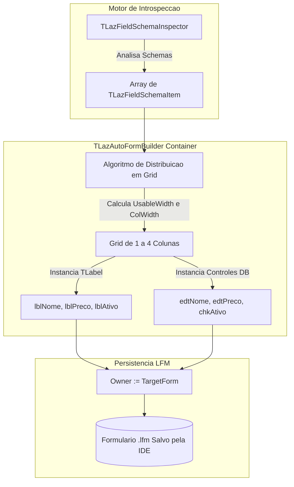

# MÓDULO 18: Construção do Componente Gerador de Cadastros (TLazAutoFormBuilder)

A construção de telas de cadastro (operações CRUD) consome tradicionalmente uma fatia desproporcional do tempo de engenharia em aplicações de gestão corporativa (ERP, CRM, WMS). Desenhar dezenas de rótulos (`TLabel`), caixas de edição (`TDBEdit`), configuradores numéricos e memorandos, vinculando manualmente propriedade por propriedade (`DataSource`, `DataField`), é uma tarefa repetitiva e suscetível a erros de digitação.

Neste módulo, elevamos a produtividade ao estado da arte ao construir o componente **`TLazAutoFormBuilder`**, um contêiner inteligente para a **LCL (Lazarus 3.x+)** capaz de materializar telas completas de cadastro com cálculo responsivo de grid e persistência automática na árvore `.lfm`.

---

## 1. Arquitetura do Motor Gerador de Telas

O `TLazAutoFormBuilder` descende de `TScrollBox`, garantindo suporte nativo a rolagem vertical quando o número de campos excede a área visível do formulário:



---

## 2. A Injeção no Grafo de Componentes e Persistência no `.lfm`

Um dos segredos mais críticos da engenharia de componentes geradores na LCL reside na **atribuição de propriedade (*Ownership*)**:

- Se um controle filho for instanciado com `Owner := Self`, ele pertence ao contêiner, mas o Lazarus **não cria a variável de membro** no formulário principal e não o serializa individualmente no `.lfm`.
- Para que o desenvolvedor tenha total acesso aos controles gerados (ex.: manipular `edtNome.Color` ou associar eventos) e para que eles sejam gravados permanentemente no `.lfm`, o `Owner` **deve ser o formulário proprietário** (`GetParentForm(Self)`):

```pascal
TargetForm := GetOwnerForm;
if TargetForm <> nil then
  EffectiveOwner := TargetForm
else
  EffectiveOwner := Self;

// Instanciação com registro no formulário
CtrlLabel := TLabel.Create(EffectiveOwner);
CtrlLabel.Parent := Self;
CtrlLabel.Name := EffectiveOwner.FindUniqueName('lbl' + SanitizedName);
```

---

## 3. Algoritmo de Distribuição em Grid Responsivo

O cálculo de largura útil desconta os espaçamentos horizontais configurados (`HorizontalSpacing`) e divide o espaço restante de maneira proporcional pelo número de colunas (`ColumnsCount`):

```pascal
UsableWidth := ClientWidth - (FHorizontalSpacing * (FColumnsCount + 1));
if UsableWidth < 200 then
  UsableWidth := 200;
ColWidth := UsableWidth div FColumnsCount;
```

A cada iteração sobre os campos inspecionados:
1. Posiciona a `TLabel` na coordenada `(CurLeft, RowTop)`.
2. Posiciona o controle DB-Aware correspondente logo abaixo da label.
3. Se a linha atingir o número máximo de colunas, reseta `ColIndex := 0` e avança o `RowTop` somando a altura do controle e o espaçamento vertical.

---

## 4. Código-Fonte Integral do Componente

A implementação completa do motor `TLazAutoFormBuilder`, livre de dependências externas e pronta para compilação no Lazarus, está disponível em:

👉 **Arquivo:** [`code/units/LazAutoFormBuilder.pas`](file:///d:/Projetos%20AntiGravity/Livros%20componentes/Livro1_Lazarus_LCL/code/units/LazAutoFormBuilder.pas)
