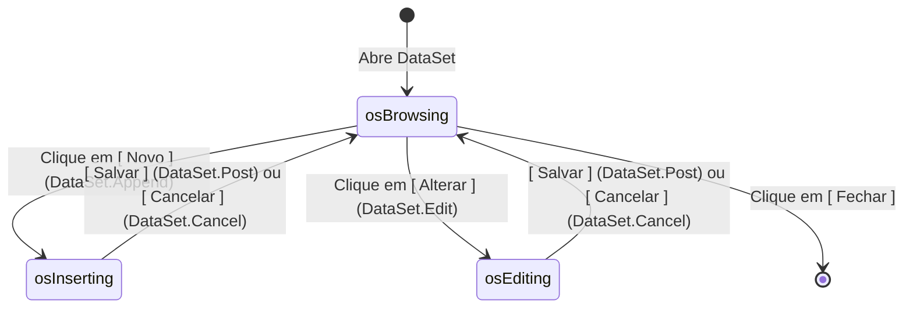

# MÓDULO 19: Caso de Estudo Real 1 — Gerador do Cadastro Completo de Clientes

Neste módulo, unificamos os blocos de engenharia construídos ao longo da Parte IV e Parte V para materializar uma aplicação comercial completa: o **Cadastro Corporativo de Clientes**. Demonstramos como os componentes `TLazAutoFormBuilder`, `TLazCRUDOperationsBar` e `TLazDBBadgeLabel` se articulam em uma arquitetura limpa e de alta fidelidade visual.

---

## 1. Arquitetura da Tela de Clientes

A janela de clientes é estruturada em três regiões bem definidas:

```
+---------------------------------------------------------------------------------+
| TLazCRUDOperationsBar: [ Novo ] [ Alterar ] [ Salvar ] [ Cancelar ] [ Excluir ] |
+---------------------------------------------------------------------------------+
| Header: Status do Cliente -> TLazDBBadgeLabel [ ATIVO / BLOQUEADO ]             |
+---------------------------------------------------------------------------------+
| TPageControl (Abas):                                                            |
|  [ 1. Dados Gerais ]  [ 2. Endereço e Contato ]  [ 3. Histórico e Crédito ]     |
| +-----------------------------------------------------------------------------+ |
| | TLazAutoFormBuilder:                                                        | |
| |  lblNome               lblDocumento (CPF/CNPJ)                              | |
| |  [ edtNome           ] [ edtDocumento           ]                           | |
| |  lblEmail              lblLimiteCredito                                     | |
| |  [ edtEmail          ] [ edtLimiteCredito       ]                           | |
| +-----------------------------------------------------------------------------+ |
+---------------------------------------------------------------------------------+
```

---

## 2. A Máquina de Estados Operacionais (`TLazCRUDOperationsBar`)

A barra de controle gerencia o ciclo de vida da interface reagindo automaticamente às transições de `TDataSet.State`:



### 2.1 Validação de CPF e CNPJ no Evento `OnValidateRecord`
Ao clicar no botão "Salvar", a barra dispara o evento `OnValidateRecord`. O código da aplicação invoca os métodos utilitários estáticos para impedir a gravação de documentos corrompidos:

```pascal
procedure TFormClientes.CRUDBarValidateRecord(Sender: TObject; var CanSave: Boolean);
var
  Doc: string;
begin
  Doc := QryClientes.FieldByName('CPF_CNPJ').AsString;
  if Length(TLazCRUDOperationsBar.OnlyDigits(Doc)) = 11 then
  begin
    if not TLazCRUDOperationsBar.ValidateCPF(Doc) then
    begin
      ShowMessage('CPF inválido. Corrija o documento antes de salvar.');
      CanSave := False;
    end;
  end
  else if Length(TLazCRUDOperationsBar.OnlyDigits(Doc)) = 14 then
  begin
    if not TLazCRUDOperationsBar.ValidateCNPJ(Doc) then
    begin
      ShowMessage('CNPJ inválido. Corrija o documento antes de salvar.');
      CanSave := False;
    end;
  end
  else
  begin
    ShowMessage('Informe um CPF (11 dígitos) ou CNPJ (14 dígitos) válido.');
    CanSave := False;
  end;
end;
```

---

## 3. Código-Fonte Integral dos Componentes do Caso de Estudo

A implementação completa da barra de operações com os algoritmos de validação de CPF e CNPJ está localizada em:

👉 **Arquivo:** [`code/units/LazCRUDOperationsBar.pas`](file:///d:/Projetos%20AntiGravity/Livros%20componentes/Livro1_Lazarus_LCL/code/units/LazCRUDOperationsBar.pas)
