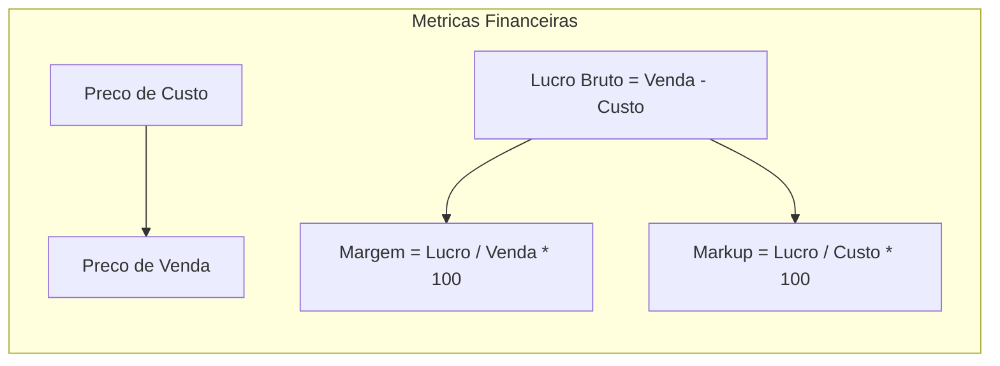

# MÓDULO 20: Caso de Estudo Real 2 — Gerador do Cadastro de Produtos e Itens

No varejo, na indústria e na distribuição, o cadastro de produtos representa o coração operacional das transações comerciais. Mais do que armazenar descrições e códigos de barras, uma tela profissional de catálogo de produtos deve prover inteligência financeira imediata: cálculo reativo de margem de lucro e markup em tempo real durante a digitação de preços, acompanhado de alertas visuais de risco de desabastecimento de estoque.

Neste módulo, implementamos o **Cadastro Inteligente de Produtos e Catálogo de Itens**, integrando o gerador `TLazAutoFormBuilder` com o componente visual **`TLazProductStockIndicator`**.

---

## 1. Topologia da Interface de Produtos

O formulário equilibra a entrada acelerada de dados com widgets analíticos de apoio à decisão:

```
+---------------------------------------------------------------------------------+
| TLazCRUDOperationsBar: [ Novo ] [ Alterar ] [ Salvar ] [ Cancelar ] [ Excluir ] |
+---------------------------------------------------------------------------------+
| TLazAutoFormBuilder (Dados do Item):                                            |
|  lblCodigo                  lblDescricao                                        |
|  [ edtCodigo              ] [ edtDescricao                                    ] |
|  lblPrecoCusto              lblPrecoVenda                                       |
|  [ edtPrecoCusto          ] [ edtPrecoVenda                                   ] |
+---------------------------------------------------------------------------------+
| Painel Financeiro e Estoque:                                                    |
|  Margem de Lucro: [ 35.50% ]  |  Markup: [ 55.00% ]                             |
|  TLazProductStockIndicator:                                                     |
|  Estoque: NORMAL (142.0)                                                        |
|  [==========================--------------------------------------------------] |
+---------------------------------------------------------------------------------+
```

---

## 2. Modelagem Matemática: Margem de Lucro vs. Markup

Um dos erros conceituais mais comuns em sistemas comerciais é a confusão entre **Margem de Lucro** e **Markup**:



A classe `TLazProductStockIndicator` provê essas fórmulas como métodos de classe puros:

```pascal
class function TLazProductStockIndicator.CalculateMargin(CostPrice, SellPrice: Double): Double;
begin
  if SellPrice <= 0 then
    Exit(0.0);
  Result := ((SellPrice - CostPrice) / SellPrice) * 100.0;
end;

class function TLazProductStockIndicator.CalculateMarkup(CostPrice, SellPrice: Double): Double;
begin
  if CostPrice <= 0 then
    Exit(0.0);
  Result := ((SellPrice - CostPrice) / CostPrice) * 100.0;
end;
```

---

## 3. Monitoramento Visual dos Níveis de Estoque

O `TLazProductStockIndicator` atua de forma reativa a cada mudança de linha no dataset (`DataChange`), avaliando os campos configurados (`CurrentStockField`, `MinStockField`, `MaxStockField`) e colorindo dinamicamente a barra de capacidade:

- **Estoque Crítico (`slCritical`):** Quantidade atual $\le$ Estoque Mínimo. Pinta em vermelho vivo com alerta.
- **Ponto de Reposição (`slWarning`):** Quantidade próxima ao mínimo ($\le 1.25 \times \text{Mínimo}$). Pinta em âmbar/laranja.
- **Estoque Saudável (`slNormal`):** Nível ideal de operação. Pinta em verde.
- **Estoque em Excesso (`slExcess`):** Quantidade superior ao teto configurado. Pinta em azul cobalto para alertar sobre capital imobilizado.

---

## 4. Código-Fonte Integral do Componente

A implementação completa do medidor visual de estoque com fórmulas financeiras está disponível em:

👉 **Arquivo:** [`code/units/LazProductStockIndicator.pas`](file:///d:/Projetos%20AntiGravity/Livros%20componentes/Livro1_Lazarus_LCL/code/units/LazProductStockIndicator.pas)
