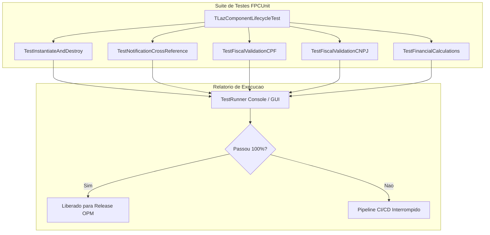

# MÓDULO 24: Testes Unitários de Componentes, Profiling e Prevenção de Leaks (FPCUnit & Heaptrc)

Componentes de software são bibliotecas reutilizáveis destinadas a serem consumidas por centenas de aplicações e desenvolvedores. Qualquer vazamento de memória (*Memory Leak*), violação de integridade ou efeito colateral em uma rotina de ciclo de vida pode propagar falhas catastróficas por todo o sistema cliente. Por essa razão, a engenharia de componentes exige uma disciplina rigorosa de **Testes Unitários Automatizados** e **Auditoria Estrita de Heap**.

Neste módulo, estruturamos uma suíte de testes com o framework nativo **FPCUnit** e demonstramos o uso cirúrgico do **Heaptrc (`-gh`)** para garantir componentes à prova de vazamentos.

---

## 1. Automação de Testes com FPCUnit

O FPCUnit é o framework xUnit nativo do Free Pascal, permitindo criar baterias de testes regressivos para validar componentes antes de cada release:



### 1.1 Testando o Mecanismo de Referências Cruzadas (`Notification`)
Um dos testes mais vitais valida se referências fracas são limpas automaticamente quando o componente dependente é destruído:

```pascal
procedure TLazComponentLifecycleTest.TestNotificationCrossReference;
var
  HostPanel: TLazSafeLinkedPanel;
  DummyTarget: TComponent;
begin
  HostPanel := TLazSafeLinkedPanel.Create(nil);
  try
    DummyTarget := TComponent.Create(nil);
    try
      HostPanel.LinkComponent(DummyTarget);
      AssertEquals('Deve haver 1 componente vinculado', 1, HostPanel.LinkedCount);
    finally
      DummyTarget.Free; // Destrói o alvo antes do host
    end;

    // O mecanismo Notification deve expurgar a referência órfã
    AssertEquals('A referência deve ser removida automaticamente', 0, HostPanel.LinkedCount);
  finally
    HostPanel.Free;
  end;
end;
```

---

## 2. Auditoria Cirúrgica de Memória com o Heaptrc (`-gh`)

O compilador Free Pascal inclui um profiler nativo de gerenciamento de heap capaz de rastrear todos os blocos de memória alocados. Para ativá-lo, basta adicionar a flag `-gh` nos parâmetros do compilador ou em *Project Options -> Debugging -> Check for memory leaks on exit*:

```
Heap dump by heaptrc unit of D:\Projetos\test_runner.exe
3847 memory blocks allocated : 291834/302912
3847 memory blocks freed     : 291834/302912
0 unfreed memory blocks : 0
True heap size : 458752
True free heap : 458752
```

Se a linha **`0 unfreed memory blocks : 0`** for exibida, o componente possui certificação de **Zero Memory Leak**. Caso contrário, o Heaptrc despeja o *Call Stack* exato de onde a alocação órfã se originou.

---

## 3. O Padrão `BeginUpdate` / `EndUpdate`

Controles que manipulam coleções ou grandes matrizes de dados devem suspender os eventos de repintura durante modificações em lote:

```pascal
procedure TLazCustomTabBar.BeginUpdate;
begin
  Inc(FUpdateCount);
end;

procedure TLazCustomTabBar.EndUpdate;
begin
  if FUpdateCount > 0 then
  begin
    Dec(FUpdateCount);
    if FUpdateCount = 0 then
      Invalidate; // Dispara uma única repintura ao final de todas as inserções
  end;
end;
```

---

## 4. Código-Fonte Integral da Suíte de Testes

A suíte completa de testes unitários para os componentes do livro está disponível em:

👉 **Arquivo:** [`code/units/LazComponentTests.pas`](file:///d:/Projetos%20AntiGravity/Livros%20componentes/Livro1_Lazarus_LCL/code/units/LazComponentTests.pas)
