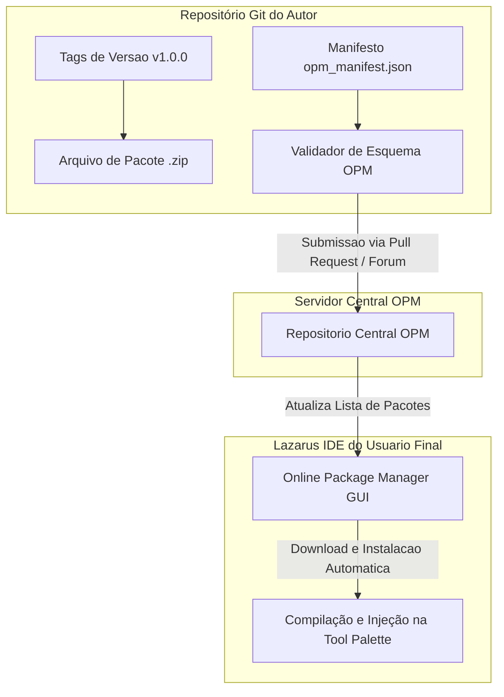

# MÓDULO 25: Publicação, Versionamento e Distribuição nos Ecossistemas Oficiais (OPM & CI/CD)

A conclusão do ciclo de engenharia de componentes não termina com o código funcionando na máquina local do desenvolvedor. Para que uma biblioteca alcance adoção em larga escala na comunidade global de **Free Pascal / Lazarus**, ela deve ser empacotada de acordo com as convenções oficiais, disponibilizada no **Online Package Manager (OPM)** e validada continuamente em pipelines de **Integração Contínua (CI/CD)** multiplataforma.

Neste módulo final do Livro 1, estabelecemos as diretrizes de governança de código, estruturação de manifestos OPM e automação de builds headless com **`lazbuild`**.

---

## 1. Estrutura Canônica de um Repositório de Componentes LCL

Um repositório profissional deve segregar responsabilidades para garantir compilações limpas tanto em servidores sem interface gráfica (*headless servers*) quanto em desktops com a IDE completa:

```
repo-root/
├── .github/
│   └── workflows/
│       └── ci_lazbuild.yml        # Automação de CI/CD via GitHub Actions
├── docs/                          # Documentação e manuais em Markdown
├── src/                           # Código-fonte das unidades de runtime (.pas)
├── design/                        # Editores de propriedades e wizards (.pas)
├── packages/
│   ├── laz_eng_components_rt.lpk  # Pacote de execução (RunTimeOnly)
│   ├── laz_eng_components_dt.lpk  # Pacote de design (DesignTime)
│   └── opm_manifest.json          # Manifesto oficial do Online Package Manager
├── test/                          # Suíte de testes automatizados com FPCUnit
└── README.md                      # Instruções de instalação e licença
```

---

## 2. Publicação no Online Package Manager (OPM)

O **Online Package Manager (OPM)** é o gerenciador de pacotes oficial embutido no Lazarus (acessível pelo menu *Package -> Online Package Manager*). Ele permite que desenvolvedores instalem bibliotecas com um único clique, resolvendo dependências automaticamente.



### 2.1 O Arquivo de Manifesto JSON
O arquivo de manifesto descreve os requisitos mínimos de compilador (`FPCMinVersion`), versão da IDE (`LazMinVersion`) e a lista de pacotes a serem registrados:

```json
{
  "PackageName": "laz_eng_components",
  "DisplayName": "Lazarus Component Engineering Suite",
  "Category": "Components",
  "Version": "1.0.0.0",
  "Dependencies": [
    { "Name": "LCL", "MinVersion": "3.0.0" },
    { "Name": "SQLDB", "MinVersion": "1.0.0" }
  ],
  "Packages": [
    { "Name": "laz_eng_components_rt.lpk", "Type": "RunTimeOnly" },
    { "Name": "laz_eng_components_dt.lpk", "Type": "DesignTime" }
  ],
  "FPCMinVersion": "3.2.2",
  "LazMinVersion": "3.0.0"
}
```

---

## 3. Automação de CI/CD com `lazbuild`

A ferramenta de linha de comando `lazbuild` permite compilar pacotes e projetos Lazarus de forma determinística sem abrir a interface gráfica. O workflow do GitHub Actions executa compilações cruzadas em matriz para **Windows** e **Linux (Ubuntu)**:

```bash
# Compilação do pacote de runtime sem abrir a IDE
lazbuild --build-all code/packages/laz_eng_components_rt.lpk

# Compilação do pacote de design-time
lazbuild --build-all code/packages/laz_eng_components_dt.lpk
```

Se qualquer alteração quebrar a compilação ou introduzir um erro sintático, o pipeline bloqueia o merge do *Pull Request* antes que o defeito chegue aos usuários finais.

---

## 4. Códigos e Arquivos de Infraestrutura

Os arquivos completos de manifesto e pipeline estão disponíveis em:

👉 **Manifesto OPM:** [`code/packages/opm_manifest.json`](file:///d:/Projetos%20AntiGravity/Livros%20componentes/Livro1_Lazarus_LCL/code/packages/opm_manifest.json)  
👉 **Pipeline GitHub Actions:** [`code/ci/github_actions_lazbuild.yml`](file:///d:/Projetos%20AntiGravity/Livros%20componentes/Livro1_Lazarus_LCL/code/ci/github_actions_lazbuild.yml)
