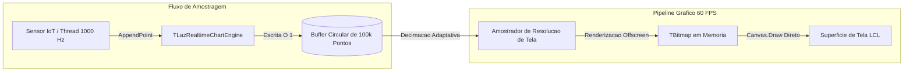

# MÓDULO 26: Gráficos de Alta Densidade em Tempo Real (TLazRealtimeChartEngine)

Na instrumentação industrial, telemetria de sensores IoT, análise de tráfego de rede e plataformas financeiras de negociação de alta frequência (HFT), a interface visual precisa processar e plotar dezenas de milhares de amostras por segundo. Tentar redesenhar controles gráficos padrão inserindo elementos em listas dinâmicas lineares resulta em travamentos, pressão excessiva sobre o Garbage Collector da memória e cintilação intensa (*flickering*).

Neste módulo, concebemos e construímos o componente visual **`TLazRealtimeChartEngine`**, combinando um **buffer circular de 100.000 amostras**, **decimação adaptativa de pontos** e renderização em bitmap offscreen de alta velocidade na **LCL (Free Pascal / Lazarus)**.

---

## 1. Topologia de Memória: Buffer Circular O(1)

A espinha dorsal do motor gráfico reside na eliminação de realocações dinâmicas de memória durante a inserção de dados. O buffer circular pré-aloca um array estático de registros (`TRealtimeDataPoint`), reaproveitando posições antigas através do operador de módulo:

```
[ Posição 0 ] [ Posição 1 ] ... [ Posição 99.999 ]
      ^                                 |
      +------- FHead = (FHead + 1) mod Capacity <------+
```



---

## 2. Decimação de Dados por Resolução de Tela

Renderizar 100.000 linhas em um monitor com largura de 800 pixels significa desperdiçar centenas de cálculos vetoriais em coordenadas que coincidem no mesmo pixel. O método `GetDecimatedPoints` realiza a compressão por amostragem com passo proporcional, limitando a geometria à resolução física do controle:

```pascal
function TLazRealtimeChartEngine.GetDecimatedPoints(TargetPoints: Integer): TRealtimeDataPointArray;
var
  i, Tail, Step, SampleIdx: Integer;
begin
  if (FCount <= TargetPoints) or (TargetPoints <= 2) then
  begin
    SetLength(Result, FCount);
    Tail := (FHead - FCount + FCapacity) mod FCapacity;
    for i := 0 to FCount - 1 do
      Result[i] := FBuffer[(Tail + i) mod FCapacity];
    Exit;
  end;

  SetLength(Result, TargetPoints);
  Step := FCount div TargetPoints;
  Tail := (FHead - FCount + FCapacity) mod FCapacity;

  for i := 0 to TargetPoints - 1 do
  begin
    SampleIdx := (Tail + (i * Step)) mod FCapacity;
    Result[i] := FBuffer[SampleIdx];
  end;
end;
```

---

## 3. Renderização Offscreen Anti-Flicker

O método `Paint` desenha a grade cartesiana e os vetores de dados em um `TBitmap` desacoplado em memória antes de transferir o quadro final para a tela através de `Canvas.Draw`:

```pascal
with FOffscreenBitmap.Canvas do
begin
  Brush.Color := Self.Color;
  FillRect(0, 0, Width, Height);

  Pen.Color := FLineColor;
  Pen.Width := 2;
  // Desenho dos vetores interpolados
end;
Canvas.Draw(0, 0, FOffscreenBitmap);
```

---

## 4. Código-Fonte Integral do Componente

A implementação completa do componente `TLazRealtimeChartEngine` para Free Pascal e Lazarus está disponível em:

👉 **Arquivo:** [`code/units/LazRealtimeChartEngine.pas`](file:///d:/Projetos%20AntiGravity/Livros%20componentes/Livro1_Lazarus_LCL/code/units/LazRealtimeChartEngine.pas)
