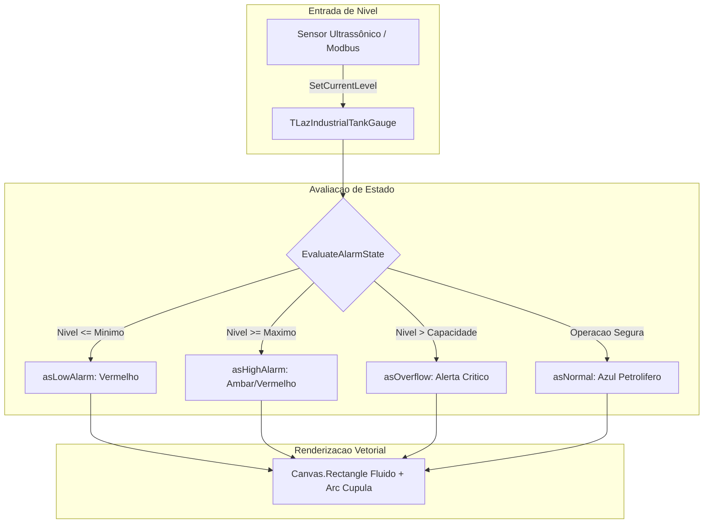

# MÓDULO 27: Medidores de Nível e Tanques Industriais (TLazIndustrialTankGauge)

Em plantas de automação industrial, estações de tratamento de água, refinarias químicas e sistemas de gerenciamento predial (BMS), a representação gráfica de silos, reservatórios e tanques de armazenamento cilíndricos exige precisão geométrica e resposta dinâmica imediata a transbordamentos ou esvaziamento crítico.

Neste módulo, desenvolvemos o componente visual vetorial **`TLazIndustrialTankGauge`**, implementado em **Lazarus / LCL**, com preenchimento volumétrico proporcional, marcas graduadas de calibração, cúpula superior curva e máquina de estados de alarme.

---

## 1. Topologia Visual e Geometria do Tanque

O controle projeta um cilindro com domo superior hemisférico, dividindo a área de desenho em zona de fluido, corpo estrutural e régua graduada lateral:

```
          .-------.         <-- Cúpula Superior (Arc)
         /         \
        |           |  ---  1000 m³ (Tick)
        |~~~~~~~~~~~|  ---   750 m³
        |  Fluido   |  ---   500 m³
        |  Ativo    |  ---   250 m³
        |___________|  ---     0 m³
         650.0 m³ (65%)     <-- Rótulo de Nível
```



---

## 2. Cálculo Proporcional e Alertas

A porcentagem volumétrica é computada em ponto flutuante, atualizando a altura geométrica do fluido:

```pascal
FluidH := Round((GetLevelPercentage / 100.0) * TankHeight);
FluidTop := TankBottom - FluidH;

Canvas.Brush.Color := ActiveColor;
if FluidH > 0 then
  Canvas.Rectangle(TankLeft + 3, FluidTop, TankRight - 3, TankBottom);
```

Sempre que a variável de processo ultrapassa os limites pré-estabelecidos (`LowAlarmLevel` ou `HighAlarmLevel`), o evento `OnAlarmTriggered` é disparado para atuação imediata de válvulas ou sirenes no supervisório.

---

## 3. Código-Fonte Integral do Componente

A implementação completa do medidor industrial `TLazIndustrialTankGauge` para Free Pascal e Lazarus está disponível em:

👉 **Arquivo:** [`code/units/LazIndustrialTankGauge.pas`](file:///d:/Projetos%20AntiGravity/Livros%20componentes/Livro1_Lazarus_LCL/code/units/LazIndustrialTankGauge.pas)
