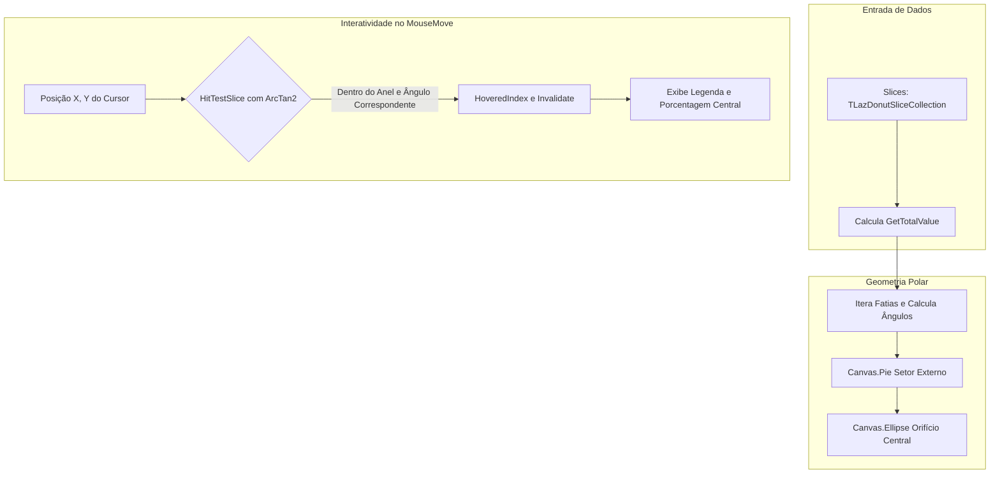

# MÓDULO 28: Gráficos de Radar e Donut Vetorial (TLazVectorDonutChart)

Dashboards analíticos corporativos exigem a exibição sintética da distribuição percentual de dados (composição de faturamento, alocação de recursos em nuvem, métricas de vendas por canal). Embora os gráficos de pizza clássicos (*Pie Charts*) sejam comuns, o design de interface contemporâneo prioriza gráficos em formato **Donut (Rosca)**, pois o espaço oco central permite exibir o valor total consolidado ou os detalhes da fatia ativa sob o cursor do mouse.

Neste módulo, projetamos e construímos o componente **`TLazVectorDonutChart`**, utilizando **trigonometria polar nativa** e algoritmo de **Hit-Testing por coordenadas angulares** para a LCL (Free Pascal / Lazarus).

---

## 1. Trigonometria e Geometria da Rosca

Cada fatia da rosca é delimitada por um raio externo ($R_{ext}$) e um raio interno ($R_{int}$), com abertura proporcional ao valor da fatia em relação ao total:

$$
\theta_{\text{varredura}} = \left(\frac{\text{Valor}}{\text{Total}}\right) \times 360^{\circ}
$$

As extremidades do setor circular são computadas através de projeção trigonométrica:

$$
X = C_x + R_{ext} \cdot \cos(\theta), \quad Y = C_y + R_{ext} \cdot \sin(\theta)
$$



---

## 2. Hit-Testing Polar de Alta Precisão

Diferente de controles que utilizam máscaras de bitmap pesadas, o método `HitTestSlice` resolve a fatia apontada pelo mouse aplicando a fórmula da distância euclidiana e o arco tangente de dois parâmetros (`ArcTan2`):

```pascal
DistSq := Sqr(X - Cx) + Sqr(Y - Cy);
Dist := Sqrt(DistSq);

if (Dist < InnerR) or (Dist > OuterR) then
  Exit(-1); // Fora do anel da rosca

AngleRad := ArcTan2(Y - Cy, X - Cx);
AngleDeg := RadToDeg(AngleRad);
if AngleDeg < 0 then
  AngleDeg := AngleDeg + 360.0;
```

---

## 3. Código-Fonte Integral do Componente

A unidade com a implementação completa do gráfico Donut vetorial `TLazVectorDonutChart` está localizada em:

👉 **Arquivo:** [`code/units/LazVectorDonutChart.pas`](file:///d:/Projetos%20AntiGravity/Livros%20componentes/Livro1_Lazarus_LCL/code/units/LazVectorDonutChart.pas)
