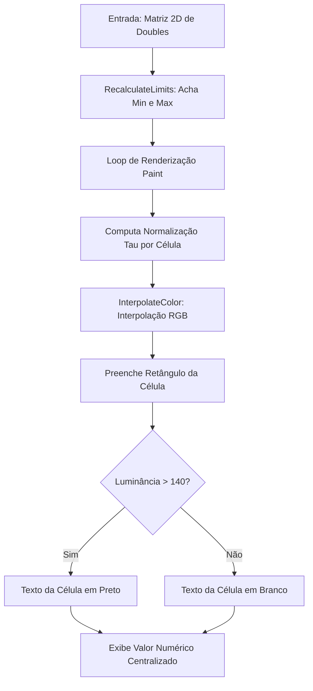

# MÓDULO 29: Visualizador de Mapas de Calor (TLazMatrixHeatmap)

A análise exploratória de dados complexos — como correlação estatística entre variáveis de negócios, distribuição espacial de tráfego, telemetria de sensores industriais e matrizes de risco financeiro — requer ferramentas visuais capazes de sintetizar centenas de números simultaneamente. O **Mapa de Calor Matricial (*Heatmap*)** converte valores contínuos em um gradiente de cores térmicas perceptualmente intuitivo.

Neste módulo, construímos o **`TLazMatrixHeatmap`**, um controle visual para Free Pascal e Lazarus LCL baseado em matrizes bidimensionais com interpolação de gradiente linear em espaço RGB, cálculo dinâmico de limites extremos e contraste tipográfico adaptativo por luminância.

---

## 1. Fundamentos Matemáticos: Interpolação de Gradientes e Luminância

A representação cromática de um valor escalar $V$ restrito ao intervalo $[V_{\min}, V_{\max}]$ baseia-se na normalização linear da taxa $\tau \in [0, 1]$:

$$
\tau = \frac{V - V_{\min}}{V_{\max} - V_{\min}}
$$

Para cada canal cromático elementar ($R, G, B$), a interpolação entre a cor fria inicial ($C_{\min}$) e a cor quente final ($C_{\max}$) é resolvida independentemente:

$$
R(\tau) = R_{\min} + \tau \cdot (R_{\max} - R_{\min})
$$
$$
G(\tau) = G_{\min} + \tau \cdot (G_{\max} - G_{\min})
$$
$$
B(\tau) = B_{\min} + \tau \cdot (B_{\max} - B_{\min})
$$

### Contraste Tipográfico por Luminância Relativa

Para garantir legibilidade absoluta do texto numérico desenhado sobre a célula colorida, calcula-se a luminância aparente do fundo utilizando os coeficientes padrão ITU-R BT.601:

$$
Y = 0.299 \cdot R + 0.587 \cdot G + 0.114 \cdot B
$$

Se $Y > 140$, a fonte selecionada é preta (`clBlack`); caso contrário, a fonte é renderizada em branco puro (`clWhite`).



---

## 2. Detecção e Interatividade com Células

A interface expõe seleção visual por cursor do mouse sobrepondo uma moldura contrastante de 2 pixels e despachando o evento `OnCellClick`:

```pascal
procedure TLazMatrixHeatmap.MouseDown(Button: TMouseButton; Shift: TShiftState; X, Y: Integer);
var
  CellW, CellH: Single;
  R, C: Integer;
begin
  inherited MouseDown(Button, Shift, X, Y);
  if (Button = mbLeft) and (FRowCount > 0) and (FColCount > 0) then
  begin
    CellW := Width / FColCount;
    CellH := Height / FRowCount;
    C := Trunc(X / CellW);
    R := Trunc(Y / CellH);
    if (R >= 0) and (R < FRowCount) and (C >= 0) and (C < FColCount) then
    begin
      FSelectedRow := R;
      FSelectedCol := C;
      Invalidate;
      if Assigned(FOnCellClick) then
        FOnCellClick(Self, R, C, FData[R, C]);
    end;
  end;
end;
```

---

## 3. Código-Fonte e Integração LCL

A implementação integral do componente encontra-se em [`LazMatrixHeatmap.pas`](file:///d:/Projetos%20AntiGravity/Livros%20componentes/Livro1_Lazarus_LCL/code/units/LazMatrixHeatmap.pas).

O componente é registrado na paleta `'Lazarus Engenharia Avancada'` e integra-se diretamente com formulários LCL, suportando redimensionamento fluido via `Align := alClient` ou `Anchors`.
