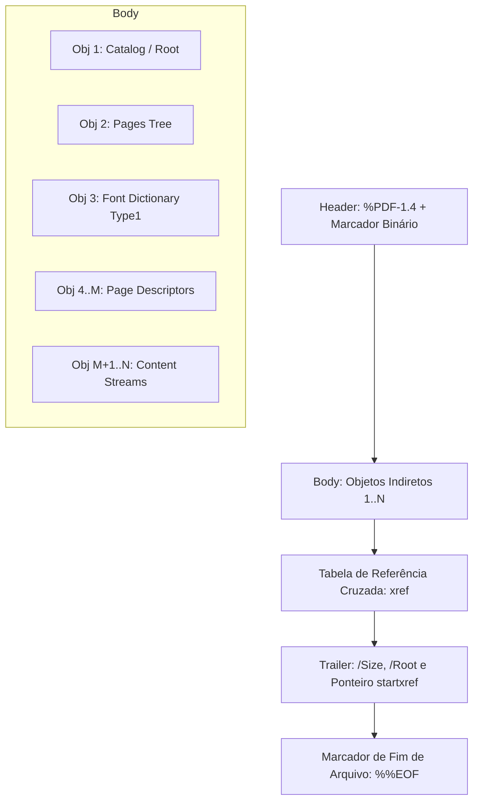

# MÓDULO 30: Motor Gerador de PDFs e Documentos Financeiros (TLazFastPdfReportBuilder)

A emissão de relatórios gerenciais, extratos consolidados, borderôs bancários e faturas fiscais é um requisito crítico em sistemas corporativos. A dependência de impressoras virtuais do sistema operacional (como Microsoft Print to PDF) ou de bibliotecas dinâmicas externas (como libharu ou wkhtmltopdf) cria fragilidades de implantação em ambientes heterogêneos Linux, Windows e macOS.

Neste módulo, projetamos e construímos o **`TLazFastPdfReportBuilder`**, um gerador de arquivos PDF nativo escrito em Free Pascal puro (compatível com a especificação ISO 32000-1 / PDF 1.4), sem dependências de DLLs, executando serialização direta da gramática binária do formato PDF.

---

## 1. A Estrutura Interna de um Arquivo PDF

Um arquivo PDF válido é estruturado em quatro seções fundamentais:



1. **Header:** Identifica a versão do formato (`%PDF-1.4`) acompanhado de bytes com bit alto ativado (`%âãÏÓ`) para forçar o reconhecimento em modo binário por gateways FTP e navegadores.
2. **Body:** Coleção de objetos indiretos (`X 0 obj ... endobj`) que representam o Catálogo, a árvore de Páginas (`/Pages`), fontes tipográficas e *streams* gráficos vetoriais.
3. **Cross-Reference Table (`xref`):** Tabela de indexação que mapeia o deslocamento exato em bytes (*byte offset*) de cada objeto a partir do início do arquivo, permitindo acesso aleatório e renderização assíncrona por visualizadores de PDF.
4. **Trailer:** Referencia o objeto raiz (`/Root 1 0 R`) e informa a posição exata da tabela `xref`.

---

## 2. Operadores Gráficos Vetoriais e Sistema de Coordenadas

Ao contrário do sistema de coordenadas de tela padrão (onde a origem `(0, 0)` reside no canto superior esquerdo com $Y$ apontando para baixo), o PDF utiliza o sistema cartesiano tradicional: a origem `(0, 0)` está no canto **inferior esquerdo**, e os valores de $Y$ crescem em direção ao topo da página.

O componente realiza automaticamente a conversão de unidades (milímetros para pontos tipográficos de 72 dpi) e inverte o eixo vertical:

$$
Y_{\text{PDF}} = \text{PageHeight}_{\text{pt}} - \left(Y_{\text{mm}} \cdot \frac{72.0}{25.4}\right)
$$

### Operadores de Stream Empregados
- `BT` / `ET`: Delimitam blocos de texto (*Begin Text* / *End Text*).
- `Tf`: Seleciona fonte e corpo tipográfico (ex: `/F1 10 Tf`).
- `Td`: Desloca a matriz de texto para as coordenadas absolutas calculadas.
- `Tj`: Imprime a cadeia literal de caracteres com escape obrigatório de parênteses `\(` e `\)`.
- `re` / `m` / `l` / `S` / `f`: Criação e preenchimento de retângulos, movimentação de cursor gráfico, traçado de linhas e preenchimento de polígonos.
- `rg` / `RG`: Ajuste de cores RGB de preenchimento e contorno em valores normalizados entre $0.0$ e $1.0$.

---

## 3. Emissão de Extratos Financeiros e Zebrado

O método `DrawFinancialRow` automatiza a geração de grades de extratos bancários com formatação de colunas, alinhamento numérico à direita e linhas delimitadoras:

```pascal
procedure TLazFastPdfReportBuilder.DrawFinancialRow(Y: Double; const Col1, Col2, Col3, Col4: string;
  W1, W2, W3, W4: Double; IsHeader: Boolean);
var
  CurrX: Double;
begin
  if IsHeader then
  begin
    SetFillColor($00F0E6D8);
    DrawRect(15, Y - 1, W1 + W2 + W3 + W4, 7, True, False);
    SetDrawColor(clBlack);
  end;
  CurrX := 15;
  DrawText(CurrX + 1, Y + 4, Col1, 9, ptaLeft);
  CurrX := CurrX + W1;
  DrawText(CurrX + 1, Y + 4, Col2, 9, ptaLeft);
  CurrX := CurrX + W2;
  DrawText(CurrX + W3 - 2, Y + 4, Col3, 9, ptaRight);
  CurrX := CurrX + W3;
  DrawText(CurrX + W4 - 2, Y + 4, Col4, 9, ptaRight);
  SetDrawColor($00E0E0E0);
  DrawLine(15, Y + 6, 15 + W1 + W2 + W3 + W4, Y + 6, 0.2);
end;
```

---

## 4. Código-Fonte e Integração

A unidade completa está implementada em [`LazFastPdfReport.pas`](file:///d:/Projetos%20AntiGravity/Livros%20componentes/Livro1_Lazarus_LCL/code/units/LazFastPdfReport.pas).
O componente não requer inicialização de interface visual (pode ser executado em modo console, serviços daemon ou aplicações LCL comuns) e é registrado na paleta `'Lazarus Engenharia Avancada'`.
