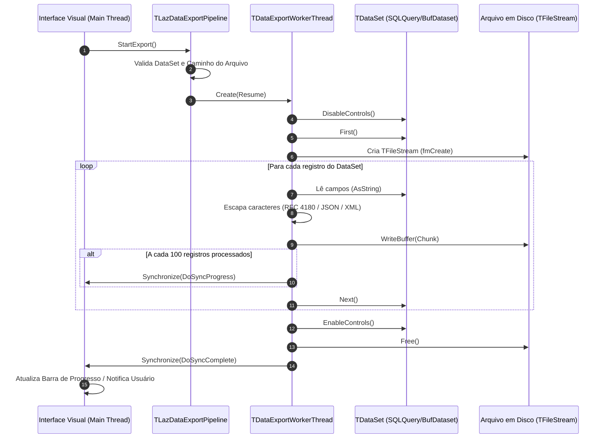

# MÓDULO 31: Pipeline de Exportação em Segundo Plano (TLazDataExportPipeline)

Exportar centenas de milhares de registros de um banco de dados relacional para formatos padronizados (como CSV, JSONL ou planilhas) diretamente no *thread* de interface gráfica (Main Thread) é uma das causas primárias do congelamento de telas ("A aplicação não está respondendo") em sistemas corporativos legados.

Neste módulo, construímos o **`TLazDataExportPipeline`**, um componente para Free Pascal e Lazarus que orquestra a exportação assíncrona por *streaming* a partir de qualquer descendente de `TDataSet` (`TSQLQuery`, `TBufDataset`, `TMemDataset`), utilizando uma `TThread` dedicada, paginação de notificações com `Synchronize` e suporte nativo a três formatos de dados.

---

## 1. Arquitetura Multithread e Fluxo de Execução

O diagrama abaixo detalha o ciclo de vida do pipeline e a sincronização com a GUI:



---

## 2. Padrões de Formatação Implementados

### A. CSV em Conformidade com RFC 4180
Campos contendo delimitadores de coluna (`;` ou `,`), quebras de linha (`#10` ou `#13`) ou aspas duplas (`"`) são encapsulados em aspas duplas com escape dobrado (`""`):

```pascal
function TDataExportWorkerThread.EscapeCsvField(const S: string): string;
begin
  if (Pos('"', S) > 0) or (Pos(',', S) > 0) or (Pos(';', S) > 0) or (Pos(#10, S) > 0) then
    Result := '"' + StringReplace(S, '"', '""', [rfReplaceAll]) + '"'
  else
    Result := S;
end;
```

### B. JSONL (JSON Lines) para Pipelines de Big Data e IA
Cada linha do arquivo gerado representa um objeto JSON autônomo e válido, permitindo ingestão paralela de grandes volumes sem a necessidade de carregar arrays JSON inteiros na memória RAM:

```text
{"ID": "1001", "NOME": "Servidor Cloud Alpha", "VALOR": "450.00"}
{"ID": "1002", "NOME": "Cluster Kubernetes Beta", "VALOR": "1290.50"}
```

### C. XML Spreadsheet (Compatibilidade com Excel sem OLE Automation)
Gera arquivos em formato XML Spreadsheet 2003 (`urn:schemas-microsoft-com:office:spreadsheet`), permitindo abertura nativa no Microsoft Excel, LibreOffice Calc e Google Planilhas sem requerer nenhuma biblioteca externa.

---

## 3. Código-Fonte e Registro LCL

O código-fonte integral encontra-se em [`LazDataExportPipeline.pas`](file:///d:/Projetos%20AntiGravity/Livros%20componentes/Livro1_Lazarus_LCL/code/units/LazDataExportPipeline.pas).

O componente é registrado na paleta `'Lazarus Engenharia Avancada'`, oferecendo as propriedades `DataSet`, `OutputFile`, `Format` e os eventos de resposta assíncrona `OnProgress` e `OnComplete`.
