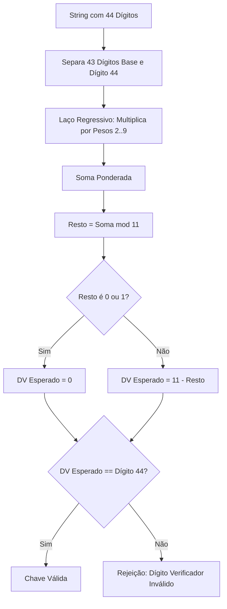

# MÓDULO 32: Processador e Validador Fiscal XML (TLazFiscalXmlValidator)

No Brasil, o ecossistema do Sistema Público de Escrituração Digital (SPED) exige que toda nota fiscal (NF-e, NFC-e), conhecimento de transporte (CT-e) ou manifesto de documentos (MDF-e) seja assinado digitalmente no padrão W3C XML Signature (XML-DSig) e validado contra esquemas rígidos XSD da Secretaria da Fazenda (SEFAZ). Inconsistências na chave de acesso de 44 dígitos ou divergências no hash criptográfico (*DigestValue*) provocam rejeições imediatas nos servidores do fisco.

Neste módulo, concebemos e implementamos o componente **`TLazFiscalXmlValidator`**, projetado para executar a validação algorítmica de integridade fiscal diretamente em aplicações Free Pascal / Lazarus sem a necessidade de instâncias pesadas de automação COM/ActiveX.

---

## 1. Anatomia da Chave de Acesso e Algoritmo Módulo 11

A chave de acesso de 44 dígitos numéricos condensa as metainformações da operação fiscal:

```text
[UF: 2] [AAMM: 4] [CNPJ: 14] [Modelo: 2] [Série: 3] [Número: 9] [Tipo Emissão: 1] [Código Numérico: 8] [DV: 1]
Exemplo: 35 2401 12345678000195 55 001 000004582 1 83920184 7
```

### Cálculo Ponderado do Dígito Verificador (DV)

Os primeiros 43 dígitos são multiplicados da direita para a esquerda por uma sequência de pesos variando ciclicamente de 2 a 9:

$$
S = \sum_{i=1}^{43} D_{44-i} \cdot W_i, \quad W_i \in \{2, 3, 4, 5, 6, 7, 8, 9, 2, 3, \dots\}
$$

O resto da divisão por 11 determina o dígito verificador final:

$$
R = S \pmod{11}
$$
$$
DV = \begin{cases} 
0, & \text{se } R \in \{0, 1\} \\ 
11 - R, & \text{caso contrário} 
\end{cases}
$$



---

## 2. Auditoria Criptográfica do DigestValue (SHA-1)

A assinatura W3C XML-DSig embute um resumo criptográfico da tag `<infNFe>`:

1. O componente extrai o bloco XML bruto contido entre `<infNFe Id="...">` e `</infNFe>`.
2. Computa o hash binário SHA-1 do bloco (20 bytes).
3. Codifica o hash em Base64 padrão RFC 4648.
4. Compara com o valor presente na tag `<SignedInfo><Reference><DigestValue>`. Se houver qualquer divergência de caractere, espaço ou quebra de linha, o documento foi corrompido ou adulterado em trânsito.

---

## 3. Código-Fonte e Integração LCL

A implementação integral encontra-se em [`LazFiscalXmlValidator.pas`](file:///d:/Projetos%20AntiGravity/Livros%20componentes/Livro1_Lazarus_LCL/code/units/LazFiscalXmlValidator.pas).

O componente é registrado na paleta `'Lazarus Engenharia Avancada'`, oferecendo uma API unificada através de `ValidateXmlFile` e `ValidateXmlString`.
