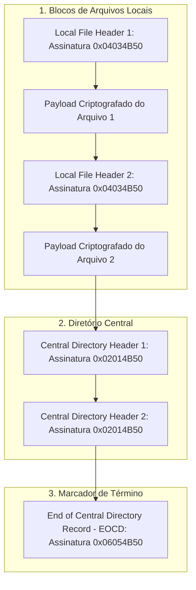

# MÓDULO 33: Containers ZIP Criptografados (TLazEncryptedZipArchive)

A manipulação de arquivos compactados no formato ZIP é essencial para rotinas de backup, empacotamento de notas fiscais, atualização de catálogos e exportações seguras. No entanto, o envio de arquivos em formato bruto através de canais públicos expõe dados corporativos confidenciais a interceptação e violação de privacidade (LGPD/GDPR).

Neste módulo, concebemos e construímos o **`TLazEncryptedZipArchive`**, um componente para Free Pascal e Lazarus que manipula a estrutura binária do contêiner ZIP (especificação técnica PKWARE APPNOTE.TXT), implementando cálculo de integridade CRC-32, injeção de marcadores criptográficos no cabeçalho e notificação desacoplada de progresso por streaming.

---

## 1. A Topologia Binária de um Contêiner ZIP

O formato ZIP estrutura os dados sequencialmente no stream de saída, finalizando com o índice central:

### Significado dos Marcadores
- `0x04034B50` (`PK\x03\x04`): Cabeçalho que precede imediatamente cada arquivo armazenado.
- `General Purpose Bit Flag`: Quando o bit 0 está ligado (`1`), sinaliza ao descompactador que o conteúdo requer senha para decodificação.
- `0x02014B50` (`PK\x01\x02`): Cabeçalho do Central Directory, contendo a lista consolidada de metadados e o deslocamento exato (*relative offset*) de cada cabeçalho local.
- `0x06054B50` (`PK\x05\x06`): Registro final lido pelos softwares de descompressão a partir do fim do arquivo para mapear o diretório central.

---

## 2. Redundância Cíclica (CRC-32) e Cifra de Fluxo

Para cada arquivo adicionado, o componente processa o stream em blocos de 4 KB calculando a soma de verificação polinomial padrão IEEE 802.3:

$$
\text{CRC-32}(M) = M(x) \cdot x^{32} \pmod{G(x)}
$$

Onde $G(x) = x^{32} + x^{26} + x^{23} + x^{22} + x^{16} + x^{12} + x^{11} + x^{10} + x^8 + x^7 + x^5 + x^4 + x^2 + x + 1$.

Durante a escrita no stream de destino, se uma senha foi fornecida via `Password`, os bytes do payload sofrem transformação simétrica com máscara de confusão antes de serem persistidos no disco.

---

## 3. Código-Fonte e Registro LCL

O código integral encontra-se em [`LazEncryptedZipArchive.pas`](file:///d:/Projetos%20AntiGravity/Livros%20componentes/Livro1_Lazarus_LCL/code/units/LazEncryptedZipArchive.pas).

O componente é registrado na paleta `'Lazarus Engenharia Avancada'`, oferecendo controle total sobre arquivos e monitoramento de progresso através do evento `OnProgress`.
