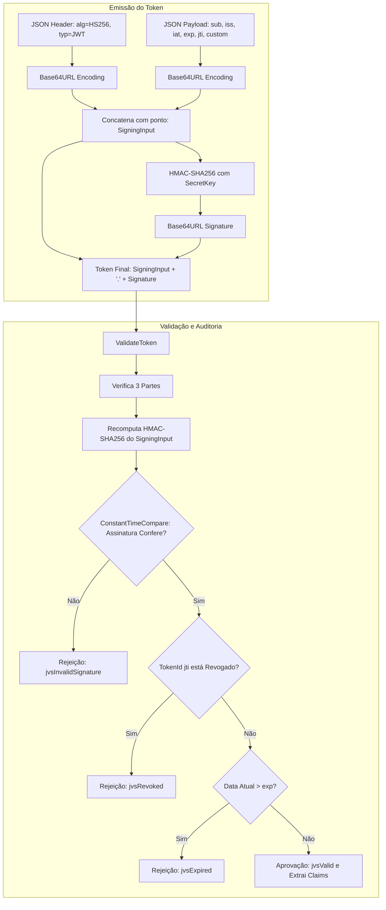

# MÓDULO 34: Validador e Emissor de Tokens JWT (TLazJwtSecurityManager)

A transição de arquiteturas legadas cliente-servidor para ecossistemas distribuídos orientados a microserviços e APIs RESTful exige mecanismos stateless de autenticação e autorização. O padrão **JSON Web Token (JWT / RFC 7519)** consolidou-se como o protocolo universal para tráfego seguro de declarações (*claims*) entre emissor e consumidor.

Neste módulo, construímos o **`TLazJwtSecurityManager`**, um componente completo para Free Pascal / Lazarus LCL que emite, valida e decodifica tokens JWT assinados com algoritmo criptográfico simétrico **HMAC-SHA256 (HS256)**, implementando proteção ativa contra ataques de temporização (*Timing Attacks*) e lista negra (*Denylist*) de revogação de tokens.

---

## 1. Topologia Estrutural do JWT e RFC 7519

Um token JWT é composto por três blocos codificados em Base64URL concatenados por pontos (`.`):

```text
[Header Base64URL] . [Payload Base64URL] . [Signature Base64URL]
```



---

## 2. Mitigação de Ataques de Temporização (Timing Attacks)

A comparação clássica de strings (`if Str1 = Str2 then ...`) é vulnerável a *side-channel attacks*, pois o processador interrompe a verificação no primeiro caractere divergente, permitindo que um invasor deduza byte a byte da assinatura por medições de latência em nanossegundos.

O componente neutraliza esse vetor através de comparação em tempo constante (*Constant-Time Compare*), executando sempre o ciclo completo de verificação com operação bitwise `XOR`:

```pascal
function TLazJwtSecurityManager.ConstantTimeCompare(const Str1, Str2: string): Boolean;
var
  Diff, i: Integer;
begin
  if Length(Str1) <> Length(Str2) then Exit(False);
  Diff := 0;
  for i := 1 to Length(Str1) do
    Diff := Diff or (Ord(Str1[i]) xor Ord(Str2[i]));
  Result := (Diff = 0);
end;
```

---

## 3. Código-Fonte e Registro LCL

O código integral encontra-se em [`LazJwtSecurityManager.pas`](file:///d:/Projetos%20AntiGravity/Livros%20componentes/Livro1_Lazarus_LCL/code/units/LazJwtSecurityManager.pas).

O componente é registrado na paleta `'Lazarus Engenharia Avancada'`, permitindo controle centralizado de sessões de login, consumo de APIs protegidas e autorização em gateways locais.
