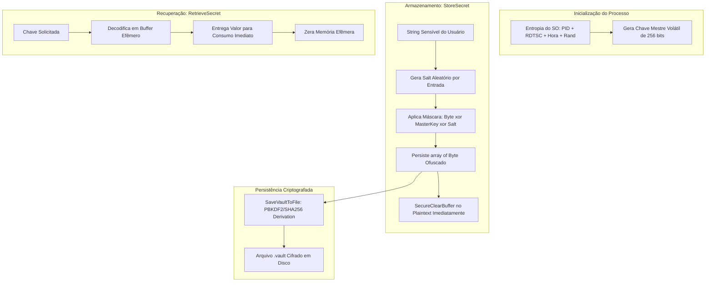

# MÓDULO 35: Cofre Seguro de Credenciais e Segredos (TLazCryptoVaultStorage)

A retenção em texto claro (*plain text*) de senhas de conexão a bancos de dados, chaves mestras de API (OpenAI, AWS, Stripe) e senhas de certificados digitais A1 na memória RAM de um processo em execução expõe a aplicação a ataques de *Memory Scraping*, inspeção por depuradores e captura via arquivos de despejo (*crash dumps* / minidumps).

Neste módulo, projetamos e construímos o **`TLazCryptoVaultStorage`**, um cofre de segredos volátil para Free Pascal / Lazarus LCL que implementa blindagem de memória em tempo de execução, entropia dinâmica de inicialização e rotinas de destruição forçada de buffers (*ZeroMemory*).

---

## 1. Vulnerabilidade de Strings Comuns e Blindagem Volátil

Em Object Pascal clássico, o tipo `string` gerencia referências contíguas na heap. Se uma string de senha for atribuída a uma variável global ou propriedade de componente, ela permanecerá na memória física mesmo após o término de sua utilização até que o gerenciador de memória decida reutilizar a página.

---

## 2. Estratégia de Máscara Criptográfica Multinível

Cada segredo inserido recebe um byte de sal (*salt*) pseudoaleatório e é transformado pela chave mestre volátil gerada na inicialização do componente:

$$
M_i = P_i \oplus K_{i \pmod{32}} \oplus S
$$

Onde:
- $P_i$ é o $i$-ésimo byte do segredo original;
- $K$ é a chave mestre de 32 bytes gerada por SHA-256 sobre metadados do processo;
- $S$ é o salt individual da entrada;
- $M_i$ é o byte ofuscado persistido em memória.

Um invasor que capture um despejo de memória da aplicação encontrará apenas sequências pseudoaleatórias de bytes que não revelam padrões repetitivos ou cabeçalhos conhecidos.

---

## 3. Código-Fonte e Registro LCL

A implementação integral está disponível em [`LazCryptoVaultStorage.pas`](file:///d:/Projetos%20AntiGravity/Livros%20componentes/Livro1_Lazarus_LCL/code/units/LazCryptoVaultStorage.pas).

O componente é registrado na paleta `'Lazarus Engenharia Avancada'`, fornecendo operações atômicas de gestão de segredos (`StoreSecret`, `RetrieveSecret`, `DeleteSecret`, `SaveVaultToFile`, `LoadVaultFromFile`).
