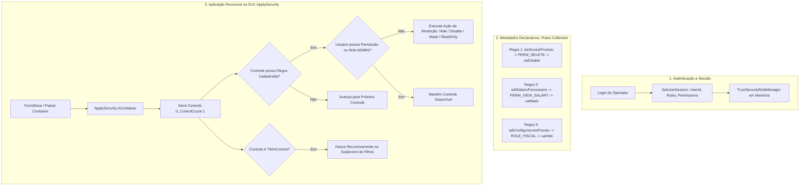

# MÓDULO 36: Motor de Permissões Baseadas em Papéis (TLazSecurityRoleManager)

A governança de acesso em sistemas corporativos ERP e PDV frequentemente sofre com a dispersão de verificações manuais de privilégios (`if Usuario.Admin then btnExcluir.Visible := True else ...`) espalhadas de forma desordenada por centenas de eventos `FormShow` e `FormCreate`. Esse anti-padrão gera falhas catastróficas de conformidade quando um controle novo é adicionado à tela sem a respectiva proteção manual.

Neste módulo, projetamos e construímos o **`TLazSecurityRoleManager`**, um componente declarativo de segurança para Free Pascal / Lazarus LCL que implementa a arquitetura de **Controle de Acesso Baseado em Papéis (RBAC - Role-Based Access Control)** através de varredura recursiva de árvores de componentes da interface visual.

---

## 1. Topologia Declarativa RBAC

O modelo desacopla a definição do usuário e seus papéis/permissões da estrutura física dos formulários:

---

## 2. Ações de Restrição Especializadas

Quando o usuário ativo não detém o privilégio exigido, o motor executa uma de quatro ações padronizadas:
1. **`uaHide`**: Torna o controle invisível (`Visible := False`), removendo-o da percepção do usuário.
2. **`uaDisable`**: Desabilita interações (`Enabled := False`), mantendo o elemento visível porém inerte.
3. **`uaReadOnly`**: Se o controle for descendente de `TCustomEdit`, trava edição de texto mantendo foco e seleção.
4. **`uaMask`**: Ofusca o conteúdo visual com caracteres substitutos (`***` ou `R$ *****,**`), essencial para conformidade com a LGPD em dados financeiros e salariais.

---

## 3. Código-Fonte e Registro LCL

O código integral encontra-se em [`LazSecurityRoleManager.pas`](file:///d:/Projetos%20AntiGravity/Livros%20componentes/Livro1_Lazarus_LCL/code/units/LazSecurityRoleManager.pas).

O componente é registrado na paleta `'Lazarus Engenharia Avancada'`, permitindo configuração das regras diretamente via editor de coleção do Object Inspector em tempo de design.
