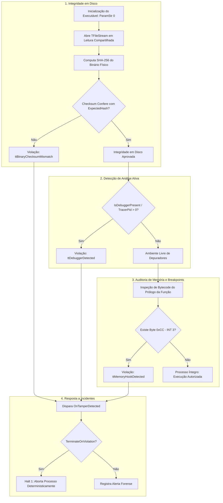

# MÓDULO 37: Auditor de Integridade de Executáveis (TLazIntegrityWatchdog)

A pirataria de software, a distribuição de versões modificadas com cavalos de Troia (*Trojanized Binaries*) e o ataque por engenharia reversa ativa (onde invasores utilizam ferramentas como x64dbg, Cheat Engine ou IDA Pro para modificar instruções de saltos condicionais como `JNE` para `NOP`) colocam em risco sistemas corporativos e direitos autorais.

Neste módulo, concebemos e construímos o **`TLazIntegrityWatchdog`**, um componente guardião de integridade binária (*Anti-Tampering & Binary Integrity Guardian*) para Free Pascal e Lazarus LCL, capaz de auditar a si mesmo em disco via SHA-256 e detectar depuradores e pontos de interrupção em tempo de execução.

---

## 1. Topologia Anti-Adulteração e Defesa em Profundidade

O componente divide sua estratégia de defesa em três camadas consecutivas:



---

## 2. Detecção de Software Breakpoints (0xCC / INT 3)

Depuradores e softwares de trapaça inserem pontos de interrupção substituindo o primeiro byte da instrução alvo pelo opcode `0xCC` (a interrupção de software `INT 3` da arquitetura Intel x86/x64). O método `HasMemoryBreakpoints` lê a memória de execução e detecta essa anomalia:

```pascal
function TLazIntegrityWatchdog.HasMemoryBreakpoints(FuncPtr: Pointer; CheckBytes: Integer): Boolean;
var
  P: PByte;
  i: Integer;
begin
  Result := False;
  if not Assigned(FuncPtr) or (CheckBytes <= 0) then Exit;
  P := PByte(FuncPtr);
  for i := 0 to CheckBytes - 1 do
  begin
    if P[i] = $CC then
      Exit(True);
  end;
end;
```

---

## 3. Código-Fonte e Registro LCL

O código integral encontra-se em [`LazIntegrityWatchdog.pas`](file:///d:/Projetos%20AntiGravity/Livros%20componentes/Livro1_Lazarus_LCL/code/units/LazIntegrityWatchdog.pas).

O componente é registrado na paleta `'Lazarus Engenharia Avancada'`, oferecendo parâmetros configuráveis de política de resposta a violações (`TerminateOnViolation`).
