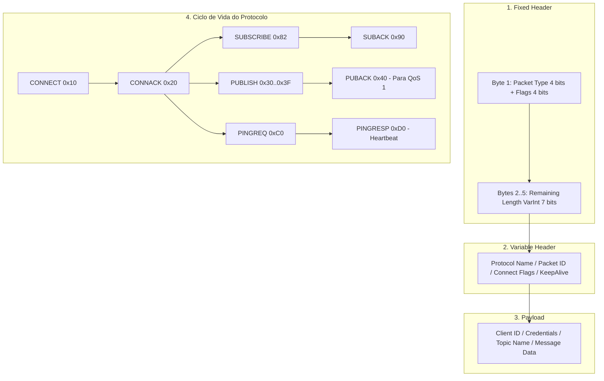

# MÓDULO 38: Cliente de Mensageria IoT via MQTT (TLazMqttClientBridge)

A telemetria industrial moderna, a automação predial e a comunicação assíncrona entre serviços descentralizados dependem massivamente do protocolo **MQTT (Message Queuing Telemetry Transport)**, padronizado pela OASIS. Criado especificamente para redes de largura de banda restrita e alta latência, o MQTT opera sobre TCP/IP através de um modelo *Publish/Subscribe* mediado por um *Broker* central (como Mosquitto, HiveMQ ou EMQX).

Neste módulo, concebemos e construímos o **`TLazMqttClientBridge`**, um cliente MQTT 3.1.1 nativo para Free Pascal e Lazarus LCL, sem dependência de bibliotecas C externas como libmosquitto, codificando e decodificando o enquadramento binário do protocolo.

---

## 1. Topologia do Protocolo MQTT e Enquadramento Binário

Cada pacote MQTT consiste em um cabeçalho fixo (*Fixed Header*) de 2 a 5 bytes, seguido opcionalmente por um cabeçalho variável (*Variable Header*) e pelo *Payload*:



### Codificação do Comprimento Remanescente (*Variable Byte Integer*)

O campo `Remaining Length` utiliza uma representação compacta de 7 bits por byte, onde o bit mais significativo (bit 7) atua como flag de continuação (*continuation bit*), permitindo codificar tamanhos de até 256 MB em apenas 4 bytes:

```pascal
function TLazMqttClientBridge.EncodeRemainingLength(LengthVal: Integer): TBytes;
var
  EncodedByte: Byte;
  Pos: Integer;
begin
  SetLength(Result, 0);
  repeat
    EncodedByte := LengthVal mod 128;
    LengthVal := LengthVal div 128;
    if LengthVal > 0 then
      EncodedByte := EncodedByte or 128;
    Pos := Length(Result);
    SetLength(Result, Pos + 1);
    Result[Pos] := EncodedByte;
  until LengthVal = 0;
end;
```

---

## 2. Níveis de Garantia de Entrega (Quality of Service - QoS)

1. **QoS 0 (At Most Once):** Entrega por melhor esforço (*Fire and Forget*). Sem confirmação de recebimento.
2. **QoS 1 (At Least Once):** Entrega garantida com envio de `PUBACK`. Mensagens podem ser duplicadas em quedas momentâneas de rede.
3. **QoS 2 (Exactly Once):** Quatro vias de aperto de mão (*Handshake*: `PUBLISH` $\rightarrow$ `PUBREC` $\rightarrow$ `PUBREL` $\rightarrow$ `PUBCOMP`) garantindo entrega única sem duplicação.

---

## 3. Código-Fonte e Registro LCL

O código integral encontra-se em [`LazMqttClientBridge.pas`](file:///d:/Projetos%20AntiGravity/Livros%20componentes/Livro1_Lazarus_LCL/code/units/LazMqttClientBridge.pas).

O componente é registrado na paleta `'Lazarus Engenharia Avancada'`, oferecendo uma interface limpa com eventos assíncronos `OnMessageReceived` e `OnConnectionChange`.
