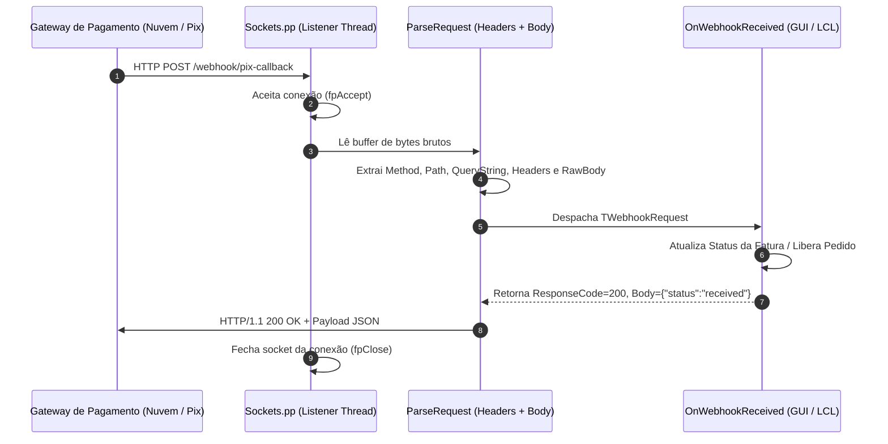

# MÓDULO 39: Servidor de Webhooks Embutido (TLazEmbeddedWebhookServer)

A integração em tempo real com plataformas de comércio eletrônico, adquirentes de cartão de crédito e gateways de pagamento instantâneo (como Pix no Brasil via Mercado Pago, Asaas ou Gerencianet) opera através do padrão **Webhook**: no momento em que um evento financeiro ocorre na nuvem, o gateway dispara uma requisição HTTP `POST` para a aplicação de destino informando o status da transação.

Subir e manter um servidor web externo volumoso (como Apache HTTP Server, Nginx ou IIS) exclusivamente para repassar requisições HTTP para uma aplicação desktop ou backend Lazarus acarreta complexidade de infraestrutura desnecessária.

Neste módulo, concebemos e construímos o **`TLazEmbeddedWebhookServer`**, um microservidor HTTP não-bloqueante e de alta performance desenvolvido diretamente sobre a biblioteca de sockets nativa do Free Pascal (`Sockets.pp`).

---

## 1. Topologia de Recepção Assíncrona de Webhooks



---

## 2. Isolamento em Worker Thread e Prevenção de Timeouts

Gateways de pagamento estabelecem limites rígidos de timeout (frequentemente entre 2 e 5 segundos). Se o receptor não responder rapidamente com `HTTP 200 OK`, o gateway considera a entrega fracassada e inicia tentativas agressivas de reenvio (*Retries*).

O `TLazEmbeddedWebhookServer` executa a escuta em uma `TThread` isolada:

```pascal
procedure TWebhookListenerThread.Execute;
var
  ServerAddr, ClientAddr: TInetSockAddr;
  ClientSocket: LongInt;
  AddrLen: TSockLen;
  ClientIP: string;
begin
  FServerSocket := fpSocket(AF_INET, SOCK_STREAM, 0);
  // ... Configura porta e faz bind/listen ...
  while not Terminated do
  begin
    AddrLen := SizeOf(ClientAddr);
    ClientSocket := fpAccept(FServerSocket, @ClientAddr, @AddrLen);
    if ClientSocket >= 0 then
    begin
      ClientIP := NetAddrToStr(ClientAddr.sin_addr);
      HandleClient(ClientSocket, ClientIP);
    end;
  end;
end;
```

---

## 3. Código-Fonte e Registro LCL

O código integral encontra-se em [`LazEmbeddedWebhookServer.pas`](file:///d:/Projetos%20AntiGravity/Livros%20componentes/Livro1_Lazarus_LCL/code/units/LazEmbeddedWebhookServer.pas).

O componente é registrado na paleta `'Lazarus Engenharia Avancada'`, oferecendo as propriedades `Port`, `Active` e o evento unificado `OnWebhookReceived`.
