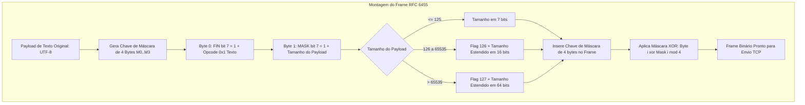

# MÓDULO 40: Cliente WebSocket com Reconexão Automática (TLazWebSocketLiveClient)

A comunicação em tempo real entre interfaces gráficas e serviços em nuvem (como chats corporativos, cotações de bolsas financeiras, painéis de monitoramento de armazéns e notificações de despacho) exige canais bidirecionais de baixa latência. O protocolo **WebSocket (RFC 6455)** estabelece uma conexão full-duplex persistente sobre uma única conexão TCP após um aperto de mão inicial HTTP.

Neste módulo, concebemos e construímos o **`TLazWebSocketLiveClient`**, um cliente WebSocket para Free Pascal e Lazarus LCL que implementa o enquadramento de frames binários com máscara obrigatória no envio (*Client-Side Masking*), fila de mensagens offline (*Offline Spooling*) e reconexão resiliente baseada no algoritmo de **Backoff Exponencial**.

---

## 1. Topologia de Frames RFC 6455 e Máscara Criptográfica

A especificação RFC 6455 impõe que todo frame transmitido pelo cliente em direção ao servidor seja ofuscado por uma chave de máscara de 4 bytes (*Masking Key*) gerada pseudoaleatoriamente:

### Algoritmo de Mascaramento

Para cada byte $i$ da mensagem, o byte transmitido $T_i$ é computado por:

$$
T_i = P_i \oplus M_{i \pmod{4}}
$$

Onde $P_i$ é o byte original e $M$ é o vetor de máscara de 4 bytes. Isso impede que proxies intermediários interpretem indevidamente padrões de texto HTTP no túnel persistente.

---

## 2. Resiliência de Rede: Fila Offline e Backoff Exponencial

Quando a conexão de rede cai momentaneamente (por exemplo, transição entre Wi-Fi e Ethernet ou oscilação de roteador):
1. O estado transiciona para `wssReconnecting`.
2. Quaisquer mensagens enviadas pela aplicação via `SendText` não são descartadas: elas são enfileiradas na lista `FOfflineQueue`.
3. O intervalo entre tentativas de reconexão duplica progressivamente: 1s, 2s, 4s, 8s, 16s até o teto `MaxReconnectDelaySec` (32s), evitando congestionamento do servidor (*Thundering Herd Problem*).
4. Ao restabelecer a conexão (`wssConnected`), o método `FlushOfflineQueue` esvazia a fila garantindo a entrega sequencial ordenada.

---

## 3. Código-Fonte e Registro LCL

O código integral encontra-se em [`LazWebSocketLiveClient.pas`](file:///d:/Projetos%20AntiGravity/Livros%20componentes/Livro1_Lazarus_LCL/code/units/LazWebSocketLiveClient.pas).

O componente é registrado na paleta `'Lazarus Engenharia Avancada'`, oferecendo uma interface reativa moderna para aplicações LCL em tempo real.
