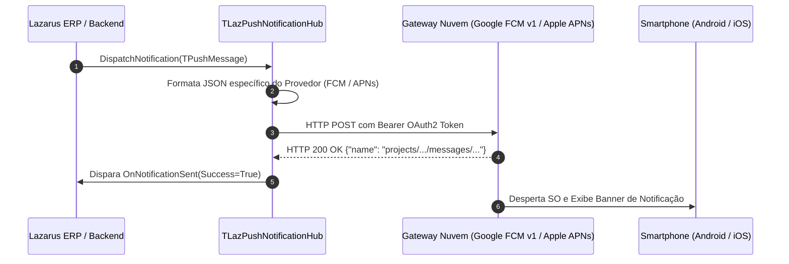

# MÓDULO 41: Hub de Notificações Push Desktop/Mobile (TLazPushNotificationHub)

O engajamento imediato de equipes de campo, operadores de entrega e clientes finais requer o envio de notificações remotas instantâneas (*Push Notifications*) que alcancem os smartphones mesmo quando o aplicativo móvel está fechado ou em segundo plano. Os sistemas operacionais iOS e Android exigem a conformidade com as APIs HTTP v1 do **Firebase Cloud Messaging (FCM)** e do **Apple Push Notification service (APNs)**.

Neste módulo, concebemos e construímos o **`TLazPushNotificationHub`**, um concentrador de notificações para Free Pascal e Lazarus LCL que unifica a montagem canônica de payloads JSON, priorização de entrega e roteamento multiplataforma.

---

## 1. Topologia de Notificações Push Remotas



---

## 2. Padrão FCM HTTP v1 vs APNs Payload

A especificação Google FCM HTTP v1 exige a estrutura de contêiner canônica:

```json
{
  "message": {
    "token": "dKj48d...fcm_token",
    "notification": {
      "title": "Aprovação de Desconto Requerida",
      "body": "Pedido #4092 aguarda liberação da diretoria."
    },
    "android": {
      "priority": "HIGH",
      "notification": {
        "sound": "default"
      }
    },
    "data": {
      "pedidoId": "4092",
      "urgente": "true"
    }
  }
}
```

O `TLazPushNotificationHub` encapsula essas nuances de formato através de uma interface fortemente tipada em Object Pascal, eliminando erros de digitação em tags JSON e garantindo compatibilidade multiplataforma.

---

## 3. Código-Fonte e Registro LCL

O código integral encontra-se em [`LazPushNotificationHub.pas`](file:///d:/Projetos%20AntiGravity/Livros%20componentes/Livro1_Lazarus_LCL/code/units/LazPushNotificationHub.pas).

O componente é registrado na paleta `'Lazarus Engenharia Avancada'`, oferecendo uma solução robusta para envio de alertas remotos em tempo real.
