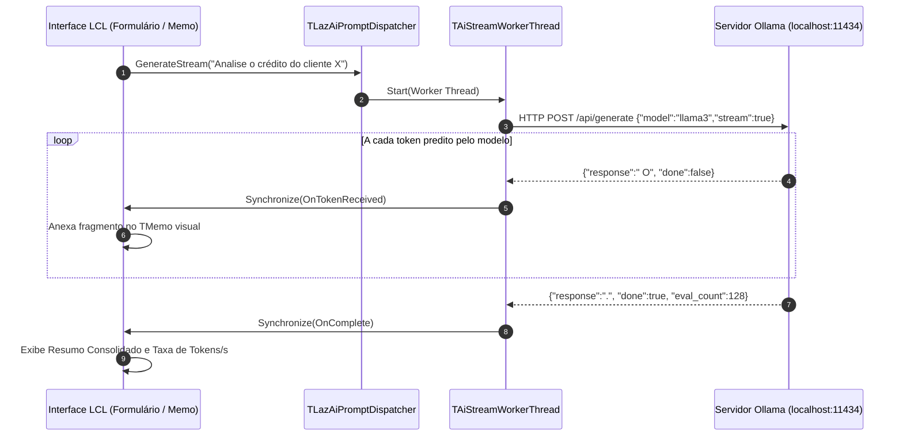

# MÓDULO 42: Dispatcher de Prompts para LLMs Locais (TLazAiPromptDispatcher)

A introdução de modelos de linguagem de grande porte (LLMs como Llama 3, Mistral, DeepSeek-R1 e Phi-3) executados localmente na infraestrutura da empresa (via backends de inferência como Ollama, LocalAI ou vLLM) revolucionou o enriquecimento de dados em sistemas de gestão. A execução local preserva a privacidade dos dados corporativos (sem envio de balanços e dados fiscais para servidores de terceiros na nuvem).

Neste módulo, concebemos e construímos o **`TLazAiPromptDispatcher`**, um despachante assíncrono de inferência para Free Pascal e Lazarus LCL que consome o endpoint `/api/generate` em modo de streaming contínuo (*token by token*), sincronizando a interface visual sem congelamento da GUI e computando métricas de taxa de geração (tokens por segundo).

---

## 1. Topologia de Inferência Local e Streaming

Ao contrário das requisições REST tradicionais onde a resposta é entregue em bloco após vários segundos, a geração de texto por LLMs emite cada palavra ou fração de palavra (*token*) assim que a passagem de atenção (*Attention Forward Pass*) é concluída:

---

## 2. Decodificação de Linhas JSONL e Métricas de Desempenho

O componente parseia os pacotes incrementais e calcula a velocidade efetiva de processamento:

$$
\text{Taxa} = \left(\frac{\text{Total de Tokens}}{\Delta t_{\text{milisegundos}}}\right) \times 1000.0 \quad [\text{tokens/s}]
$$

O cancelamento preemptivo é garantido pela invocação de `CancelGeneration`, que encerra a thread de streaming imediatamente sem reter handles de conexão.

---

## 3. Código-Fonte e Registro LCL

O código integral encontra-se em [`LazAiPromptDispatcher.pas`](file:///d:/Projetos%20AntiGravity/Livros%20componentes/Livro1_Lazarus_LCL/code/units/LazAiPromptDispatcher.pas).

O componente é registrado na paleta `'Lazarus Engenharia Avancada'`, permitindo acoplamento direto a telas de atendimento, sugestão de classificação de compras e análise de crédito.
