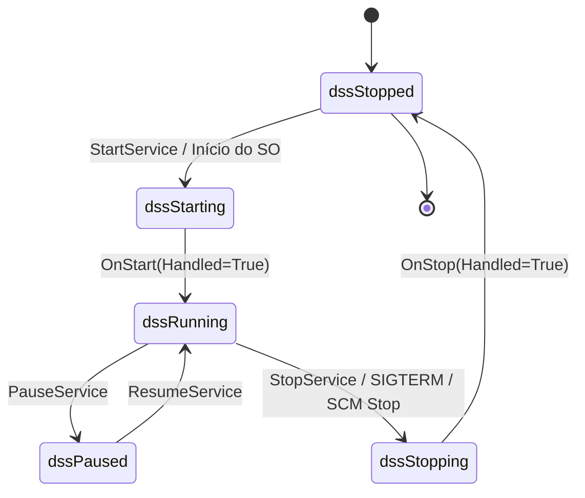

# MÓDULO 45: Construtor Universal de Daemons e Serviços (TLazSystemDaemonController)

A infraestrutura corporativa contemporânea opera através de serviços em segundo plano contínuos (*Headless Services*) encarregados de sincronização de filas, pipelines de mensageria, ingestão de IoT e backups agendados. O mesmo código-fonte frequentemente precisa rodar como um **Windows Service** em servidores Windows Server e como um **Daemon gerenciado por Systemd** em instâncias de servidores Linux (Ubuntu, Debian, RedHat).

Neste módulo, concebemos e construímos o **`TLazSystemDaemonController`**, um controlador multiplataforma para Free Pascal e Lazarus que unifica o ciclo de vida operacional de serviços (`Start`, `Stop`, `Pause`, `Resume`), processa argumentos de linha de comando (`--install`, `--uninstall`, `--debug`) e gera automaticamente arquivos de configuração unitária do Systemd (`.service`).

---

## 1. Topologia Unificada de Ciclo de Vida



---

## 2. Geração Automatizada de Unidades Systemd (.service)

No Linux corporativo moderno, a inicialização e supervisão de processos é controlada pelo `systemd`. O componente automatiza a produção do arquivo descritor de serviço:

```ini
[Unit]
Description=Enterprise Backend Daemon Service
After=network.target

[Service]
Type=simple
ExecStart=/opt/enterprise/bin/daemon --daemon
Restart=always
RestartSec=5
StandardOutput=journal
StandardError=journal

[Install]
WantedBy=multi-user.target
```

Através do parâmetro de linha de comando `--systemd-unit`, o administrador do sistema pode emitir e canalizar a configuração diretamente para o diretório `/etc/systemd/system/`:

```bash
./meudaemon --systemd-unit > /etc/systemd/system/meudaemon.service
systemctl daemon-reload
systemctl enable --now meudaemon
```

---

## 3. Modo Interativo de Depuração (--debug)

Depurar serviços do Windows ou daemons do Linux anexando depuradores ao processo em execução no background é trabalhoso. O `TLazSystemDaemonController` permite a execução em modo console interativo:

```pascal
if (Cmd = '--debug') or (Cmd = '-d') then
begin
  FIsInteractive := True;
  StartService;
  WriteLn('Pressione [Enter] para encerrar o servico...');
  ReadLn;
  StopService;
end;
```

---

## 4. Código-Fonte e Registro LCL

O código integral encontra-se em [`LazSystemDaemonController.pas`](file:///d:/Projetos%20AntiGravity/Livros%20componentes/Livro1_Lazarus_LCL/code/units/LazSystemDaemonController.pas).

O componente é registrado na paleta `'Lazarus Engenharia Avancada'`, permitindo arquitetar microserviços headless com máxima resiliência.
