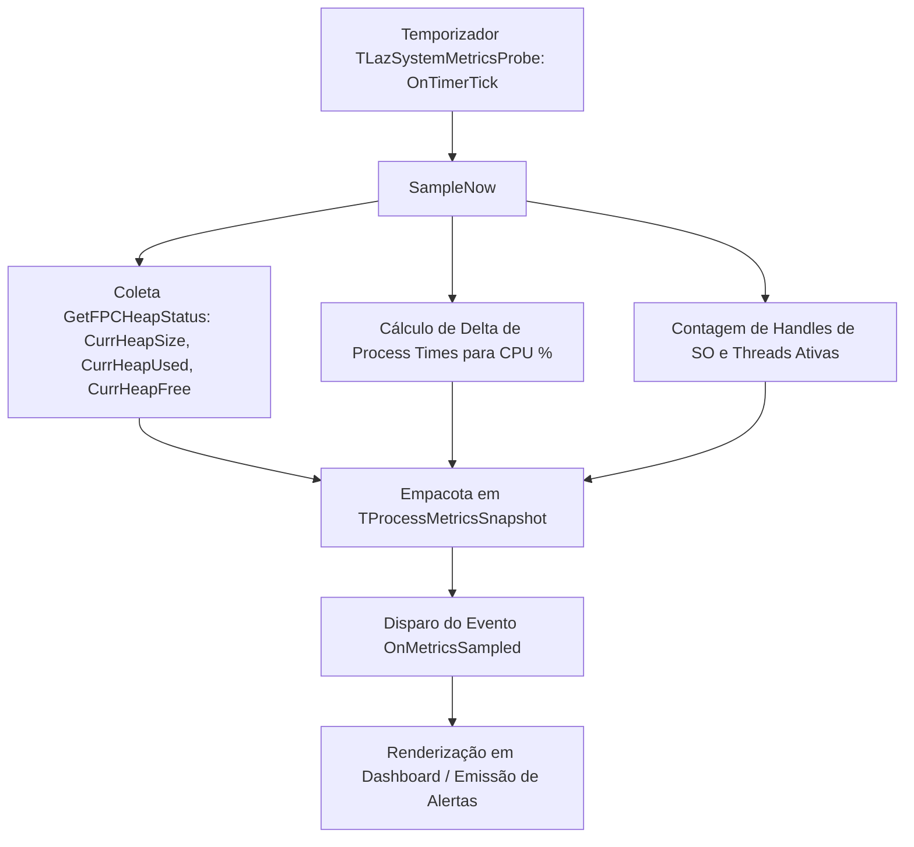

# MÓDULO 46: Sonda de Monitoramento de Sistema (TLazSystemMetricsProbe)

A estabilidade de aplicações de missão crítica (como PDVs de supermercados operando 18 horas ininterruptas ou servidores backend processando milhares de requisições por hora) requer supervisão interna contínua da saúde do processo. Vazamentos graduais de memória (*Memory Leaks*), exaustão de handles do sistema operacional e picos anômalos de CPU precisam ser identificados antes que provoquem a falha fatal da aplicação (*Crash*).

Neste módulo, concebemos e construímos o **`TLazSystemMetricsProbe`**, um componente de telemetria para Free Pascal e Lazarus LCL que inspeciona periodicamente as métricas do processo, o estado da heap nativa (`GetFPCHeapStatus`), a contagem de handles e threads ativas.

---

## 1. Topologia de Coleta e Diagnóstico da Heap

O Free Pascal Runtime Library (RTL) disponibiliza a função intrínseca `GetFPCHeapStatus`, retornando um registro `TFPCHeapStatus` com detalhes precisos da fragmentação e uso de memória:

### Cálculo de Fragmentação da Memória

A taxa de fragmentação da Heap pode ser inferida pela razão entre a memória livre retida e o total alocado:

$$
\text{Fragmentação} = \left(\frac{\text{CurrHeapFree}}{\text{CurrHeapSize}}\right) \times 100\%
$$

Valores persistentemente elevados indicam alocações repetidas de pequenos blocos contíguos que impedem a liberação de páginas físicas de volta ao sistema operacional.

---

## 2. Código-Fonte e Registro LCL

O código integral encontra-se em [`LazSystemMetricsProbe.pas`](file:///d:/Projetos%20AntiGravity/Livros%20componentes/Livro1_Lazarus_LCL/code/units/LazSystemMetricsProbe.pas).

O componente é registrado na paleta `'Lazarus Engenharia Avancada'`, oferecendo uma sonda discreta e configurável para dashboards operacionais.
