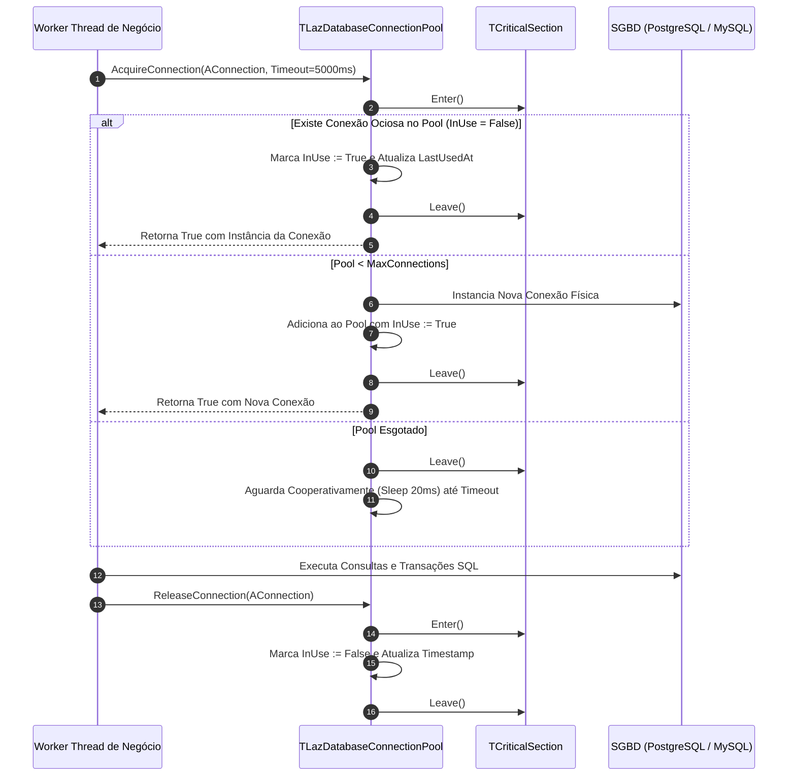

# MÓDULO 47: Gerenciador de Pool de Conexões SQL (TLazDatabaseConnectionPool)

Abrir e autenticar uma nova conexão com um Sistema Gerenciador de Banco de Dados Relacional (PostgreSQL, MySQL, Oracle, Firebird ou SQL Server) é uma operação computacionalmente custosa: envolve resolução de DNS, aperto de mão TCP de três vias (*Three-Way Handshake*), negociação criptográfica TLS e verificação de credenciais de usuário. Em sistemas multithread e APIs de alto volume, abrir uma conexão por requisição esgota a memória do SGBD e gera gargalos de latência.

Neste módulo, concebemos e construímos o **`TLazDatabaseConnectionPool`**, um gerenciador de pool de conexões thread-safe para Free Pascal e Lazarus LCL baseado em seções críticas (`syncobjs.TCriticalSection`), garantindo reaproveitamento de conexões ativas, controle rigoroso de timeouts e expurgo (*Purge*) de conexões ociosas ou zumbis.

---

## 1. Topologia de Empréstimo (Acquire) e Devolução (Release)



---

## 2. Expurgo de Conexões Inativas (Reaper Pattern)

Conexões de banco mantidas inativas por longos períodos frequentemente são encerradas unilateralmente por firewalls de rede ou parâmetros `idle_timeout` do servidor de banco de dados, tornando-se "zumbis".

O método `PurgeIdleConnections` itera em ordem regressiva eliminando conexões excedentes ao `MinConnections` cuja inatividade ultrapasse `IdleTimeoutSeconds`:

```pascal
procedure TLazDatabaseConnectionPool.PurgeIdleConnections;
var
  i: Integer;
  Item: TPooledConnection;
  IdleSec: Double;
begin
  FLock.Enter;
  try
    for i := FPoolItems.Count - 1 downto 0 do
    begin
      if FPoolItems.Count <= FMinConnections then Break;
      Item := TPooledConnection(FPoolItems[i]);
      if not Item.InUse then
      begin
        IdleSec := (Now - Item.LastUsedAt) * 86400.0;
        if IdleSec > FIdleTimeoutSeconds then
        begin
          FPoolItems.Delete(i);
          DestroyPooledItem(Item);
        end;
      end;
    end;
  finally
    FLock.Leave;
  end;
end;
```

---

## 3. Código-Fonte e Registro LCL

O código integral encontra-se em [`LazDatabaseConnectionPool.pas`](file:///d:/Projetos%20AntiGravity/Livros%20componentes/Livro1_Lazarus_LCL/code/units/LazDatabaseConnectionPool.pas).

O componente é registrado na paleta `'Lazarus Engenharia Avancada'`, permitindo fácil associação a bibliotecas de persistência como `SQLdb` ou `ZeosLib`.
