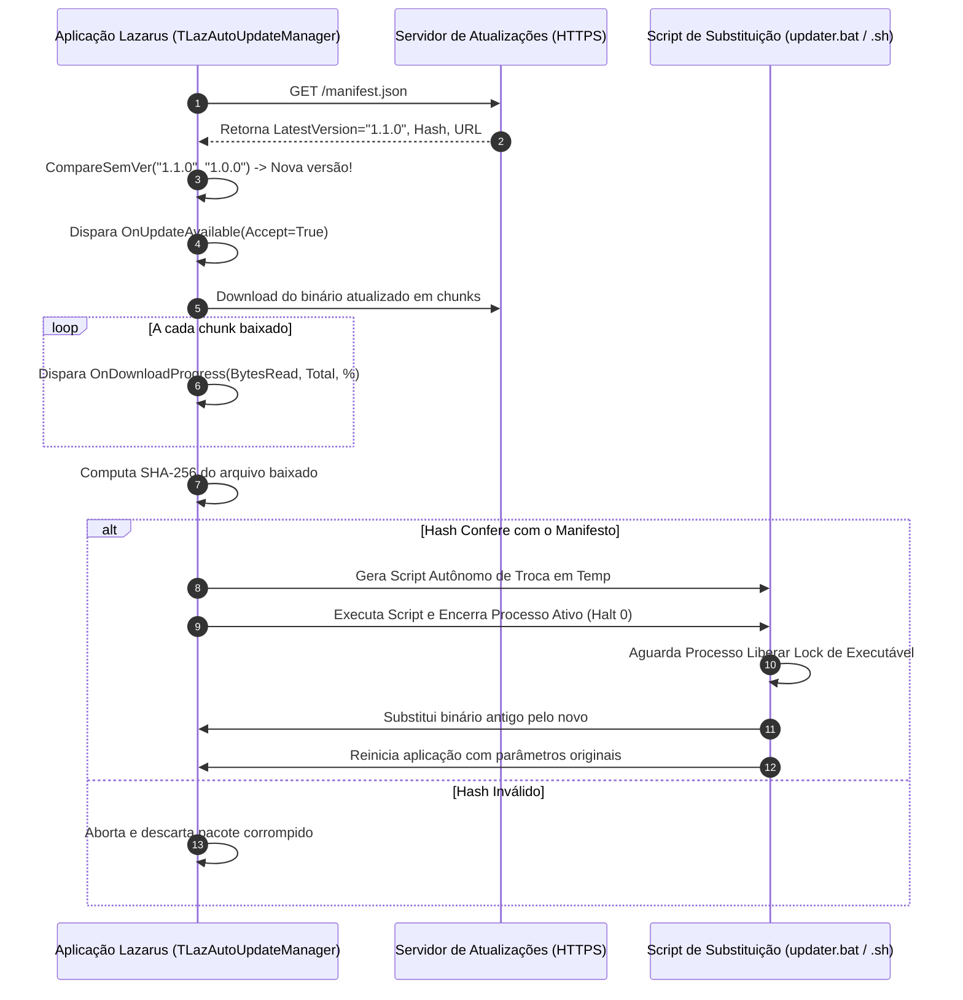

# MÓDULO 48: Motor de Atualização Automática (TLazAutoUpdateManager)

A entrega contínua de correções de segurança, notas fiscais atualizadas e novos recursos para milhares de terminais clientes (PDVs, desktops de retaguarda, coletores de armazém) sem a intervenção manual de técnicos de suporte é viabilizada pelo mecanismo de **Auto-Atualização Transparente (OTA - Over-The-Air Update)**.

Neste módulo, concebemos e construímos o **`TLazAutoUpdateManager`**, um componente para Free Pascal e Lazarus LCL que consome manifestos remotos de versão em formato JSON, compara numerações semânticas (*SemVer*), realiza download em segundo plano com acompanhamento de progresso, valida a integridade do pacote via hash SHA-256 e executa a reinicialização segura da aplicação através de script auxiliar de substituição.

---

## 1. Topologia do Pipeline de Auto-Atualização



---

## 2. Precedência SemVer e Substituição de Arquivo em Execução

Sistemas operacionais modernos (especialmente o Microsoft Windows) bloqueiam a substituição ou remoção de qualquer arquivo executável que esteja com handle aberto pelo processo ativo (*File Lock*).

Para contornar essa restrição sem exigir reinicialização do sistema operacional, o `TLazAutoUpdateManager` gera um script em lote efêmero no diretório temporário, delega a tarefa de cópia após uma pausa de segurança de 2 segundos, inicia o novo executável e auto-destrói o script:

```bat
@echo off
timeout /t 2 /nobreak > nul
copy /y "%TEMP%\update_patch.bin" "C:\App\Sistema.exe"
start "" "C:\App\Sistema.exe"
del "%~f0"
```

---

## 3. Código-Fonte e Registro LCL

O código integral encontra-se em [`LazAutoUpdateManager.pas`](file:///d:/Projetos%20AntiGravity/Livros%20componentes/Livro1_Lazarus_LCL/code/units/LazAutoUpdateManager.pas).

O componente é registrado na paleta `'Lazarus Engenharia Avancada'`, oferecendo uma solução completa para distribuição moderna de softwares de desktop.
