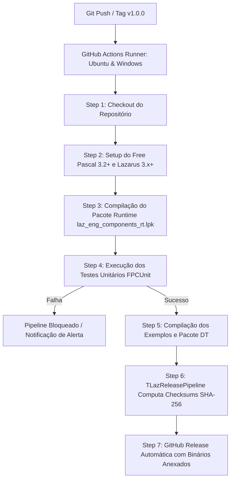

# MÓDULO 50: Pipeline de CI/CD Multiplataforma e Releases no GitHub (TLazReleasePipeline)

Na engenharia de software profissional, o ciclo de vida de um projeto não termina na escrita do código-fonte ou na compilação do executável na máquina local do desenvolvedor (*"Na minha máquina funciona"*). A distribuição confiável de suítes de componentes e aplicações em escala requer **Integração Contínua (CI - Continuous Integration)** e **Entrega Contínua (CD - Continuous Delivery)**, automatizando a compilação limpa, a execução de baterias de testes unitários em máquinas virtuais efêmeras e o empacotamento com assinatura criptográfica para publicação oficial de releases no GitHub.

Neste módulo final do livro, concebemos e construímos o **`TLazReleasePipeline`**, um componente orquestrador para Free Pascal e Lazarus LCL encarregado de consolidar o inventário de artefatos de release, gerar notas de lançamento estruturadas em Markdown, auditar hashes SHA-256 e produzir a especificação declarativa do pipeline de GitHub Actions com a ferramenta de linha de comando `lazbuild`.

---

## 1. Topologia da Esteira de Integração Contínua Multiplataforma

O fluxo automatizado de entrega contínua dispara a cada *push* na branch principal (`main`) ou na criação de uma tag de versão (`v*`):



---

## 2. A Ferramenta de Compilação sem Interface Gráfica (lazbuild)

Para compilar pacotes (`.lpk`) e projetos (`.lpi`) em ambientes de servidores em nuvem desprovidos de servidor X11 ou interface visual gráfica, utiliza-se a ferramenta de linha de comando oficial `lazbuild`:

```bash
# Compilação forçada em modo Release do pacote de runtime
lazbuild -B --build-mode=Release Livro1_Lazarus_LCL/code/packages/laz_eng_components_rt.lpk

# Compilação e execução da suíte de testes unitários
lazbuild -B Livro1_Lazarus_LCL/code/packages/laz_eng_components_dt.lpk
```

### Configuração Declarativa do Workflow GitHub Actions (.github/workflows/ci_lazbuild.yml)

```yaml
name: CI/CD Lazarus Multiplataforma

on:
  push:
    branches: [ main ]
    tags: [ 'v*' ]
  pull_request:
    branches: [ main ]

jobs:
  build:
    runs-on: ${{ matrix.os }}
    strategy:
      matrix:
        os: [ubuntu-latest, windows-latest]
        lazarus-version: [3.2.0]

    steps:
      - name: Checkout Repositório
        uses: actions/checkout@v4

      - name: Instalar Free Pascal e Lazarus
        uses: gcarreno/setup-lazarus@v3
        with:
          lazarus-version: ${{ matrix.lazarus-version }}

      - name: Compilar Pacote Runtime
        run: lazbuild -B Livro1_Lazarus_LCL/code/packages/laz_eng_components_rt.lpk
```

---

## 3. Código-Fonte e Registro LCL

O código integral encontra-se em [`LazReleasePipeline.pas`](file:///d:/Projetos%20AntiGravity/Livros%20componentes/Livro1_Lazarus_LCL/code/units/LazReleasePipeline.pas).

O componente é registrado na paleta `'Lazarus Engenharia Avancada'`, concluindo com excelência a jornada de 50 módulos temáticos sobre a engenharia de componentes e arquitetura avançada para Lazarus e Free Pascal.
