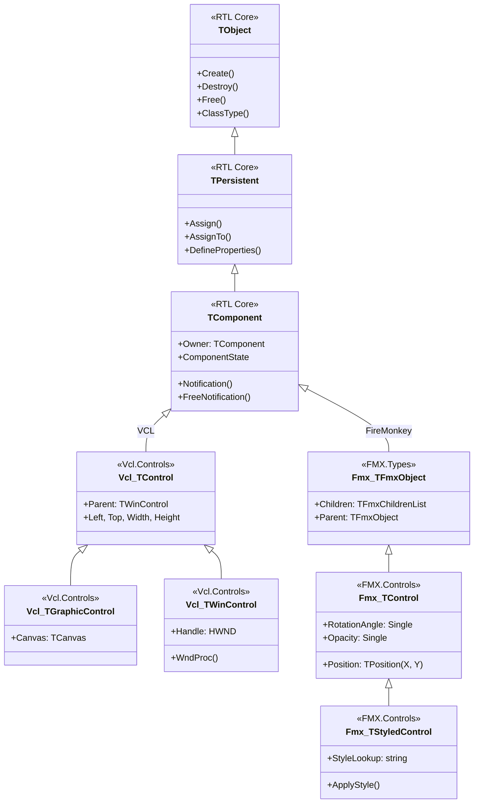

# MÓDULO 01: Arquitetura Orientada a Componentes e Hierarquia de Classes

No **Delphi 12 Athens+**, o desenvolvimento de componentes atingiu um patamar de maturidade e sofisticação sem precedentes. O arquiteto de software Object Pascal opera hoje na interseção entre duas grandes bibliotecas visuais — a tradicional e ultraotimizada **VCL (Visual Component Library)** para Windows e o revolucionário framework multiplataforma acelerado por hardware **FireMonkey (FMX)** —, amparadas por um dos compiladores nativos mais velozes do mundo e um sistema moderno de **Enhanced RTTI** enriquecido por atributos customizados.

Neste módulo inaugural, analisaremos a espinha dorsal da hierarquia de classes do Delphi moderno, dissecaremos as semelhanças e contrastes radicais entre VCL e FireMonkey, e implementaremos um componente profissional de introspecção profunda baseado na RTTI contemporânea do Delphi 12.

---

## 1. A Dualidade de Frameworks: VCL vs. FireMonkey

Ao contrário de outros ecossistemas que descartam bibliotecas maduras para forçar a migração a frameworks novos, o Delphi mantém a VCL como o padrão-ouro imbatível para aplicações Windows corporativas, enquanto oferece o FireMonkey para cenários multiplataforma (Windows, macOS, iOS, Android e Linux).

A compreensão das raízes genealógicas de cada framework é indispensável:



### 1.1 O Núcleo Comum da RTL: `TObject`, `TPersistent` e `TComponent`

Independentemente de você estar projetando para VCL ou FireMonkey, as três primeiras classes da árvore são universais e idênticas:

1. **`TObject` (`System`):** Raiz do universo Pascal. Alocada estritamente no Heap. Contém o ponteiro de 4/8 bytes no cabeçalho apontando para a **VMT (Virtual Method Table)**. Define o ciclo primitivo `Create` / `Destroy` / `Free`, e os métodos de introspecção clássicos (`ClassType`, `ClassName`, `InheritsFrom`).
2. **`TPersistent` (`System.Classes`):** Habilita explicitamente a diretiva de RTTI clássica (`{$M+}`). Introduz o contrato de cópia canônica profunda (`Assign` e `AssignTo`) e a capacidade de streaming customizado com `DefineProperties`.
3. **`TComponent` (`System.Classes`):** O elemento atômico do desenvolvimento visual e não-visual no Delphi. Introduz o conceito de **Ownership** (`AOwner`), serialização para arquivos de formulário (`.dfm` e `.fmx`), flags de estado de tempo de design (`ComponentState`), e o sistema de cancelamento de referências cruzadas (`Notification` / `FreeNotification`).

---

### 1.2 Comparativo Arquitetural: VCL vs. FireMonkey

Abaixo está o confronto técnico das duas filosofias de interface gráfica:

| Dimensão Técnica | VCL (Visual Component Library) | FireMonkey (FMX) |
| :--- | :--- | :--- |
| **Público / Alvo** | Windows Nativo (Win32 / Win64) | Multiplataforma (Windows, macOS, iOS, Android, Linux) |
| **Pipeline de Renderização** | Baseado em GDI, GDI+, Direct2D e APIs nativas do Windows. | 100% acelerado por GPU (DirectX no Windows, Metal no macOS/iOS, OpenGL/Vulkan no Android/Linux). |
| **Controle de Janelas e Handles** | `TWinControl` encapsula diretamente um `HWND` da API do Windows. | Praticamente livre de `HWND`. Apenas a janela raiz (`TCommonCustomForm`) possui handle; os controles internos são vetores gráficos em uma única superfície acelerada. |
| **Geometria e Coordenadas** | Inteiros (`Left`, `Top`, `Width`, `Height : Integer`). | Ponto Flutuante (`Position.X`, `Position.Y`, `Width`, `Height : Single`). |
| **Transformações Visuais** | Complexas e limitadas (requer transformações de matriz de device context GDI). | Nativas em cada controle (`RotationAngle`, `RotationCenter`, `Scale`, `Opacity`). |
| **Arquitetura Visual** | Mistura de controles gráficos leves (`TGraphicControl`) e janelados (`TWinControl`). | Quase todos os controles visuais herdam de `TStyledControl`, separando estritamente lógica de apresentação via `StyleLookup`. |
| **Suporte a High-DPI** | **Per-Monitor v2** com redimensionamento de fontes e escalas escalares. | Nativamente vetorial; renderiza com nitidez automática em qualquer densidade de pixels (Retina, 4K, 8K). |

---

## 2. A Evolução da RTTI: De `TypInfo` ao `System.Rtti` e Atributos Customizados

Historicamente, o Delphi dependia exclusivamente da unidade `System.TypInfo`, que disponibilizava funções procedurais em linguagem C de baixo nível (`GetPropList`, `GetTypeData`, `GetPropInfo`) restritas exclusivamente a métodos e propriedades marcados explicitamente como `published`.

A partir das versões modernas e consolidada com maestria no **Delphi 12 Athens+**, a Embarcadero introduziu e aperfeiçoou o framework **Enhanced RTTI** no namespace `System.Rtti`.

### 2.1 Por que a Enhanced RTTI Revolucionou o Delphi?
1. **Introspecção Completa:** Não está limitada à seção `published`. Pode inspecionar campos, propriedades e métodos `private`, `protected` e `public` (conforme a diretiva `{$RTTI}`).
2. **Orientação a Objetos Pura:** Substitui ponteiros opacos e estruturas C por classes ricas como `TRttiContext`, `TRttiType`, `TRttiProperty`, `TRttiMethod` e `TRttiField`.
3. **Atributos Customizados (`TCustomAttribute`):** Capacidade de anotar classes, propriedades e métodos com metadados decorativos legíveis em tempo de execução, abrindo as portas para validação declarativa, serializadores JSON/ORM sem acoplamento e injeção de dependência moderna.

```
+-------------------------------------------------------------+
|               ARQUITETURA DA ENHANCED RTTI                  |
|                                                             |
|   TRttiContext (Estrutura de Contexto Leve)                 |
|       |                                                     |
|       v                                                     |
|   TRttiType (Informações da Classe / Tipo)                  |
|       |                                                     |
|       +---> GetAttributes() -> Array de TCustomAttribute    |
|       |                                                     |
|       +---> GetProperties() -> Array de TRttiProperty       |
|       |         |                                           |
|       |         +-> Name, PropertyType, Visibility          |
|       |         +-> IsReadable, IsWritable                  |
|       |         +-> GetValue(Instance), SetValue(...)       |
|       |         +-> GetAttributes()                         |
|       |                                                     |
|       +---> GetMethods()    -> Array de TRttiMethod         |
|       +---> GetFields()     -> Array de TRttiField          |
+-------------------------------------------------------------+
```

---

## 3. Implementação Prática: O Componente `TDlpTypeHierarchyInspector`

Para exercitar a arquitetura do Delphi 12, construímos o componente `TDlpTypeHierarchyInspector`. Ele realiza:
1. Inspeção da árvore de herança de qualquer objeto ou controle até `TObject`.
2. Extração de todas as propriedades do componente através de `System.Rtti`, incluindo propriedades `public` e `published`.
3. Descoberta e decodificação dinâmica de **Atributos Customizados** (`ComponentDocAttribute`).
4. Proteção estrita contra dangling pointers via `FreeNotification` e `Notification`.

### 3.1 Código Pascal Completo e Compilável

Abaixo está o código-fonte integral da unidade `DlpTypeHierarchyInspector.pas`:

```pascal
{==============================================================================
  Livro: Desenvolvimento Moderno de Componentes no Delphi: VCL, FireMonkey e ToolsAPI
  Módulo 01: Arquitetura Orientada a Componentes e Hierarquia de Classes
  Componente: TDlpTypeHierarchyInspector
  Autor: Engenharia de Software Especializada & Arquitetura RAD
  Ambiente: Delphi 12 Athens+ (Win32, Win64 e Multiplataforma)
  Descrição: Componente não-visual que inspeciona a hierarquia de herança,
             a RTTI clássica (TypInfo) e a RTTI estendida moderna (System.Rtti),
             incluindo atributos customizados anotados em classes e propriedades.
==============================================================================}
unit DlpTypeHierarchyInspector;

interface

uses
  System.SysUtils,
  System.Classes,
  System.TypInfo,
  System.Rtti;

type
  { Atributo customizado para demonstrar anotação semântica em componentes }
  ComponentDocAttribute = class(TCustomAttribute)
  private
    FDescription: string;
    FVersion: string;
  public
    constructor Create(const ADescription, AVersion: string);
    property Description: string read FDescription;
    property Version: string read FVersion;
  end;

  { Nível de profundidade de inspeção de herança }
  TDlpInspectionDepth = (
    idImmediateOnly,    // Apenas a classe alvo
    idUntilComponent,   // Até TComponent
    idFullToTObject     // Até a raiz universal TObject
  );

  { Registro com metadados de propriedade obtidos via System.Rtti }
  TDlpPropertyExtendedMeta = record
    PropName: string;
    TypeName: string;
    Visibility: string;
    IsReadable: Boolean;
    IsWritable: Boolean;
    CustomAttributeCount: Integer;
    AttributesSummary: string;
  end;

  { Array dinâmico com os metadados das propriedades }
  TDlpPropertyExtendedMetaArray = TArray<TDlpPropertyExtendedMeta>;

  { Eventos para callbacks e reatividade na UI }
  TOnClassNodeFound = procedure(Sender: TObject; const AClassName: string;
    AClassRef: TClass; ADepth: Integer) of object;
  TOnPropertyInspected = procedure(Sender: TObject;
    const AMeta: TDlpPropertyExtendedMeta) of object;

  {============================================================================
    Classe: TDlpTypeHierarchyInspector
    Componente não-visual projetado para Delphi 12 Athens+
  ============================================================================}
  [ComponentDoc('Inspetor avançado de RTTI estendida e genealogia para Delphi 12', '1.0.0')]
  TDlpTypeHierarchyInspector = class(TComponent)
  private
    FTargetComponent: TComponent;
    FInspectionDepth: TDlpInspectionDepth;
    FIncludePrivateProps: Boolean;
    FOnClassNodeFound: TOnClassNodeFound;
    FOnPropertyInspected: TOnPropertyInspected;

    procedure SetTargetComponent(const AValue: TComponent);
    function VisibilityToString(AVis: TMvVisibility): string;
  protected
    procedure Notification(AComponent: TComponent; Operation: TOperation); override;
  public
    constructor Create(AOwner: TComponent); override;
    destructor Destroy; override;

    { Métodos de extração de relatórios e inspeção via RTTI }
    function GetClassAncestry(AInstance: TObject = nil): TStrings;
    function GetExtendedProperties(AInstance: TObject = nil): TDlpPropertyExtendedMetaArray;
    function GenerateMarkdownDocumentation(AInstance: TObject = nil): string;
  published
    property TargetComponent: TComponent read FTargetComponent write SetTargetComponent;
    property InspectionDepth: TDlpInspectionDepth read FInspectionDepth write FInspectionDepth default idFullToTObject;
    property IncludePrivateProps: Boolean read FIncludePrivateProps write FIncludePrivateProps default False;

    property OnClassNodeFound: TOnClassNodeFound read FOnClassNodeFound write FOnClassNodeFound;
    property OnPropertyInspected: TOnPropertyInspected read FOnPropertyInspected write FOnPropertyInspected;
  end;

{ Procedimento oficial de registro na Tool Palette do Delphi }
procedure Register;

implementation

procedure Register;
begin
  RegisterComponents('Engenharia Delphi 12', [TDlpTypeHierarchyInspector]);
end;

{ ComponentDocAttribute }

constructor ComponentDocAttribute.Create(const ADescription, AVersion: string);
begin
  inherited Create;
  FDescription := ADescription;
  FVersion := AVersion;
end;

{ TDlpTypeHierarchyInspector }

constructor TDlpTypeHierarchyInspector.Create(AOwner: TComponent);
begin
  inherited Create(AOwner);
  FTargetComponent := nil;
  FInspectionDepth := idFullToTObject;
  FIncludePrivateProps := False;
end;

destructor TDlpTypeHierarchyInspector.Destroy;
begin
  FTargetComponent := nil;
  inherited Destroy;
end;

procedure TDlpTypeHierarchyInspector.SetTargetComponent(const AValue: TComponent);
begin
  if FTargetComponent <> AValue then
  begin
    if Assigned(FTargetComponent) then
      FTargetComponent.RemoveFreeNotification(Self);

    FTargetComponent := AValue;

    if Assigned(FTargetComponent) then
      FTargetComponent.FreeNotification(Self);
  end;
end;

procedure TDlpTypeHierarchyInspector.Notification(AComponent: TComponent; Operation: TOperation);
begin
  inherited Notification(AComponent, Operation);
  { Proteção contra referências pendentes ao deletar componentes no form designer }
  if (Operation = opRemove) and (AComponent = FTargetComponent) then
    FTargetComponent := nil;
end;

function TDlpTypeHierarchyInspector.VisibilityToString(AVis: TMvVisibility): string;
begin
  case AVis of
    mvPrivate:   Result := 'private';
    mvProtected: Result := 'protected';
    mvPublic:    Result := 'public';
    mvPublished: Result := 'published';
  else
    Result := 'unknown';
  end;
end;

function TDlpTypeHierarchyInspector.GetClassAncestry(AInstance: TObject): TStrings;
var
  CurrentObj: TObject;
  CurrentClass: TClass;
  Depth: Integer;
  ShouldStop: Boolean;
begin
  Result := TStringList.Create;
  try
    CurrentObj := AInstance;
    if not Assigned(CurrentObj) then
      CurrentObj := FTargetComponent;

    if not Assigned(CurrentObj) then
    begin
      Result.Add('Nenhum componente ou objeto selecionado para inspeção.');
      Exit;
    end;

    CurrentClass := CurrentObj.ClassType;
    Depth := 0;

    while Assigned(CurrentClass) do
    begin
      Result.Add(Format('[Nível %d] %s (Endereço VMT: %p)',
        [Depth, CurrentClass.ClassName, Pointer(CurrentClass)]));

      if Assigned(FOnClassNodeFound) then
        FOnClassNodeFound(Self, CurrentClass.ClassName, CurrentClass, Depth);

      Inc(Depth);

      ShouldStop := False;
      case FInspectionDepth of
        idImmediateOnly:
          ShouldStop := True;
        idUntilComponent:
          if CurrentClass = TComponent then
            ShouldStop := True;
        idFullToTObject:
          if CurrentClass = TObject then
            ShouldStop := True;
      end;

      if ShouldStop then
        Break;

      CurrentClass := CurrentClass.ClassParent;
    end;
  except
    on E: Exception do
      Result.Add('Falha durante introspecção de classe: ' + E.Message);
  end;
end;

function TDlpTypeHierarchyInspector.GetExtendedProperties(AInstance: TObject): TDlpPropertyExtendedMetaArray;
var
  CurrentObj: TObject;
  RttiContext: TRttiContext;
  RttiType: TRttiType;
  RttiProp: TRttiProperty;
  RttiAttr: TCustomAttribute;
  List: TList<TDlpPropertyExtendedMeta>;
  Meta: TDlpPropertyExtendedMeta;
  AttrSb: TStringBuilder;
  I: Integer;
begin
  CurrentObj := AInstance;
  if not Assigned(CurrentObj) then
    CurrentObj := FTargetComponent;

  if not Assigned(CurrentObj) then
  begin
    SetLength(Result, 0);
    Exit;
  end;

  List := TList<TDlpPropertyExtendedMeta>.Create;
  AttrSb := TStringBuilder.Create;
  try
    RttiContext := TRttiContext.Create;
    try
      RttiType := RttiContext.GetType(CurrentObj.ClassType);
      if Assigned(RttiType) then
      begin
        for RttiProp in RttiType.GetProperties do
        begin
          if (not FIncludePrivateProps) and (RttiProp.Visibility in [mvPrivate, mvProtected]) then
            Continue;

          Meta.PropName := RttiProp.Name;
          if Assigned(RttiProp.PropertyType) then
            Meta.TypeName := RttiProp.PropertyType.Name
          else
            Meta.TypeName := 'UnknownType';

          Meta.Visibility := VisibilityToString(RttiProp.Visibility);
          Meta.IsReadable := RttiProp.IsReadable;
          Meta.IsWritable := RttiProp.IsWritable;

          { Inspeciona Atributos Customizados da propriedade }
          AttrSb.Clear;
          Meta.CustomAttributeCount := Length(RttiProp.GetAttributes);
          for RttiAttr in RttiProp.GetAttributes do
          begin
            if AttrSb.Length > 0 then
              AttrSb.Append(', ');
            AttrSb.Append(RttiAttr.ClassName);
          end;
          Meta.AttributesSummary := AttrSb.ToString;

          List.Add(Meta);

          if Assigned(FOnPropertyInspected) then
            FOnPropertyInspected(Self, Meta);
        end;
      end;
    finally
      RttiContext.Free;
    end;

    Result := List.ToArray;
  finally
    AttrSb.Free;
    List.Free;
  end;
end;

function TDlpTypeHierarchyInspector.GenerateMarkdownDocumentation(AInstance: TObject): string;
var
  CurrentObj: TObject;
  Ancestry: TStrings;
  Props: TDlpPropertyExtendedMetaArray;
  SB: TStringBuilder;
  I: Integer;
  RttiContext: TRttiContext;
  RttiType: TRttiType;
  RttiAttr: TCustomAttribute;
begin
  CurrentObj := AInstance;
  if not Assigned(CurrentObj) then
    CurrentObj := FTargetComponent;

  if not Assigned(CurrentObj) then
    Exit('**Erro**: Nenhum componente ou objeto alvo atribuído.');

  SB := TStringBuilder.Create;
  Ancestry := nil;
  try
    SB.AppendLine(Format('### Documentação Técnica RTTI: `%s`', [CurrentObj.ClassName]));
    SB.AppendLine('');

    { Exibe atributos customizados da própria classe }
    RttiContext := TRttiContext.Create;
    try
      RttiType := RttiContext.GetType(CurrentObj.ClassType);
      if Assigned(RttiType) then
      begin
        SB.AppendLine('#### Atributos da Classe:');
        for RttiAttr in RttiType.GetAttributes do
        begin
          if RttiAttr is ComponentDocAttribute then
          begin
            SB.AppendLine(Format('- **Descricão**: %s (Versão: `%s`)',
              [ComponentDocAttribute(RttiAttr).Description, ComponentDocAttribute(RttiAttr).Version]));
          end
          else
          begin
            SB.AppendLine(Format('- **Atributo**: `%s`', [RttiAttr.ClassName]));
          end;
        end;
        SB.AppendLine('');
      end;
    finally
      RttiContext.Free;
    end;

    SB.AppendLine('#### 1. Árvore Genealógica de Herança:');
    SB.AppendLine('```text');
    Ancestry := GetClassAncestry(CurrentObj);
    for I := 0 to Ancestry.Count - 1 do
      SB.AppendLine(Ancestry[I]);
    SB.AppendLine('```');
    SB.AppendLine('');

    SB.AppendLine('#### 2. Propriedades Inspecionadas via Enhanced RTTI:');
    SB.AppendLine('');
    SB.AppendLine('| Propriedade | Tipo | Visibilidade | Leitura | Escrita | Atributos Customizados |');
    SB.AppendLine('| :--- | :--- | :---: | :---: | :---: | :--- |');

    Props := GetExtendedProperties(CurrentObj);
    for I := Low(Props) to High(Props) do
    begin
      SB.AppendLine(Format('| `%s` | `%s` | `%s` | %s | %s | %s |', [
        Props[I].PropName,
        Props[I].TypeName,
        Props[I].Visibility,
        BoolToStr(Props[I].IsReadable, 'Sim', 'Não'),
        BoolToStr(Props[I].IsWritable, 'Sim', 'Não'),
        Props[I].AttributesSummary
      ]));
    end;

    Result := SB.ToString;
  finally
    Ancestry.Free;
    SB.Free;
  end;
end;

end.
```

---

## 4. Análise dos Pilares Técnicos de Delphi 12

### 4.1 `TRttiContext` como Estrutura de Gerenciamento de Vida
Observe o bloco dentro de `GetExtendedProperties`:

```pascal
RttiContext := TRttiContext.Create;
try
  RttiType := RttiContext.GetType(CurrentObj.ClassType);
  // ...
finally
  RttiContext.Free;
end;
```
No Delphi moderno, `TRttiContext` é um `record` gerenciado com semântica de interface subjacente. Ao chamar `TRttiContext.Create`, uma referência à pool de metadados de RTTI da aplicação é retida. Ao chamar `RttiContext.Free`, a memória associada aos caches temporários de introspecção é reciclada, prevenindo degradação de performance em rotinas intensivas.

### 4.2 Anotações com Atributos Customizados (`TCustomAttribute`)
Na declaração do componente, utilizamos a sintaxe de colchetes:

```pascal
[ComponentDoc('Inspetor avançado de RTTI estendida e genealogia para Delphi 12', '1.0.0')]
TDlpTypeHierarchyInspector = class(TComponent)
```
Em tempo de compilação, o compilador do Delphi 12 emite uma entrada na tabela de atributos da classe. Em tempo de execução, chamamos:

```pascal
for RttiAttr in RttiType.GetAttributes do
begin
  if RttiAttr is ComponentDocAttribute then
  begin
    // Lê Description e Version sem que a classe alvo precise implementar nenhuma interface!
  end;
end;
```
Isso estabelece o desacoplamento mais puro possível: metadados descritivos coexistem com a classe sem contaminar sua lógica de negócio ou introduzir dependências cíclicas.

---

## 5. Checklist de Engenharia do Módulo 01

- [x] O Delphi 12 Athens+ suporta plenamente tanto a VCL (para máxima aderência e velocidade no Windows 11) quanto o FireMonkey (para soluções multiplataforma aceleradas por GPU).
- [x] Controles VCL utilizam handles do sistema operacional (`HWND`) através de `TWinControl` ou são windowless via `TGraphicControl`.
- [x] Controles FireMonkey herdam de `TFmxObject` -> `TControl` -> `TStyledControl`, renderizam por vetores e separam totalmente estrutura de aparência através do sistema de estilos.
- [x] Sempre vincule componentes interligados com `FreeNotification` e anule referências no método `Notification(opRemove)`.
- [x] O framework `System.Rtti` e atributos customizados derivados de `TCustomAttribute` são a base moderna para criação de componentes inteligentes, geradores de formulários e motores de persistência.
