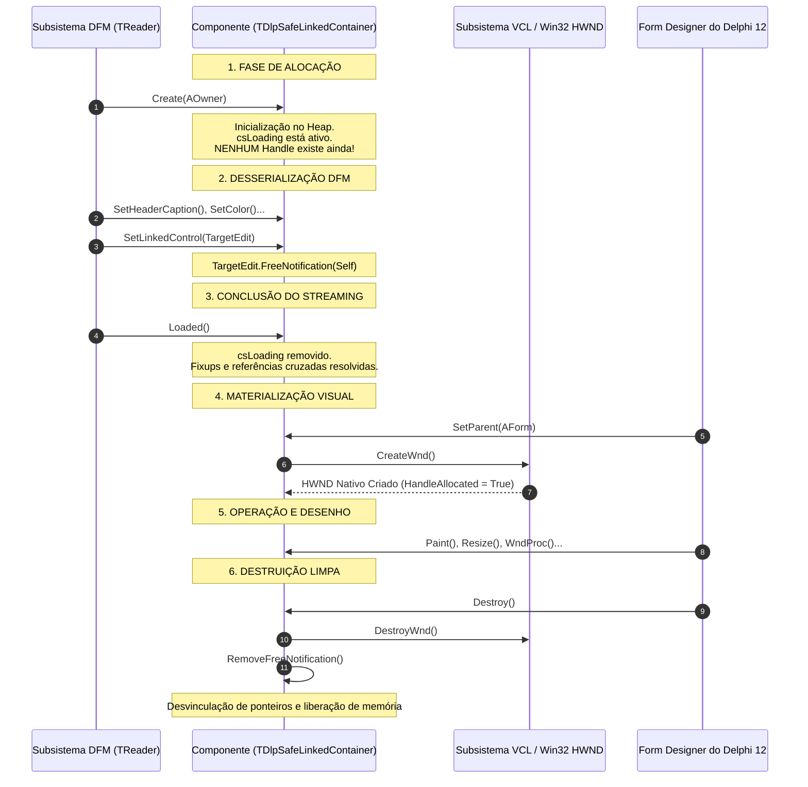

# MÓDULO 02: O Ciclo de Vida Completo do Componente

A estabilidade de qualquer suíte profissional de componentes no **Delphi 12 Athens+** repousa sobre a compreensão milimétrica do ciclo de vida dos seus objetos. Desenvolvedores que desconhecem os estágios exatos de transição de estado frequentemente enfrentam anomalias desconcertantes: propriedades que revertem para valores padrão, componentes que falham ao serem colados na superfície do formulário, exceções misteriosas durante a carga do executável e, o pior de todos os pesadelos RAD: violações de acesso (`Access Violation in module coreide.bpl`) que derrubam a própria IDE ao deletar um componente com o mouse.

Neste módulo, realizaremos um mergulho profundo no pipeline de vida dos componentes Delphi, contrastando a inicialização da **VCL** e do **FireMonkey (FMX)**, dissecando o subsistema de notificações cruzadas e implementando um contêiner com vinculação fraca totalmente imune a dangling pointers.

---

## 1. O Pipeline Determinístico no Delphi 12

O ciclo de vida de um componente Delphi é rigorosamente dividido em seis fases ordenadas:



---

## 2. As Fases Críticas de Vida e Suas Armadilhas

### 2.1 Construtor: `Create(AOwner: TComponent)`
No momento da execução do construtor:
- A instância foi alocada pelo operador `NewInstance`.
- O parâmetro `AOwner` passa a ser o tutor do ciclo de vida. Se `AOwner` for fornecido, nosso componente será inserido na lista interna de componentes do proprietário (`FComponents: TList<TComponent>`) e será automaticamente destruído quando o Owner for finalizado.
- **Armadilha Fatal na VCL:** Nunca acesse a propriedade `Handle`, métodos de desenho do `Canvas` ou propriedades dependentes de janela no construtor. Ao ler a propriedade `Handle` prematuramente, o método getter `GetHandle` verifica que o handle ainda não existe e invoca compulsoriamente `HandleNeeded` $\to$ `CreateHandle` $\to$ `CreateWnd`. Isso força a alocação de um `HWND` no Windows antes mesmo do componente receber um `Parent`, resultando em janelas órfãs flutuantes ou falhas no DFM.

### 2.2 O Pós-Carregamento: `procedure Loaded; override;`
Quando um formulário é carregado do arquivo `.dfm` (seja em tempo de design ou durante a inicialização da aplicação), as propriedades são escritas na ordem em que foram salvas no arquivo.
- Se a propriedade `BorderColor` depender da propriedade `Color`, e `BorderColor` for lida primeiro no arquivo de texto, qualquer validação no método assessor `SetBorderColor` falhará se tentar avaliar `Color`.
- O método `Loaded` é o local canônico do Object Pascal para:
  1. Realizar validações cruzadas entre propriedades dependentes.
  2. Ajustar layouts complexos que exigem que todos os componentes vizinhos já estejam instanciados.
  3. Notificar o subsistema visual de que os dados estão prontos.

### 2.3 A Materialização da Janela: `CreateWnd` e `DestroyWnd`
Diferente de frameworks puramente abstratos, a VCL mantém uma correspondência direta com a arquitetura de janelas da API do Windows:
- `procedure CreateWnd; override;`: Invocado assim que o `HWND` é fisicamente criado pela função `CreateWindowEx` da API do Windows. Aqui é seguro chamar rotinas da Win32 API, inicializar timers nativos ou integrar controles com a DWM (Desktop Window Manager) do Windows 11.
- `procedure DestroyWnd; override;`: Executado imediatamente antes do fechamento do `HWND`. Recursos da API do Windows associados exclusivamente ao identificador de janela devem ser finalizados aqui.

### 2.4 Ciclo de Vida no FireMonkey: O Papel de `ApplyStyle`
No FireMonkey (FMX), o paradigma é substancialmente diferente:
- A maioria dos controles não cria `HWND` nativo (apenas a janela raiz possui handle).
- O equivalente conceitual de `CreateWnd` no FMX é o método virtual:
  ```pascal
  procedure ApplyStyle; override;
  ```
- No FMX, o controle visual herda de `TStyledControl`. Ao ser instanciado e colocado em um container com estilo ativo, a engine do FireMonkey procura no arquivo de estilo (`.style`) a estrutura vetorial correspondente a `StyleLookup`. O método `ApplyStyle` é invocado para localizar e vincular objetos filhos do estilo (como sub-painéis, shapes e animações com `FindStyleResource`).

---

## 3. O Mapa Completo de Flags: `ComponentState` e `ControlState`

O estado interno de um componente no Delphi é monitorado por duas propriedades fundamentais:

### 3.1 `ComponentState: TComponentState`

| Flag | Condição Operacional | Diretiva de Engenharia |
| :--- | :--- | :--- |
| `csDesigning` | O componente está na superfície do Form Designer do Delphi IDE. | Desabilitar conexões reais de banco de dados, requisições HTTP e threads. Renderizar guias visuais e bordas de seleção. |
| `csLoading` | O subsistema de streaming está ativamente injetando dados do `.dfm`. | Bloquear recálculos prematuros de layout ou notificações em cascata nos métodos assessores `Set...`. |
| `csDestroying` | A instância está no processo final de liberação no Heap. | Proibir terminantemente o disparo de eventos do usuário (`OnClick`, `OnChange`), cancelar workers assíncronos e não repintar. |
| `csReadingState` | Leitura ativa de bloco de propriedades pelo `TReader`. | Utilizado internamente pela RTL durante reconstituição de árvores. |
| `csFreeNotification` | Indica que o componente foi registrado como ouvinte de destruição de outro objeto. | Gerenciado pela RTL através do par `FreeNotification` / `RemoveFreeNotification`. |
| `csSubComponent` | O componente foi marcado como subcomponente aninhado (`SetSubComponent(True)`). | Persiste suas propriedades dentro do bloco do componente pai no arquivo `.dfm`. |

### 3.2 `ControlState: TControlState`

Enquanto `ComponentState` gerencia a vida e o streaming, `ControlState` governa a interação e o desenho em tempo de execução:
- `csLButtonDown`: Botão esquerdo do mouse pressionado sobre a área cliente.
- `csClicked`: O controle foi acionado e está processando o clique.
- `csCustomPaint`: O controle está em modo de repintura personalizada.
- `csCreating`: O handle da janela está no exato instante de construção.

---

## 4. O Mal das Referências Cruzadas e a Solução `FreeNotification`

No desenvolvimento de componentes avançados, é rotina expor propriedades que apontam para outros componentes existentes no formulário (por exemplo: um botão apontando para um menu popup, um label apontando para um edit, ou um painel apontando para um controle parceiro).

Se você simplesmente salvar o ponteiro em uma variável privada:
```pascal
// CÓDIGO INSEGURO / AMADOR
procedure TMeuComponente.SetAlvo(const AValue: TControl);
begin
  FAlvo := AValue;
end;
```
Quando o usuário seleciona o componente apontado no designer e o deleta, a variável `FAlvo` se torna um **dangling pointer** (aponta para uma região de memória que não existe mais). Qualquer tentativa posterior de ler `FAlvo.Name` ou chamar um método virtual resultará em uma falha fatal que fecha o Delphi IDE ou corrompe o projeto.

### O Protocolo Definitivo de Vinculação Segura:

```
[Seu Componente]                                      [Componente Alvo]
       |                                                      |
       |--- 1. SetTarget(TargetInstance) -------------------->|
       |--- 2. TargetInstance.FreeNotification(Self) -------->| (Inscreve na lista interna)
       |                                                      |
       |             ... Ciclo normal de trabalho ...         |
       |                                                      |
       |                                  [Usuário deleta o Componente Alvo]
       |                                                      |
       |<-- 3. Notification(Self, opRemove) ------------------| (Avisa antes de desalocar!)
       |                                                      |
       +--- 4. FTarget := nil; Invalidate; -------------------+
```

Ao registrar `FreeNotification`, garantimos que, no instante em que o alvo for destruído, ele primeiro notificará todos os observadores, permitindo que nosso componente anule a referência com total segurança.

---

## 5. Implementação Prática: O Componente `TDlpSafeLinkedContainer`

Para materializar o ciclo de vida e a gestão segura de referências no Delphi 12, implementamos o `TDlpSafeLinkedContainer`.

O componente inclui:
- Despacho de auditoria em cada marco de vida (`Create`, `CreateWnd`, `Loaded`, `Notification`, `Destroy`).
- Suporte a duas referências fracas protegidas: `LinkedControl` (visual) e `SecondaryComponent` (não-visual).
- Renderização visual estilizada com badge de status, bordas nítidas para o Windows 11 e indicadores visuais sob a flag `csDesigning`.
- Suporte nativo a `DoubleBuffered` para eliminação total de flickering.

### 5.1 Código Pascal Completo e Compilável

Abaixo está o código integral da unidade `DlpSafeLinkedContainer.pas`:

```pascal
{==============================================================================
  Livro: Desenvolvimento Moderno de Componentes no Delphi: VCL, FireMonkey e ToolsAPI
  Módulo 02: O Ciclo de Vida Completo do Componente
  Componente: TDlpSafeLinkedContainer
  Autor: Engenharia de Software Especializada & Arquitetura RAD
  Ambiente: Delphi 12 Athens+ (Win32, Win64 e VCL)
  Descrição: Painel contêiner moderno para Delphi 12 que exemplifica o ciclo
             de vida determinístico completo (Create -> CreateWnd -> Loaded ->
             Notification -> Destroy), integrando gerenciamento seguro de
             vínculos fracos bilaterais e renderização com suporte a temas VCL.
==============================================================================}
unit DlpSafeLinkedContainer;

interface

uses
  Winapi.Windows,
  Winapi.Messages,
  System.SysUtils,
  System.Classes,
  Vcl.Controls,
  Vcl.Graphics,
  Vcl.Forms,
  Vcl.Themes;

type
  { Modo de visualização de status de vínculo no container }
  TDlpLinkStatusStyle = (lssNone, lssBadge, lssBorderHighlight);

  { Evento monitor de transição de ciclo de vida }
  TDlpLifecycleStageEvent = procedure(Sender: TObject; const AStage: string;
    const ADescription: string) of object;

  {============================================================================
    Classe: TDlpSafeLinkedContainer
    Herda de TCustomControl para ter HWND próprio, ciclo de mensagens
    e gerenciamento completo de vinculação fraca a outros componentes.
  ============================================================================}
  TDlpSafeLinkedContainer = class(TCustomControl)
  private
    FLinkedControl: TControl;
    FSecondaryComponent: TComponent;
    FLinkStatusStyle: TDlpLinkStatusStyle;
    FHeaderCaption: string;
    FHeaderHeight: Integer;
    FHeaderColor: TColor;
    FBorderColor: TColor;
    FOnLifecycleStage: TDlpLifecycleStageEvent;

    procedure SetLinkedControl(const AValue: TControl);
    procedure SetSecondaryComponent(const AValue: TComponent);
    procedure SetLinkStatusStyle(const AValue: TDlpLinkStatusStyle);
    procedure SetHeaderCaption(const AValue: string);
    procedure SetHeaderHeight(const AValue: Integer);
    procedure SetHeaderColor(const AValue: TColor);
    procedure SetBorderColor(const AValue: TColor);

    procedure DispatchLifecycleEvent(const AStage, ADetails: string);
  protected
    { 1. Fase de alocação de janela pelo subsistema Windows }
    procedure CreateWnd; override;
    procedure DestroyWnd; override;

    { 2. Fase de conclusão de streaming a partir do .dfm }
    procedure Loaded; override;

    { 3. Rastreamento e limpeza segura de referências cruzadas }
    procedure Notification(AComponent: TComponent; Operation: TOperation); override;

    { 4. Ciclo de desenho visual com Double Buffering }
    procedure Paint; override;
    procedure Resize; override;
  public
    constructor Create(AOwner: TComponent); override;
    destructor Destroy; override;

    { Métodos de diagnóstico e estado }
    function HasActiveLink: Boolean;
    function GetDiagnosticSnapshot: string;
  published
    { Vínculos seguros com componentes do formulário }
    property LinkedControl: TControl read FLinkedControl write SetLinkedControl;
    property SecondaryComponent: TComponent read FSecondaryComponent write SetSecondaryComponent;

    { Propriedades visuais do container }
    property LinkStatusStyle: TDlpLinkStatusStyle read FLinkStatusStyle write SetLinkStatusStyle default lssBadge;
    property HeaderCaption: string read FHeaderCaption write SetHeaderCaption;
    property HeaderHeight: Integer read FHeaderHeight write SetHeaderHeight default 30;
    property HeaderColor: TColor read FHeaderColor write SetHeaderColor default $002A2A2A;
    property BorderColor: TColor read FBorderColor write SetBorderColor default $004A4A4A;

    { Propriedades VCL convencionais publicadas }
    property Align;
    property Anchors;
    property AutoSize;
    property Color default $001E1E1E;
    property Constraints;
    property DoubleBuffered default True;
    property DragCursor;
    property DragKind;
    property DragMode;
    property Enabled;
    property Font;
    property ParentColor default False;
    property ParentDoubleBuffered;
    property ParentFont;
    property ParentShowHint;
    property PopupMenu;
    property ShowHint;
    property TabOrder;
    property TabStop default True;
    property Touch;
    property Visible;

    { Eventos VCL convencionais }
    property OnClick;
    property OnContextPopup;
    property OnDblClick;
    property OnDragDrop;
    property OnDragOver;
    property OnEndDock;
    property OnEndDrag;
    property OnEnter;
    property OnExit;
    property OnGesture;
    property OnKeyDown;
    property OnKeyPress;
    property OnKeyUp;
    property OnMouseActivate;
    property OnMouseDown;
    property OnMouseEnter;
    property OnMouseLeave;
    property OnMouseMove;
    property OnMouseUp;
    property OnResize;
    property OnStartDock;
    property OnStartDrag;

    { Evento de auditoria de ciclo de vida }
    property OnLifecycleStage: TDlpLifecycleStageEvent read FOnLifecycleStage write FOnLifecycleStage;
  end;

procedure Register;

implementation

procedure Register;
begin
  RegisterComponents('Engenharia Delphi 12', [TDlpSafeLinkedContainer]);
end;

{ TDlpSafeLinkedContainer }

constructor TDlpSafeLinkedContainer.Create(AOwner: TComponent);
begin
  inherited Create(AOwner);

  { Habilita aceitação de controles filhos no Form Designer e Double Buffering nativo }
  ControlStyle := ControlStyle + [csAcceptsControls, csCaptureMouse, csClickEvents, csDoubleClicks];
  DoubleBuffered := True;

  { Configura dimensões padrão e paleta escura (modern dark style) }
  Width := 300;
  Height := 200;
  Color := $001E1E1E;
  FHeaderColor := $002A2A2A;
  FHeaderHeight := 30;
  FBorderColor := $004A4A4A;
  FHeaderCaption := 'Modern Delphi 12 Container';
  FLinkStatusStyle := lssBadge;
  FLinkedControl := nil;
  FSecondaryComponent := nil;

  { Tipografia padrão moderna do Windows 11 }
  Font.Name := 'Segoe UI';
  Font.Size := 9;
  Font.Color := $00F0F0F0;

  DispatchLifecycleEvent('Create', Format('Owner: %s | csDesigning: %s',
    [BoolToStr(Assigned(AOwner), 'Presente', 'nil'),
     BoolToStr(csDesigning in ComponentState, 'Sim', 'Não')]));
end;

destructor TDlpSafeLinkedContainer.Destroy;
begin
  DispatchLifecycleEvent('Destroy', 'Liberando recursos e removendo notificações registradas...');

  { Limpeza bilateral de notificações para evitar dangling callbacks }
  if Assigned(FLinkedControl) then
  begin
    FLinkedControl.RemoveFreeNotification(Self);
    FLinkedControl := nil;
  end;

  if Assigned(FSecondaryComponent) then
  begin
    FSecondaryComponent.RemoveFreeNotification(Self);
    FSecondaryComponent := nil;
  end;

  inherited Destroy;
end;

procedure TDlpSafeLinkedContainer.CreateWnd;
begin
  inherited CreateWnd;

  { O HWND do Windows 11 foi alocado pelo sistema operacional }
  DispatchLifecycleEvent('CreateWnd', Format('HWND nativo alocado: 0x%p', [Pointer(Handle)]));
end;

procedure TDlpSafeLinkedContainer.DestroyWnd;
begin
  DispatchLifecycleEvent('DestroyWnd', Format('HWND prestes a ser desalocado: 0x%p', [Pointer(Handle)]));
  inherited DestroyWnd;
end;

procedure TDlpSafeLinkedContainer.Loaded;
begin
  inherited Loaded;

  { Todo o arquivo .dfm foi parseado e todos os fixups resolvidos }
  DispatchLifecycleEvent('Loaded', Format('DFM concluído. LinkedControl: %s | Secondary: %s',
    [BoolToStr(Assigned(FLinkedControl), 'Atribuído', 'Vazio'),
     BoolToStr(Assigned(FSecondaryComponent), 'Atribuído', 'Vazio')]));

  Invalidate;
end;

procedure TDlpSafeLinkedContainer.SetLinkedControl(const AValue: TControl);
begin
  if FLinkedControl <> AValue then
  begin
    { Proteção contra auto-referência circular }
    if AValue = Self then
      raise Exception.Create('TDlpSafeLinkedContainer não pode referenciar a si próprio como LinkedControl.');

    { Remove registro do alvo anterior }
    if Assigned(FLinkedControl) then
      FLinkedControl.RemoveFreeNotification(Self);

    FLinkedControl := AValue;

    { Solicita aviso prévio de destruição do novo controle alvo }
    if Assigned(FLinkedControl) then
      FLinkedControl.FreeNotification(Self);

    DispatchLifecycleEvent('SetLinkedControl', Format('Novo controle: %s',
      [BoolToStr(Assigned(FLinkedControl), FLinkedControl.Name, 'nil')]));

    Invalidate;
  end;
end;

procedure TDlpSafeLinkedContainer.SetSecondaryComponent(const AValue: TComponent);
begin
  if FSecondaryComponent <> AValue then
  begin
    if AValue = Self then
      raise Exception.Create('TDlpSafeLinkedContainer não pode referenciar a si próprio como SecondaryComponent.');

    if Assigned(FSecondaryComponent) then
      FSecondaryComponent.RemoveFreeNotification(Self);

    FSecondaryComponent := AValue;

    if Assigned(FSecondaryComponent) then
      FSecondaryComponent.FreeNotification(Self);

    DispatchLifecycleEvent('SetSecondaryComponent', Format('Novo componente: %s',
      [BoolToStr(Assigned(FSecondaryComponent), FSecondaryComponent.Name, 'nil')]));

    Invalidate;
  end;
end;

procedure TDlpSafeLinkedContainer.Notification(AComponent: TComponent; Operation: TOperation);
begin
  inherited Notification(AComponent, Operation);

  { Tratamento preventivo de exclusões em Design-Time e Run-Time }
  if Operation = opRemove then
  begin
    if AComponent = FLinkedControl then
    begin
      DispatchLifecycleEvent('Notification(opRemove)',
        Format('Controle vinculado [%s] está sendo destruído. Anulando referência.', [AComponent.Name]));
      FLinkedControl := nil;
      Invalidate;
    end
    else if AComponent = FSecondaryComponent then
    begin
      DispatchLifecycleEvent('Notification(opRemove)',
        Format('Componente secundário [%s] está sendo destruído. Anulando referência.', [AComponent.Name]));
      FSecondaryComponent := nil;
      Invalidate;
    end;
  end;
end;

procedure TDlpSafeLinkedContainer.SetLinkStatusStyle(const AValue: TDlpLinkStatusStyle);
begin
  if FLinkStatusStyle <> AValue then
  begin
    FLinkStatusStyle := AValue;
    Invalidate;
  end;
end;

procedure TDlpSafeLinkedContainer.SetHeaderCaption(const AValue: string);
begin
  if FHeaderCaption <> AValue then
  begin
    FHeaderCaption := AValue;
    Invalidate;
  end;
end;

procedure TDlpSafeLinkedContainer.SetHeaderHeight(const AValue: Integer);
begin
  if (FHeaderHeight <> AValue) and (AValue >= 0) then
  begin
    FHeaderHeight := AValue;
    Invalidate;
  end;
end;

procedure TDlpSafeLinkedContainer.SetHeaderColor(const AValue: TColor);
begin
  if FHeaderColor <> AValue then
  begin
    FHeaderColor := AValue;
    Invalidate;
  end;
end;

procedure TDlpSafeLinkedContainer.SetBorderColor(const AValue: TColor);
begin
  if FBorderColor <> AValue then
  begin
    FBorderColor := AValue;
    Invalidate;
  end;
end;

procedure TDlpSafeLinkedContainer.Resize;
begin
  inherited Resize;
  Invalidate;
end;

procedure TDlpSafeLinkedContainer.Paint;
var
  R, HeaderR, BadgeR: TRect;
  LinkInfo: string;
begin
  { Blindagem contra tentativas de pintura durante destruição ou carga de DFM }
  if (csDestroying in ComponentState) or (csReadingState in ComponentState) then
    Exit;

  { 1. Desenho do Corpo Principal }
  Canvas.Brush.Color := Color;
  Canvas.Brush.Style := bsSolid;
  Canvas.Pen.Color := FBorderColor;
  Canvas.Pen.Width := 1;
  Canvas.Rectangle(0, 0, Width, Height);

  { 2. Desenho do Cabeçalho Superior }
  if FHeaderHeight > 0 then
  begin
    HeaderR := Rect(0, 0, Width, FHeaderHeight);
    Canvas.Brush.Color := FHeaderColor;
    Canvas.FillRect(HeaderR);

    { Linha de separação do cabeçalho }
    Canvas.Pen.Color := FBorderColor;
    Canvas.MoveTo(0, FHeaderHeight);
    Canvas.LineTo(Width, FHeaderHeight);

    { Título em destaque }
    Canvas.Font.Assign(Self.Font);
    Canvas.Font.Style := [fsBold];
    Canvas.Brush.Style := bsClear;
    R := Rect(12, 0, Width - 12, FHeaderHeight);
    Vcl.Graphics.DrawText(Canvas.Handle, PChar(FHeaderCaption), Length(FHeaderCaption),
      R, DT_LEFT or DT_VCENTER or DT_SINGLELINE);
  end;

  { 3. Renderização do Destaque de Vínculo }
  if Assigned(FLinkedControl) and (FLinkStatusStyle <> lssNone) then
  begin
    LinkInfo := Format('LINK: %s (%s)', [FLinkedControl.Name, FLinkedControl.ClassName]);
    Canvas.Font.Size := 8;
    Canvas.Font.Style := [fsBold];

    if FLinkStatusStyle = lssBadge then
    begin
      BadgeR := Rect(Width - 160, 4, Width - 8, FHeaderHeight - 4);
      Canvas.Brush.Color := $00336600; // Verde corporativo
      Canvas.Brush.Style := bsSolid;
      Canvas.Pen.Color := $0055AA00;
      Canvas.RoundRect(BadgeR.Left, BadgeR.Top, BadgeR.Right, BadgeR.Bottom, 6, 6);

      Canvas.Font.Color := clWhite;
      Canvas.Brush.Style := bsClear;
      Vcl.Graphics.DrawText(Canvas.Handle, PChar(LinkInfo), Length(LinkInfo),
        BadgeR, DT_CENTER or DT_VCENTER or DT_SINGLELINE);
    end
    else if FLinkStatusStyle = lssBorderHighlight then
    begin
      Canvas.Pen.Color := $0000AAFF; // Laranja/Dourado de foco
      Canvas.Pen.Width := 2;
      Canvas.Brush.Style := bsClear;
      Canvas.Rectangle(1, 1, Width - 1, Height - 1);
    end;
  end;

  { 4. Indicador visual exclusivo de Design-Time }
  if csDesigning in ComponentState then
  begin
    Canvas.Pen.Style := psDot;
    Canvas.Pen.Color := clHighlight;
    Canvas.Brush.Style := bsClear;
    Canvas.Rectangle(2, 2, Width - 2, Height - 2);
  end;
end;

procedure TDlpSafeLinkedContainer.DispatchLifecycleEvent(const AStage, ADetails: string);
begin
  if Assigned(FOnLifecycleStage) then
  begin
    try
      FOnLifecycleStage(Self, AStage, ADetails);
    except
      { Silencia falhas no handler do usuário para manter integridade do ciclo de vida }
    end;
  end;
end;

function TDlpSafeLinkedContainer.HasActiveLink: Boolean;
begin
  Result := Assigned(FLinkedControl) and
            not (csDestroying in FLinkedControl.ComponentState);
end;

function TDlpSafeLinkedContainer.GetDiagnosticSnapshot: string;
var
  SB: TStringBuilder;
begin
  SB := TStringBuilder.Create;
  try
    SB.AppendLine(Format('Componente: %s (%s)', [Name, ClassName]));
    SB.AppendLine(Format('- HWND Alocado: %s', [BoolToStr(HandleAllocated, 'Sim', 'Não')]));
    SB.AppendLine(Format('- csDesigning: %s', [BoolToStr(csDesigning in ComponentState, 'Sim', 'Não')]));
    SB.AppendLine(Format('- csLoading: %s', [BoolToStr(csLoading in ComponentState, 'Sim', 'Não')]));
    SB.AppendLine(Format('- csDestroying: %s', [BoolToStr(csDestroying in ComponentState, 'Sim', 'Não')]));
    SB.AppendLine(Format('- csReadingState: %s', [BoolToStr(csReadingState in ComponentState, 'Sim', 'Não')]));
    SB.AppendLine(Format('- LinkedControl: %s',
      [BoolToStr(Assigned(FLinkedControl), FLinkedControl.Name, 'nil')]));
    SB.AppendLine(Format('- SecondaryComponent: %s',
      [BoolToStr(Assigned(FSecondaryComponent), FSecondaryComponent.Name, 'nil')]));
    Result := SB.ToString;
  finally
    SB.Free;
  end;
end;

end.
```

---

## 6. Checklist de Engenharia do Módulo 02

- [x] O construtor `Create` nunca deve ler `Handle` nem acoplar propriedades com dependência de janelas nativas.
- [x] O método `Loaded` é a fronteira oficial onde todas as referências cruzadas entre componentes carregados do `.dfm` estão garantidamente disponíveis.
- [x] `CreateWnd` e `DestroyWnd` delimitam o nascimento e o encerramento do `HWND` da API do Windows na VCL. No FMX, utilize `ApplyStyle` para ancorar elementos vetoriais.
- [x] Toda propriedade que recebe um `TComponent` externo deve registrar `FreeNotification` e limpar a referência em `Notification(opRemove)` para erradicar Access Violations no Form Designer.
- [x] Respeite sempre as flags de `ComponentState`: `csDesigning` para simulações e marcações de design-time, `csLoading` para evitar reações prematuras a dados intermediários, e `csDestroying` para suprimir eventos e desenhos tardios.
