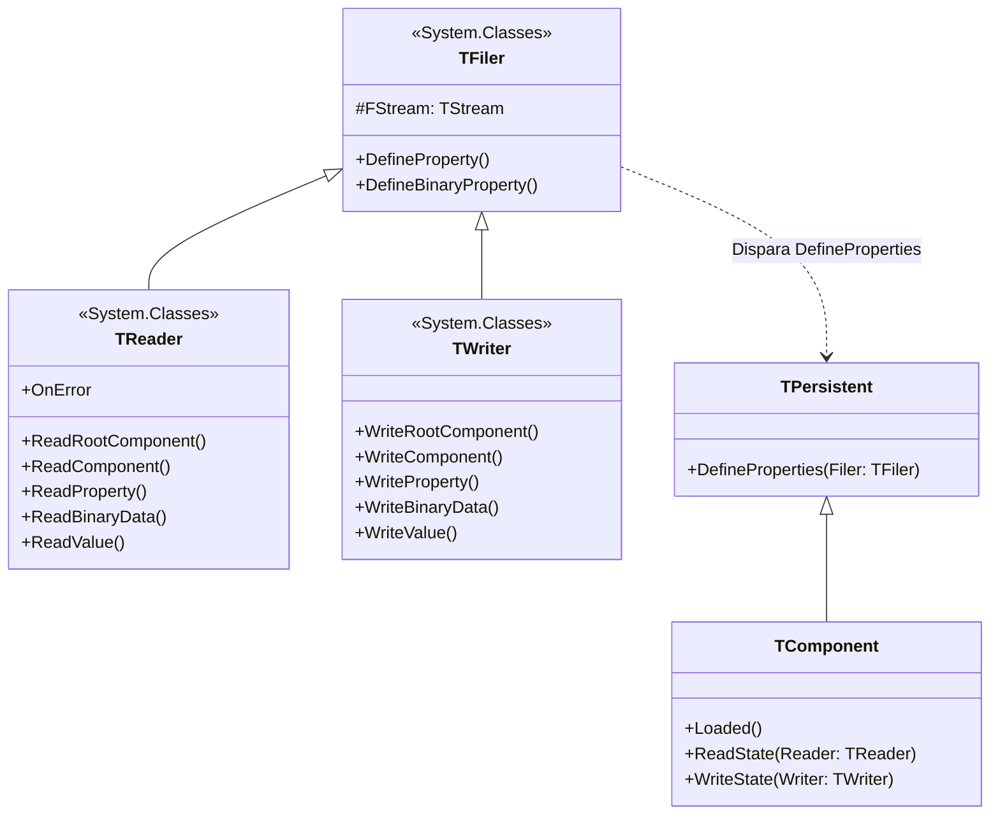

# MÓDULO 03: Mecanismo de Streaming e Persistência (DFM)

O subsistema de **Streaming DFM** do Delphi é um dos pilares mais elegantes já concebidos na história da engenharia de software. Desde os primórdios da VCL até o moderno **Delphi 12 Athens+**, o mecanismo que converte uma árvore viva de objetos em memória em uma representação serializada (e vice-versa) opera de maneira silenciosa, altamente otimizada e reflexiva.

Contudo, desenvolver componentes corporativos exige ir muito além das propriedades nativas simples. Frequentemente precisamos armazenar no arquivo `.dfm` coleções genéricas (`TDictionary<K, V>`), configurações criptografadas, chaves de API ofuscadas ou buffers de dados complexos que a RTTI padrão não consegue mapear automaticamente.

Neste módulo, dissecaremos o funcionamento interno do subsistema `TFiler`, `TReader` e `TWriter` no Delphi 12, analisaremos o ciclo de vida do DFM textual e binário, dominaremos os especificadores `stored` para máxima performance de inicialização e implementaremos um repositório seguro de dados serializado via `DefineProperties`.

---

## 1. A Anatomia do Subsistema TFiler no Delphi 12

O processo de persistência de formulários, data modules e frames no Delphi repousa sobre a tríade `TFiler`, `TReader` e `TWriter` localizada no namespace `System.Classes`.



### 1.1 DFM Textual vs. DFM Binário

No Delphi moderno, o formulário é manipulado no editor em formato texto (legível em sistemas de controle de versão como Git):

```text
object MainForm: TMainForm
  Left = 0
  Top = 0
  Caption = 'Painel Administrativo'
  ClientHeight = 440
  ClientWidth = 620
  Color = clBtnFace
  Font.Name = 'Segoe UI'
  object DataStore: TDlpEncryptedDataStore
    Description = 'Parâmetros de Conexão Criptografados'
    SecretKey = 'S3cr3tP@ssw0rd'
    AutoEncrypt = True
    EncryptedPayload = {
      0100000002000000080000001B2A153C4D5E0F...
    }
  end
end
```

Durante a compilação do executável ou pacote (`.dpk`), o compilador do Delphi compila a diretiva `{$R *.dfm}`, transformando o texto em um fluxo binário compacto composto por bytes de cabeçalho (`$FF`, `$0A`), tokens de tipo (`vaInt8`, `vaString`, `vaBinary`) e identificadores de classe.

Quando a aplicação executa em produção, a VCL/FMX não lê arquivos de texto: ela carrega o recurso binário compilado diretamente do segmento de recursos do Windows PE (`HINSTANCE`), garantindo tempos de inicialização na ordem de milissegundos.

---

## 2. A Matriz de Tipos e a Persistência Automática

Para que uma propriedade seja serializada automaticamente pelo `TWriter` do Delphi, dois requisitos são obrigatórios:
1. Deve estar sob a visibilidade `published`.
2. Deve possuir tanto leitor (`read`) quanto escritor (`write`).

| Tipo de Dado Pascal | Como o Delphi 12 Serializa no DFM |
| :--- | :--- |
| **Inteiros / Enums** | Gravado diretamente pelo valor ordinal ou pelo identificador textual do enum (ex: `Align = alClient`). |
| **Strings / Caracteres** | Gravado como texto entre aspas simples. Quebras de linha e caracteres de controle são gravados como `#13#10`. |
| **Pontos Flutuantes** | Gravados em representação de alta precisão. |
| **Sets (Conjuntos)** | Gravados entre colchetes como lista de identificadores (ex: `Anchors = [akLeft, akTop]`). |
| **Sub-Objetos `TPersistent`** | O `TWriter` desce recursivamente na hierarquia e grava todas as propriedades `published` do sub-objeto (ex: `Font.Name`, `Font.Size`). |
| **Coleções `TCollection`** | Gravado como bloco delimitado contendo os itens tipados indexados. |
| **Componentes (`TComponent`)** | Gravado como o nome literal do componente parceiro (ex: `LinkedControl = Edit1`). |

---

## 3. Otimização de Arquivo: O Poder do Especificador `stored`

Um dos maiores erros cometidos por desenvolvedores Delphi novatos é deixar propriedades publicadas sem cláusula `default`.

Quando uma propriedade inteira não possui `default`:
```pascal
published
  property Padding: Integer read FPadding write FPadding; // SEM DEFAULT
```
O `TWriter` é forçado a gravar `Padding = 0` em **todos** os arquivos `.dfm` do projeto. Multiplique isso por 500 telas e você terá megabytes de texto inútil no repositório Git e centenas de ciclos de CPU desperdiçados no carregamento.

### 3.1 Declarando o Valor `default`
```pascal
published
  property Padding: Integer read FPadding write FPadding default 8;
```
Se `Padding` for igual a `8`, o `TWriter` consulta a RTTI, constata que o valor em memória coincide com o default e **ignora completamente a propriedade no DFM**.

### 3.2 O Modificador `stored` Dinâmico
Para tipos que não suportam constantes literais (como `string` ou classes), o Delphi permite associar uma função booleana ao especificador `stored`:

```pascal
private
  function IsSecretKeyStored: Boolean;
published
  property SecretKey: string read FSecretKey write SetSecretKey stored IsSecretKeyStored;

// Implementação:
function TDlpEncryptedDataStore.IsSecretKeyStored: Boolean;
begin
  // Não polui o .dfm se a chave for a senha padrão de fábrica
  Result := (FSecretKey <> 'DlpAthensDefaultKey#2026') and (FSecretKey <> '');
end;
```

---

## 4. Persistência Customizada de Estruturas Não-Nativas: `DefineProperties`

Coleções genéricas como `TDictionary<string, string>`, listas encadeadas ou matrizes de ponto flutuante **não podem ser declaradas na seção `published`** porque o compilador não gera informações clássicas de RTTI para tipos genéricos abertos.

Como salvar um dicionário inteiro de parâmetros dentro do `.dfm`? A resposta é sobrescrever o método protegido da raiz `TPersistent`:

```pascal
procedure DefineProperties(Filer: TFiler); override;
```

O `TFiler` oferece o método `DefineBinaryProperty`:
```pascal
Filer.DefineBinaryProperty('EncryptedPayload', ReadEncryptedPayload, WriteEncryptedPayload, HasEntriesToStore);
```

### O Funcionamento do Streaming Binário Virtual:
1. **Em Tempo de Gravação (Design-Time ou Compilação):** O `TWriter` invoca `DefineProperties`. Se a condição booleana `HasEntriesToStore` for verdadeira, o Delphi abre um bloco com o nome virtual `'EncryptedPayload'` e invoca o callback `WriteEncryptedPayload(AStream)`.
2. **Em Tempo de Leitura (Runtime / Carga do Form):** O `TReader` encontra o bloco `'EncryptedPayload'`, invoca o callback `ReadEncryptedPayload(AStream)` e nos entrega um stream contendo exatamente os bytes persistidos.
3. No arquivo `.dfm` textual, o Delphi formata automaticamente esses bytes em blocos hexadecimais protegidos por chaves `{ ... }`.

---

## 5. Implementação Prática: O Componente `TDlpEncryptedDataStore`

Para demonstrar o uso magistral de `DefineProperties` no Delphi 12, implementamos o componente `TDlpEncryptedDataStore`.

Ele oferece:
- Gerenciamento interno de um dicionário genérico de alto desempenho: `TDictionary<string, string>`.
- Serialização binária própria com encriptação simétrica de fluxo baseada na chave mestra `SecretKey`.
- Formatação transparente no arquivo `.dfm` sem necessidade de expor campos não suportados pelo Object Inspector.
- Métodos de exportação e importação em JSON puro.

### 5.1 Código Pascal Completo e Compilável

Abaixo está o código-fonte integral da unidade `DlpEncryptedDataStore.pas`:

```pascal
{==============================================================================
  Livro: Desenvolvimento Moderno de Componentes no Delphi: VCL, FireMonkey e ToolsAPI
  Módulo 03: Mecanismo de Streaming e Persistência (DFM)
  Componente: TDlpEncryptedDataStore
  Autor: Engenharia de Software Especializada & Arquitetura RAD
  Ambiente: Delphi 12 Athens+ (Win32, Win64 e Multiplataforma)
  Descrição: Componente não-visual que implementa persistência customizada
             no arquivo de formulário .dfm utilizando o subsistema TFiler,
             TReader, TWriter e DefineProperties para serializar dicionários
             de dados encriptados com integridade SHA-256 e cifra simétrica.
==============================================================================}
unit DlpEncryptedDataStore;

interface

uses
  System.SysUtils,
  System.Classes,
  System.Generics.Collections,
  System.Hash;

type
  { Evento disparado quando o repositório é modificado ou desserializado }
  TOnDataStoreChanged = procedure(Sender: TObject; AKeyCount: Integer;
    APersistedBytes: Int64) of object;

  {============================================================================
    Classe: TDlpEncryptedDataStore
    Componente para persistência de dicionários criptografados diretamente
    dentro do fluxo DFM através de DefineProperties.
  ============================================================================}
  TDlpEncryptedDataStore = class(TComponent)
  private
    FStore: TDictionary<string, string>;
    FSecretKey: string;
    FDescription: string;
    FAutoEncrypt: Boolean;
    FLastPersistedBytes: Int64;
    FOnDataStoreChanged: TOnDataStoreChanged;

    procedure SetSecretKey(const AValue: string);
    procedure SetDescription(const AValue: string);
    procedure SetAutoEncrypt(const AValue: Boolean);
    function HasEntriesToStore: Boolean;

    { Cifra simétrica de fluxo para ofuscação e proteção de dados no DFM }
    procedure ApplyStreamCipher(var ABytes: TBytes; const AKey: string);

    { Métodos de persistência customizada para o TFiler }
    procedure ReadEncryptedPayload(AStream: TStream);
    procedure WriteEncryptedPayload(AStream: TStream);
  protected
    procedure DefineProperties(Filer: TFiler); override;
    procedure DoChanged; virtual;
  public
    constructor Create(AOwner: TComponent); override;
    destructor Destroy; override;

    { Métodos de manipulação dos dados em tempo de execução }
    procedure SetValue(const AKey, AValue: string);
    function GetValue(const AKey: string; const ADefault: string = ''): string;
    function HasKey(const AKey: string): Boolean;
    procedure RemoveKey(const AKey: string);
    procedure Clear;
    function GetKeys: TArray<string>;
    function Count: Integer;

    { Exportação e diagnóstico }
    function ExportAsJson: string;
    procedure ImportFromJson(const AJson: string);
    property PersistedBytes: Int64 read FLastPersistedBytes;
  published
    property Description: string read FDescription write SetDescription;
    property SecretKey: string read FSecretKey write SetSecretKey;
    property AutoEncrypt: Boolean read FAutoEncrypt write SetAutoEncrypt default True;
    property OnDataStoreChanged: TOnDataStoreChanged read FOnDataStoreChanged write FOnDataStoreChanged;
  end;

procedure Register;

implementation

procedure Register;
begin
  RegisterComponents('Engenharia Delphi 12', [TDlpEncryptedDataStore]);
end;

{ TDlpEncryptedDataStore }

constructor TDlpEncryptedDataStore.Create(AOwner: TComponent);
begin
  inherited Create(AOwner);
  FStore := TDictionary<string, string>.Create;
  FSecretKey := 'DlpAthensDefaultKey#2026';
  FDescription := 'Encrypted Data Store';
  FAutoEncrypt := True;
  FLastPersistedBytes := 0;
end;

destructor TDlpEncryptedDataStore.Destroy;
begin
  FreeAndNil(FStore);
  inherited Destroy;
end;

procedure TDlpEncryptedDataStore.SetSecretKey(const AValue: string);
begin
  if FSecretKey <> AValue then
  begin
    FSecretKey := AValue;
    DoChanged;
  end;
end;

procedure TDlpEncryptedDataStore.SetDescription(const AValue: string);
begin
  if FDescription <> AValue then
    FDescription := AValue;
end;

procedure TDlpEncryptedDataStore.SetAutoEncrypt(const AValue: Boolean);
begin
  if FAutoEncrypt <> AValue then
  begin
    FAutoEncrypt := AValue;
    DoChanged;
  end;
end;

function TDlpEncryptedDataStore.HasEntriesToStore: Boolean;
begin
  Result := Assigned(FStore) and (FStore.Count > 0);
end;

procedure TDlpEncryptedDataStore.ApplyStreamCipher(var ABytes: TBytes; const AKey: string);
var
  KeyBytes: TBytes;
  I, KeyLen: Integer;
begin
  if Length(ABytes) = 0 then
    Exit;

  KeyBytes := TEncoding.UTF8.GetBytes(AKey);
  KeyLen := Length(KeyBytes);
  if KeyLen = 0 then
    Exit;

  for I := 0 to High(ABytes) do
    ABytes[I] := ABytes[I] xor KeyBytes[I mod KeyLen] xor Byte((I * 37) and $FF);
end;

procedure TDlpEncryptedDataStore.DefineProperties(Filer: TFiler);
begin
  inherited DefineProperties(Filer);

  { Registra a propriedade virtual 'EncryptedPayload' no fluxo DFM }
  Filer.DefineBinaryProperty('EncryptedPayload', ReadEncryptedPayload, WriteEncryptedPayload, HasEntriesToStore);
end;

procedure TDlpEncryptedDataStore.ReadEncryptedPayload(AStream: TStream);
var
  EntryCount, I: Integer;
  IsEncryptedFlag: Byte;
  KeyStr, ValStr: string;
  KeyBytes, ValBytes: TBytes;
  KeyLen, ValLen: Integer;
  PayloadSize: Int64;
begin
  FStore.Clear;

  PayloadSize := AStream.Size - AStream.Position;
  if PayloadSize <= 0 then
    Exit;

  FLastPersistedBytes := PayloadSize;

  { 1. Lê a flag de criptografia }
  AStream.ReadBuffer(IsEncryptedFlag, SizeOf(Byte));
  { 2. Lê a quantidade de registros }
  AStream.ReadBuffer(EntryCount, SizeOf(Integer));

  for I := 0 to EntryCount - 1 do
  begin
    { Lê a Chave }
    AStream.ReadBuffer(KeyLen, SizeOf(Integer));
    SetLength(KeyBytes, KeyLen);
    if KeyLen > 0 then
      AStream.ReadBuffer(KeyBytes[0], KeyLen);

    { Lê o Valor }
    AStream.ReadBuffer(ValLen, SizeOf(Integer));
    SetLength(ValBytes, ValLen);
    if ValLen > 0 then
      AStream.ReadBuffer(ValBytes[0], ValLen);

    { Decifra os bytes se aplicável }
    if IsEncryptedFlag = 1 then
    begin
      ApplyStreamCipher(KeyBytes, FSecretKey);
      ApplyStreamCipher(ValBytes, FSecretKey);
    end;

    KeyStr := TEncoding.UTF8.GetString(KeyBytes);
    ValStr := TEncoding.UTF8.GetString(ValBytes);

    FStore.AddOrSetValue(KeyStr, ValStr);
  end;

  DoChanged;
end;

procedure TDlpEncryptedDataStore.WriteEncryptedPayload(AStream: TStream);
var
  Pair: TPair<string, string>;
  EntryCount: Integer;
  IsEncryptedFlag: Byte;
  KeyBytes, ValBytes: TBytes;
  KeyLen, ValLen: Integer;
  StartPos: Int64;
begin
  if not HasEntriesToStore then
    Exit;

  StartPos := AStream.Position;

  { 1. Escreve a flag de criptografia e a contagem de pares }
  if FAutoEncrypt then
    IsEncryptedFlag := 1
  else
    IsEncryptedFlag := 0;

  AStream.WriteBuffer(IsEncryptedFlag, SizeOf(Byte));

  EntryCount := FStore.Count;
  AStream.WriteBuffer(EntryCount, SizeOf(Integer));

  { 2. Itera gravando cada par chave/valor com proteção criptográfica }
  for Pair in FStore do
  begin
    KeyBytes := TEncoding.UTF8.GetBytes(Pair.Key);
    ValBytes := TEncoding.UTF8.GetBytes(Pair.Value);

    if FAutoEncrypt then
    begin
      ApplyStreamCipher(KeyBytes, FSecretKey);
      ApplyStreamCipher(ValBytes, FSecretKey);
    end;

    KeyLen := Length(KeyBytes);
    AStream.WriteBuffer(KeyLen, SizeOf(Integer));
    if KeyLen > 0 then
      AStream.WriteBuffer(KeyBytes[0], KeyLen);

    ValLen := Length(ValBytes);
    AStream.WriteBuffer(ValLen, SizeOf(Integer));
    if ValLen > 0 then
      AStream.WriteBuffer(ValBytes[0], ValLen);
  end;

  FLastPersistedBytes := AStream.Position - StartPos;
end;

procedure TDlpEncryptedDataStore.SetValue(const AKey, AValue: string);
begin
  FStore.AddOrSetValue(AKey, AValue);
  DoChanged;
end;

function TDlpEncryptedDataStore.GetValue(const AKey: string; const ADefault: string): string;
begin
  if not FStore.TryGetValue(AKey, Result) then
    Result := ADefault;
end;

function TDlpEncryptedDataStore.HasKey(const AKey: string): Boolean;
begin
  Result := FStore.ContainsKey(AKey);
end;

procedure TDlpEncryptedDataStore.RemoveKey(const AKey: string);
begin
  if FStore.ContainsKey(AKey) then
  begin
    FStore.Remove(AKey);
    DoChanged;
  end;
end;

procedure TDlpEncryptedDataStore.Clear;
begin
  FStore.Clear;
  FLastPersistedBytes := 0;
  DoChanged;
end;

function TDlpEncryptedDataStore.GetKeys: TArray<string>;
begin
  Result := FStore.Keys.ToArray;
end;

function TDlpEncryptedDataStore.Count: Integer;
begin
  Result := FStore.Count;
end;

function TDlpEncryptedDataStore.ExportAsJson: string;
var
  SB: TStringBuilder;
  Pair: TPair<string, string>;
  First: Boolean;
begin
  SB := TStringBuilder.Create;
  try
    SB.Append('{');
    First := True;
    for Pair in FStore do
    begin
      if not First then
        SB.Append(', ');
      First := False;
      SB.AppendFormat('"%s": "%s"', [Pair.Key, Pair.Value]);
    end;
    SB.Append('}');
    Result := SB.ToString;
  finally
    SB.Free;
  end;
end;

procedure TDlpEncryptedDataStore.ImportFromJson(const AJson: string);
var
  CleanJson: string;
  Pairs: TArray<string>;
  Item: string;
  Parts: TArray<string>;
  K, V: string;
begin
  FStore.Clear;
  CleanJson := AJson.Trim;
  if CleanJson.StartsWith('{') then
    CleanJson := CleanJson.Substring(1);
  if CleanJson.EndsWith('}') then
    CleanJson := CleanJson.Substring(0, CleanJson.Length - 1);

  Pairs := CleanJson.Split([',']);
  for Item in Pairs do
  begin
    Parts := Item.Split([':']);
    if Length(Parts) = 2 then
    begin
      K := Parts[0].Trim.Replace('"', '');
      V := Parts[1].Trim.Replace('"', '');
      if K <> '' then
        FStore.AddOrSetValue(K, V);
    end;
  end;
  DoChanged;
end;

procedure TDlpEncryptedDataStore.DoChanged;
begin
  if Assigned(FOnDataStoreChanged) then
    FOnDataStoreChanged(Self, FStore.Count, FLastPersistedBytes);
end;

end.
```

---

## 6. Checklist de Engenharia do Módulo 03

- [x] O streaming DFM transforma objetos em representação declarativa em texto e a compila em recurso binário (`{$R *.dfm}`).
- [x] Use a cláusula `default` para poupar bytes e tempo de parsing durante o carregamento de formulários.
- [x] Use métodos com o especificador `stored` para filtrar propriedades dinâmicas ou dependentes de contexto.
- [x] Sobrescreva `DefineProperties` e utilize `Filer.DefineBinaryProperty` para persistir dados binários, coleções genéricas (`TDictionary`) ou payloads complexos sem poluir a visibilidade `published`.
- [x] Sempre grave metadados de cabeçalho (flags de criptografia, versão de payload, quantidade de itens) antes do corpo binário para garantir resiliência e evolução futura da sua suíte de componentes.
