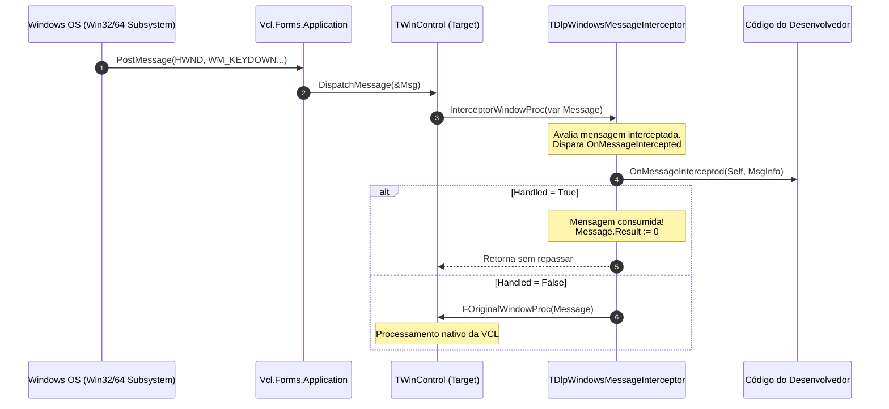

# MÓDULO 04: Tratamento de Mensagens do SO e Arquitetura de Eventos

A interface gráfica do Windows é um sistema puramente guiado por mensagens (*Message-Driven Architecture*). No **Delphi 12 Athens+**, a **VCL** encapsula a complexidade do loop de mensagens Win32/64 com uma elegância inigualável através do método virtual `WndProc` e da sintaxe de métodos de mensagem `message WM_*`.

No entanto, no desenvolvimento avançado de componentes, frequentemente precisamos ir além do óbvio: precisamos interceptar dinamicamente o fluxo de janelas de terceiros sem recorrer a herança direta (via **Subclassing com `WindowProc`**), despachar eventos assíncronos imunes a congelamentos e deadlocks na UI, e integrar eventos clássicos com **métodos anônimos e closures modernos**.

Neste módulo, realizaremos um raio-x completo do pipeline de mensagens da VCL, confrontaremos as estratégias de despacho síncrono e assíncrono, e implementaremos um componente de interceptação avançado para o Delphi 12.

---

## 1. O Pipeline de Mensagens do Windows na VCL

No Windows, cada janela física (`HWND`) possui uma função de procedimento de janela (*Window Procedure* ou `WndProc`) associada no registro da classe do SO.

Quando um evento ocorre (uma tecla é pressionada, o mouse se move ou a janela é redimensionada), o sistema operacional deposita uma estrutura `MSG` na fila da thread. A VCL captura essa mensagem através de `Application.ProcessMessage` e a entrega ao componente correspondente.



---

## 2. Métodos de Despacho: Confronto Técnico

Ao emitir ou propagar mensagens no Delphi, existem quatro rotas com comportamentos operacionais diametralmente distintos:

| Mecanismo de Despacho | Como Executa | Cruza a Fila do SO? | Retorna Imediatamente? | Risco de Deadlock |
| :--- | :--- | :---: | :---: | :---: |
| **`Perform(Msg, WParam, LParam)`** | Chama diretamente a `WndProc` do objeto Pascal em memória. | **Não**. É uma chamada de método Pascal pura $O(1)$. | Não (é síncrono). | Baixo (a menos que haja reentrância). |
| **`SendMessage(HWND, Msg, ...)`** | Invoca a API do Windows. A thread aguarda o retorno da janela de destino. | **Sim**. Cruza o subsistema do SO. | Não (bloqueia o emissor até a resposta). | **Alto** (se a janela de destino estiver bloqueada pela thread emissora). |
| **`PostMessage(HWND, Msg, ...)`** | Deposita a mensagem na fila da janela do Windows e retorna instantaneamente. | **Sim**. | **Sim** (assíncrono). | Quase nulo. |
| **`TThread.Queue(nil, AnonProc)`** | Agenda uma rotina anônima na fila da UI thread do Delphi. | Não passa pelo Win32, opera no subsistema da RTL. | **Sim** (desacoplamento assíncrono). | **Zero** (a thread de fundo nunca é bloqueada). |

---

## 3. Subclassing Dinâmico de Janelas na VCL

Quando criamos um componente derivado de `TWinControl` (como um botão ou painel), podemos interceptar mensagens declarando métodos com a palavra reservada `message`:

```pascal
procedure WMKeyDown(var Message: TWMKeyDown); message WM_KEYDOWN;
```

Porém, quando desenvolvemos um componente não-visual utilitário (como um logger de ações, um validador de formulário ou um assistente de atalhos globais), precisamos interceptar mensagens de um `TForm` ou `TEdit` já colocado na tela.

A VCL disponibiliza uma propriedade extraordinária em todo `TWinControl`:
```pascal
property WindowProc: TWndMethod read FWindowProc write FWindowProc;
```
Onde `TWndMethod` é o delegate canônico:
```pascal
TWndMethod = procedure(var Message: TMessage) of object;
```

Ao substituir temporariamente o `WindowProc` do alvo pelo nosso método, obtemos controle absoluto sobre todas as mensagens que chegam ao controle antes que a VCL as processe. Se nossa lógica marcar `MsgInfo.Handled := True`, a mensagem é abortada na raiz.

---

## 4. Modern Event Architecture: Delegates Clássicos vs. Métodos Anônimos

O Delphi 12 permite unificar a arquitetura de eventos tradicional com closures modernos.

### 4.1 O Formato Clássico: `of object`
```pascal
TOnWindowsMessageIntercepted = procedure(Sender: TObject; var AMsgInfo: TDlpMessageInfo) of object;
```
Permite ligação direta no Object Inspector em tempo de design.

### 4.2 Métodos Anônimos com Captura de Escopo (*Closures*)
```pascal
TDlpAsyncMessageCallback = reference to procedure(const AToken: Int64; const APayload: string);
```
Permite que o desenvolvedor passe blocos de código inline no momento exato do disparo:

```pascal
Interceptor.QueueAnonymousCallback(
  procedure(const AToken: Int64; const APayload: string)
  begin
    ShowMessage(Format('Notificação %d recebida: %s', [AToken, APayload]));
  end, 'Dados do Sensor');
```
As variáveis locais capturadas pelo método anônimo têm seu tempo de vida gerenciado automaticamente pela RTL através de interfaces ocultas geradas pelo compilador.

---

## 5. Implementação Prática: O Componente `TDlpWindowsMessageInterceptor`

Abaixo está a unidade completa e compilável do `TDlpWindowsMessageInterceptor`:

```pascal
{==============================================================================
  Livro: Desenvolvimento Moderno de Componentes no Delphi: VCL, FireMonkey e ToolsAPI
  Módulo 04: Tratamento de Mensagens do SO e Arquitetura de Eventos
  Componente: TDlpWindowsMessageInterceptor
  Autor: Engenharia de Software Especializada & Arquitetura RAD
  Ambiente: Delphi 12 Athens+ (Win32, Win64 e VCL)
  Descrição: Componente não-visual que realiza subclassing avançado de janelas
             VCL via WindowProc, provê interceptação com cancelamento de mensagens
             nativas do Windows (WM_*), despachos assíncronos desacoplados via
             TThread.Queue e suporte a eventos modernos com métodos anônimos.
==============================================================================}
unit DlpWindowsMessageInterceptor;

interface

uses
  Winapi.Windows,
  Winapi.Messages,
  System.SysUtils,
  System.Classes,
  Vcl.Controls,
  Vcl.Forms;

type
  { Dados estruturados da mensagem do Windows interceptada }
  TDlpMessageInfo = record
    Msg: Cardinal;
    WParam: WPARAM;
    LParam: LPARAM;
    Handled: Boolean;
    Result: LRESULT;
    Timestamp: TDateTime;
  end;

  { Delegate clássico com parâmetros tipados }
  TOnWindowsMessageIntercepted = procedure(Sender: TObject;
    var AMsgInfo: TDlpMessageInfo) of object;

  { Delegate assíncrono moderno com suporte a métodos anônimos }
  TDlpAsyncMessageCallback = reference to procedure(const AToken: Int64;
    const APayload: string);

  { Evento publicado convencional para notificação assíncrona }
  TOnAsyncDispatchedEvent = procedure(Sender: TObject; AToken: Int64;
    const APayload: string) of object;

  {============================================================================
    Classe: TDlpWindowsMessageInterceptor
    Componente não-visual para interceptação de mensagens Win32/64
  ============================================================================}
  TDlpWindowsMessageInterceptor = class(TComponent)
  private
    FTargetControl: TWinControl;
    FOriginalWindowProc: TWndMethod;
    FActive: Boolean;
    FSequenceToken: Int64;
    FInterceptKeyboard: Boolean;
    FInterceptMouse: Boolean;
    FInterceptSystem: Boolean;
    FOnMessageIntercepted: TOnWindowsMessageIntercepted;
    FOnAsyncDispatched: TOnAsyncDispatchedEvent;

    procedure SetTargetControl(const AValue: TWinControl);
    procedure SetActive(const AValue: Boolean);
    procedure AttachSubclass;
    procedure DetachSubclass;

    { Procedimento de janela substituto }
    procedure InterceptorWindowProc(var Message: TMessage);
  protected
    procedure Notification(AComponent: TComponent; Operation: TOperation); override;
    procedure Loaded; override;
  public
    constructor Create(AOwner: TComponent); override;
    destructor Destroy; override;

    { Despacho de mensagens assíncronas thread-safe para a fila da UI }
    procedure QueueAsyncNotification(const APayload: string);
    procedure QueueAnonymousCallback(ACallback: TDlpAsyncMessageCallback;
      const APayload: string);
  published
    property TargetControl: TWinControl read FTargetControl write SetTargetControl;
    property Active: Boolean read FActive write SetActive default True;
    property InterceptKeyboard: Boolean read FInterceptKeyboard write FInterceptKeyboard default True;
    property InterceptMouse: Boolean read FInterceptMouse write FInterceptMouse default False;
    property InterceptSystem: Boolean read FInterceptSystem write FInterceptSystem default False;

    property OnMessageIntercepted: TOnWindowsMessageIntercepted read FOnMessageIntercepted write FOnMessageIntercepted;
    property OnAsyncDispatched: TOnAsyncDispatchedEvent read FOnAsyncDispatched write FOnAsyncDispatched;
  end;

procedure Register;

implementation

procedure Register;
begin
  RegisterComponents('Engenharia Delphi 12', [TDlpWindowsMessageInterceptor]);
end;

{ TDlpWindowsMessageInterceptor }

constructor TDlpWindowsMessageInterceptor.Create(AOwner: TComponent);
begin
  inherited Create(AOwner);
  FTargetControl := nil;
  FOriginalWindowProc := nil;
  FActive := True;
  FSequenceToken := 0;
  FInterceptKeyboard := True;
  FInterceptMouse := False;
  FInterceptSystem := False;
end;

destructor TDlpWindowsMessageInterceptor.Destroy;
begin
  DetachSubclass;
  inherited Destroy;
end;

procedure TDlpWindowsMessageInterceptor.Loaded;
begin
  inherited Loaded;
  if FActive and Assigned(FTargetControl) then
    AttachSubclass;
end;

procedure TDlpWindowsMessageInterceptor.SetTargetControl(const AValue: TWinControl);
begin
  if FTargetControl <> AValue then
  begin
    DetachSubclass;

    if Assigned(FTargetControl) then
      FTargetControl.RemoveFreeNotification(Self);

    FTargetControl := AValue;

    if Assigned(FTargetControl) then
    begin
      FTargetControl.FreeNotification(Self);
      if FActive and not (csLoading in ComponentState) then
        AttachSubclass;
    end;
  end;
end;

procedure TDlpWindowsMessageInterceptor.SetActive(const AValue: Boolean);
begin
  if FActive <> AValue then
  begin
    FActive := AValue;
    if not (csLoading in ComponentState) and not (csDesigning in ComponentState) then
    begin
      if FActive then
        AttachSubclass
      else
        DetachSubclass;
    end;
  end;
end;

procedure TDlpWindowsMessageInterceptor.AttachSubclass;
begin
  if csDesigning in ComponentState then
    Exit;

  if Assigned(FTargetControl) and (FOriginalWindowProc = nil) then
  begin
    FOriginalWindowProc := FTargetControl.WindowProc;
    FTargetControl.WindowProc := InterceptorWindowProc;
  end;
end;

procedure TDlpWindowsMessageInterceptor.DetachSubclass;
begin
  if Assigned(FTargetControl) and Assigned(FOriginalWindowProc) then
  begin
    FTargetControl.WindowProc := FOriginalWindowProc;
    FOriginalWindowProc := nil;
  end;
end;

procedure TDlpWindowsMessageInterceptor.Notification(AComponent: TComponent; Operation: TOperation);
begin
  inherited Notification(AComponent, Operation);
  if (Operation = opRemove) and (AComponent = FTargetControl) then
  begin
    FOriginalWindowProc := nil;
    FTargetControl := nil;
  end;
end;

procedure TDlpWindowsMessageInterceptor.InterceptorWindowProc(var Message: TMessage);
var
  MsgInfo: TDlpMessageInfo;
  ShouldIntercept: Boolean;
begin
  ShouldIntercept := False;

  if FInterceptKeyboard and (Message.Msg in [WM_KEYDOWN, WM_KEYUP, WM_CHAR, WM_SYSKEYDOWN, WM_SYSKEYUP]) then
    ShouldIntercept := True;

  if FInterceptMouse and (Message.Msg in [WM_LBUTTONDOWN, WM_RBUTTONDOWN, WM_MOUSEMOVE, WM_MOUSEWHEEL]) then
    ShouldIntercept := True;

  if FInterceptSystem and (Message.Msg in [WM_SYSCOMMAND, WM_COMMAND, WM_SETFOCUS, WM_KILLFOCUS]) then
    ShouldIntercept := True;

  if ShouldIntercept and Assigned(FOnMessageIntercepted) then
  begin
    MsgInfo.Msg := Message.Msg;
    MsgInfo.WParam := Message.WParam;
    MsgInfo.LParam := Message.LParam;
    MsgInfo.Handled := False;
    MsgInfo.Result := 0;
    MsgInfo.Timestamp := Now;

    try
      FOnMessageIntercepted(Self, MsgInfo);
    except
      { Isola o pipeline de janelas contra exceções em código do consumidor }
    end;

    if MsgInfo.Handled then
    begin
      Message.Result := MsgInfo.Result;
      Exit;
    end;
  end;

  { Se não interceptada ou Handled = False, repassa para a WindowProc original }
  if Assigned(FOriginalWindowProc) then
    FOriginalWindowProc(Message);
end;

procedure TDlpWindowsMessageInterceptor.QueueAsyncNotification(const APayload: string);
var
  CurrentToken: Int64;
  SavedPayload: string;
begin
  if not Assigned(FOnAsyncDispatched) then
    Exit;

  Inc(FSequenceToken);
  CurrentToken := FSequenceToken;
  SavedPayload := APayload;

  { Enfileira de forma assíncrona na UI thread sem risco de deadlocks }
  TThread.Queue(nil,
    procedure
    begin
      if Assigned(FOnAsyncDispatched) and not (csDestroying in ComponentState) then
        FOnAsyncDispatched(Self, CurrentToken, SavedPayload);
    end);
end;

procedure TDlpWindowsMessageInterceptor.QueueAnonymousCallback(
  ACallback: TDlpAsyncMessageCallback; const APayload: string);
var
  CurrentToken: Int64;
  SavedPayload: string;
  SavedCallback: TDlpAsyncMessageCallback;
begin
  if not Assigned(ACallback) then
    Exit;

  Inc(FSequenceToken);
  CurrentToken := FSequenceToken;
  SavedPayload := APayload;
  SavedCallback := ACallback;

  TThread.Queue(nil,
    procedure
    begin
      if not (csDestroying in ComponentState) then
        SavedCallback(CurrentToken, SavedPayload);
    end);
end;

end.
```

---

## 6. Checklist de Engenharia do Módulo 04

- [x] Mensagens nativas do Windows são despachadas pela função de procedimento de janela (`WndProc`).
- [x] Use `Perform` para comunicação síncrona direta entre controles VCL sem intermediários no SO.
- [x] O encadeamento de `WindowProc` permite interceptar e abortar mensagens (`Handled := True`) de controles externos sem requerer herança de classe.
- [x] Nunca ative hooks em tempo de design (`csDesigning in ComponentState`).
- [x] Para comunicação entre threads de segundo plano e a interface gráfica, priorize `TThread.Queue` com métodos anônimos para erradicar totalmente o risco de deadlocks.
