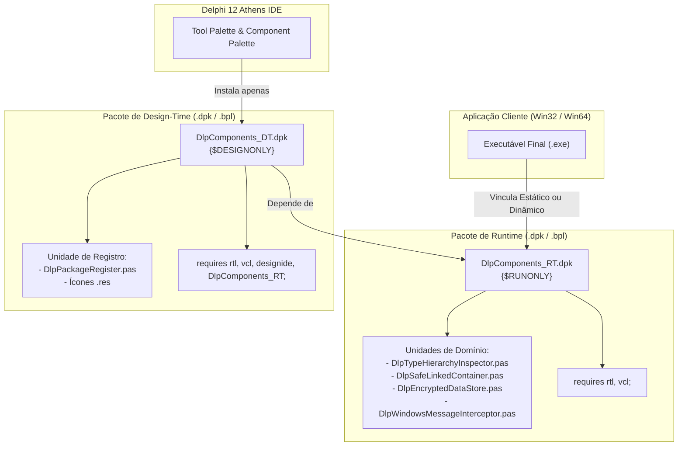

# MÓDULO 05: Empacotamento Profissional (Packages .dpk)

No ecossistema **Delphi 12 Athens+**, o empacotamento correto de componentes em pacotes compilados (**BPL - Borland/Embarcadero Package Library**) é o divisor de águas entre um código amador e uma suíte corporativa de nível industrial.

Desenvolvedores inexperientes frequentemente misturam a unidade `DesignIntf` ou o pacote `designide.dcp` diretamente em seus componentes visuais ou de lógica. Isso desencadeia um desastre de distribuição: a aplicação cliente passa a exigir a BPL de design do Delphi em tempo de execução, gerando erros de licença, falhas de DLL não encontrada na máquina do usuário final e impedindo a compilação em arquiteturas de 64 bits para servidores de backend.

Neste módulo, aprenderemos a desenhar a arquitetura estrita de desacoplamento entre pacotes **Runtime (`{$RUNONLY}`)** e **Design-Time (`{$DESIGNONLY}`)**, como compilar ícones de alta resolução e como automatizar a compilação de binários Win32 e Win64 utilizando o **MSBuild**.

---

## 1. A Arquitetura Obrigatória de Pacotes no Delphi

A estrutura profissional de componentes no Delphi requer dois pacotes cooperantes:



### 1.1 As Diretivas de Compilação Críticas: `{$RUNONLY}` e `{$DESIGNONLY}`

1. **`{$RUNONLY}` no Pacote de Runtime:**
   - Sinaliza à IDE do Delphi que esse pacote contém exclusivamente código executável da aplicação.
   - O Delphi **proíbe terminantemente** que um pacote marcado como `{$RUNONLY}` seja instalado diretamente na Tool Palette da IDE.
   - Isso impede que o desenvolvedor acidentalmente tente registrar componentes ou vincular editores de propriedade dentro do pacote de runtime.
2. **`{$DESIGNONLY}` no Pacote de Design-Time:**
   - Sinaliza que o pacote se destina exclusivamente à IDE (`bds.exe`).
   - O compilador bloqueia que projetos finais de clientes adicionem o pacote de design-time na lista de pacotes de runtime do executável.
   - Apenas o pacote de Design-Time deve conter `requires designide;`.

---

## 2. Anatomia dos Arquivos de Projeto `.dpk`

### 2.1 Pacote de Runtime: `DlpComponents_RT.dpk`
Observe as diretivas de otimização, a diretiva `{$RUNONLY}` e as dependências mínimas necessárias:

```pascal
package DlpComponents_RT;

{$R *.res}
{$IFDEF IMPLICITBUILDING This IFDEF should not be used by the compiler}
{$ALIGN 8}
{$ASSERTIONS ON}
{$BOOLEVAL OFF}
{$DEBUGINFO OFF}
{$EXTENDEDSYNTAX ON}
{$IMPORTEDDATA ON}
{$IOCHECKS ON}
{$LOCALSYMBOLS ON}
{$LONGSTRINGS ON}
{$OPENSTRINGS ON}
{$OPTIMIZATION LEVEL3}
{$OVERFLOWCHECKS OFF}
{$RANGECHECKS OFF}
{$REFERENCEINFO ON}
{$SAFEDIVIDE OFF}
{$STACKFRAMES OFF}
{$TYPEDADDRESS OFF}
{$VARSTRINGCHECKS ON}
{$WRITEABLECONST OFF}
{$MINENUMSIZE 1}
{$IMAGEBASE $400000}
{$DEFINE RELEASE}
{$ENDIF IMPLICITBUILDING}
{$DESCRIPTION 'Coleção de Engenharia Avançada de Componentes - Runtime'}
{$RUNONLY}
{$IMPLICITBUILD ON}

requires
  rtl,
  vcl;

contains
  DlpTypeHierarchyInspector in '..\units\DlpTypeHierarchyInspector.pas',
  DlpSafeLinkedContainer in '..\units\DlpSafeLinkedContainer.pas',
  DlpEncryptedDataStore in '..\units\DlpEncryptedDataStore.pas',
  DlpWindowsMessageInterceptor in '..\units\DlpWindowsMessageInterceptor.pas';

end.
```

---

### 2.2 Pacote de Design-Time: `DlpComponents_DT.dpk`
Observe que ele herda de `DlpComponents_RT` e inclui a dependência da IDE: `designide`:

```pascal
package DlpComponents_DT;

{$R *.res}
{$IFDEF IMPLICITBUILDING This IFDEF should not be used by the compiler}
{$ALIGN 8}
{$ASSERTIONS ON}
{$BOOLEVAL OFF}
{$DEBUGINFO OFF}
{$EXTENDEDSYNTAX ON}
{$IMPORTEDDATA ON}
{$IOCHECKS ON}
{$LOCALSYMBOLS ON}
{$LONGSTRINGS ON}
{$OPENSTRINGS ON}
{$OPTIMIZATION LEVEL3}
{$OVERFLOWCHECKS OFF}
{$RANGECHECKS OFF}
{$REFERENCEINFO ON}
{$SAFEDIVIDE OFF}
{$STACKFRAMES OFF}
{$TYPEDADDRESS OFF}
{$VARSTRINGCHECKS ON}
{$WRITEABLECONST OFF}
{$MINENUMSIZE 1}
{$IMAGEBASE $400000}
{$DEFINE RELEASE}
{$ENDIF IMPLICITBUILDING}
{$DESCRIPTION 'Coleção de Engenharia Avançada de Componentes - Design-Time'}
{$DESIGNONLY}
{$IMPLICITBUILD ON}

requires
  rtl,
  vcl,
  designide,
  DlpComponents_RT;

contains
  DlpPackageRegister in '..\units\DlpPackageRegister.pas';

end.
```

---

## 3. O Procedimento `Register` e a Injeção na Tool Palette

No Delphi, a unidade de registro reside exclusivamente no pacote de design-time:

```pascal
unit DlpPackageRegister;

interface

uses
  System.Classes,
  DesignIntf,
  DlpTypeHierarchyInspector,
  DlpSafeLinkedContainer,
  DlpEncryptedDataStore,
  DlpWindowsMessageInterceptor;

procedure Register;

implementation

{$R dlp_components_icons.res}

procedure Register;
begin
  RegisterComponents('Engenharia Delphi 12', [
    TDlpTypeHierarchyInspector,
    TDlpSafeLinkedContainer,
    TDlpEncryptedDataStore,
    TDlpWindowsMessageInterceptor
  ]);
end;

end.
```

---

## 4. Ícones de Paleta de Alta Densidade (24x24 e 32x32)

No Delphi 12 Athens+, a IDE opera em modo High-DPI nativo. Para que os ícones fiquem nítidos em monitores 4K:
1. Crie imagens em formato bitmap de 32 bits (com canal alfa) ou PNG nas resoluções **24x24** e **32x32**.
2. Crie um script de recursos (`dlp_components_icons.rc`):
   ```rc
   TDLPTYPEHIERARCHYINSPECTOR   BITMAP "icons\\TDlpTypeHierarchyInspector.bmp"
   TDLPSAFELINKEDCONTAINER      BITMAP "icons\\TDlpSafeLinkedContainer.bmp"
   TDLPENCRYPTEDDATASTORE       BITMAP "icons\\TDlpEncryptedDataStore.bmp"
   TDLPWINDOWSMESSAGEINTERCEPTOR BITMAP "icons\\TDlpWindowsMessageInterceptor.bmp"
   ```
3. Compile o arquivo `.rc` com o compilador de recursos do Delphi:
   ```cmd
   brcc32 dlp_components_icons.rc
   ```
4. Vincule o arquivo compilado com `{$R dlp_components_icons.res}` na unidade de registro.

---

## 5. Compilação Automatizada via Linha de Comando com MSBuild

O Delphi utiliza arquivos de projeto `.dproj` baseados no padrão Microsoft Build Engine (**MSBuild**). Isso possibilita compilações automáticas em pipelines de CI/CD (GitHub Actions, Azure DevOps, Jenkins):

```cmd
:: Configura o ambiente de linha de comando do Delphi 12
call "C:\Program Files (x86)\Embarcadero\Studio\23.0\bin\rsvars.bat"

:: 1. Compila o pacote de Runtime em Win32 (Release)
msbuild DlpComponents_RT.dproj /p:Config=Release /p:Platform=Win32 /t:Build

:: 2. Compila o pacote de Runtime em Win64 (Release)
msbuild DlpComponents_RT.dproj /p:Config=Release /p:Platform=Win64 /t:Build

:: 3. Compila o pacote de Design-Time em Win32 (A IDE do Delphi 12 executa em Win32/Win64)
msbuild DlpComponents_DT.dproj /p:Config=Release /p:Platform=Win32 /t:Build
```

---

## 6. Checklist de Engenharia do Módulo 05

- [x] O pacote de runtime deve ser estritamente compilado com a diretiva `{$RUNONLY}`.
- [x] O pacote de design-time deve conter `{$DESIGNONLY}` e ser o único a depender de `designide.dcp`.
- [x] Nunca referencie unidades de design (`DesignIntf`, `DesignEditors`) dentro de unidades do pacote de runtime.
- [x] O procedimento `Register` deve residir em uma unidade isolada do pacote de design-time.
- [x] Automatize suas compilações com scripts baseados em `MSBuild` para garantir suporte a plataformas Win32 e Win64 em esteiras de integração contínua.
