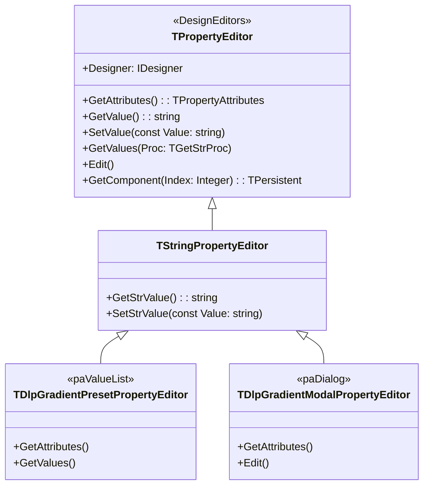

# MÓDULO 06: Property Editors Customizados

No **Delphi 12 Athens+**, a experiência do desenvolvedor (*Developer Experience - DX*) ao interagir com uma suíte de componentes corporativos no **Object Inspector** define o sucesso de sua adoção.

Componentes modernos não devem sobrecarregar o usuário com valores enigmáticos ou formatos textuais obscuros. Propriedades complexas demandam **editores de propriedades customizados (Property Editors)** capazes de fornecer:
1. **Dropdowns Contextuais (`paValueList`):** Listas suspensas dinâmicas de opções no Object Inspector calculadas a partir de estados do próprio componente ou de fontes de metadados externas.
2. **Editores Visuais com Janelas Modais (`paDialog`):** Diálogos com preview ao vivo, paletas de cores integradas e validações estritas, disparados pelo botão de reticências `[...]`.

Neste módulo, dissecaremos a arquitetura das interfaces da Open Tools API dedicadas ao design visual (`DesignIntf` e `DesignEditors`), especializaremos classes de `TPropertyEditor` e implementaremos dois editores completos de propriedades para o Delphi 12.

---

## 1. As Unidades Canônicas: `DesignIntf` e `DesignEditors`

No Delphi moderno, todo o suporte a extensões de tempo de design foi desacoplado da RTL principal e reside no pacote **`designide.dcp`**, através de duas unidades principais:
- **`DesignIntf`:** Declara as interfaces fundamentais do Form Designer, como `IDesigner`, `IDesignerSelections` e o tipo `TPropertyAttributes`.
- **`DesignEditors`:** Fornece as implementações base de editores de propriedades e componentes: `TPropertyEditor`, `TStringPropertyEditor`, `TIntegerPropertyEditor`, `TClassPropertyEditor` e `TComponentEditor`.



---

## 2. A Tabela de Atributos: `TPropertyAttributes`

O método fundamental que dita o comportamento de uma propriedade no Object Inspector do Delphi é:

```pascal
function GetAttributes: TPropertyAttributes; override;
```

| Atributo | Significado na IDE | Ação Técnica Requerida |
| :--- | :--- | :--- |
| **`paValueList`** | Transforma a linha do Object Inspector em um ComboBox suspenso. | Sobrescrever `GetValues(Proc: TGetStrProc)`. |
| **`paSortList`** | Instrui a IDE a ordenar as strings fornecidas em ordem alfabética. | N/A (associado a `paValueList`). |
| **`paDialog`** | Adiciona o botão elíptico `[...]` na margem direita da célula. | Sobrescrever `Edit`. |
| **`paMultiSelect`** | Mantém a propriedade editável mesmo com múltiplos componentes selecionados. | Suportar múltiplos alvos via `PropCount` e `GetComponent(I)`. |
| **`paSubProperties`** | Habilita o símbolo de expansão `+` para navegar em sub-objetos `TPersistent`. | Padrão em `TClassPropertyEditor`. |
| **`paAutoUpdate`** | Dispara `SetValue` imediatamente a cada tecla digitada sem esperar o `Enter`. | Ideal para filtros e previews dinâmicos. |

---

## 3. Construção do Dropdown de Valores com `paValueList`

Quando o usuário precisa selecionar um estilo visual predefinido para o componente `TDlpGradientHeader`:

```pascal
type
  TDlpGradientPresetPropertyEditor = class(TStringPropertyEditor)
  public
    function GetAttributes: TPropertyAttributes; override;
    procedure GetValues(Proc: TGetStrProc); override;
  end;
```

### O Despacho de Valores em `GetValues`:
```pascal
procedure TDlpGradientPresetPropertyEditor.GetValues(Proc: TGetStrProc);
var
  HeaderComp: TDlpGradientHeader;
  PresetName: string;
begin
  if GetComponent(0) is TDlpGradientHeader then
  begin
    HeaderComp := TDlpGradientHeader(GetComponent(0));
    for PresetName in HeaderComp.GetAvailablePresets do
      Proc(PresetName); // Injeta o item na lista suspensa da IDE
  end;
end;
```
A função de callback `Proc` é invocada repetidamente, alimentando a lista suspensa diretamente com os presets suportados pela instância do componente.

---

## 4. Janelas Modais com Preview ao Vivo e `Designer.Modified`

Para editar o gradiente visual com precisão matemática, uma linha de texto no Object Inspector é insuficiente. Construímos um diálogo modal que contém uma instância do próprio componente atuando como painel de preview em tempo real:

```pascal
procedure TDlpGradientModalPropertyEditor.Edit;
var
  Dlg: TForm;
  PreviewPanel: TDlpGradientHeader;
  // ...
begin
  // Cria diálogo de configuração em tempo de design
  if Dlg.ShowModal = mrOk then
  begin
    HeaderComp.StartColor := SelectedStart;
    HeaderComp.EndColor := SelectedEnd;
    SetStrValue(Format('#%0.6X -> #%0.6X', [SelectedStart, SelectedEnd]));
    Designer.Modified;
  end;
end;
```

> **REGRA DE OURO DA TOOLSAPI: DESIGNER.MODIFIED**
> Se você alterar propriedades de um componente programaticamente a partir de uma janela de diálogo modal ou wizard, você **deve** invocar obrigatoriamente `Designer.Modified`. Sem essa chamada, a IDE do Delphi não saberá que o formulário foi alterado. O usuário fechará o Delphi e suas alterações serão perdidas silenciosamente porque o arquivo `.dfm` não foi marcado como "sujo" (*dirty*)!

---

## 5. O Procedimento de Registro `RegisterPropertyEditor`

No arquivo de registro do pacote de design-time:

```pascal
procedure Register;
begin
  RegisterPropertyEditor(TypeInfo(string), TDlpGradientHeader, 'PresetName',
    TDlpGradientPresetPropertyEditor);

  RegisterPropertyEditor(TypeInfo(string), TDlpGradientHeader, 'TitleText',
    TDlpGradientModalPropertyEditor);
end;
```

---

## 6. Implementação Prática: Componente e Editores Completos

O código integral das duas unidades está organizado no repositório:
- **`code/units/DlpGradientHeader.pas`:** Controle visual de cabeçalho com algoritmo de interpolação matemática de gradiente RGB em GDI pura com Double Buffering.
- **`code/units/DlpGradientPropEditor.pas`:** Unidade de design-time contendo o dropdown dinâmico de presets e o editor modal completo com seleção de cores via `TColorDialog` e preview ao vivo.

---

## 7. Checklist de Engenharia do Módulo 06

- [x] Isole todo o código de Property Editors e dependências de `DesignIntf` e `DesignEditors` no pacote de design-time (`DlpComponents_DT.dpk`).
- [x] Utilize `paValueList` para eliminar digitação manual de valores discretos.
- [x] Utilize `paDialog` e o método `Edit` para criar interfaces modais enriquecidas para configurações complexas.
- [x] Sempre invoque `Designer.Modified` após aplicar modificações em diálogos modais para disparar a persistência imediata no `.dfm`.
- [x] Use `GetComponent(0)` para recuperar a instância alvo selecionada pelo desenvolvedor no Form Designer.
